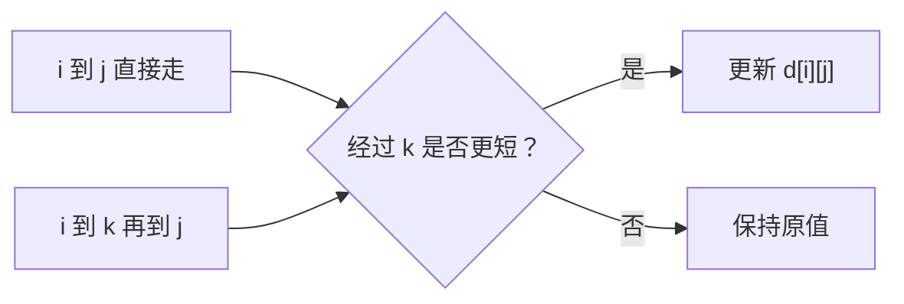

# 所有顶点之间的最短路径与弗洛伊德（Floyd）算法

# 所有顶点之间的最短路径与弗洛伊德（Floyd）算法

## 从单源到多源：问题怎么升级

迪杰斯特拉（Dijkstra）算法解决的是：**从某一个源点 $v$ 出发**，到图中其余各顶点的最短路径。但如果想知道**任意两个顶点之间**的最短路径，比如从 $0$ 到 $3$、从 $1$ 到 $5$、从 $4$ 到 $2$……最朴素的想法是：把每个顶点都当作一次源点，跑 $n$ 遍 Dijkstra。这样确实能得到答案，时间复杂度为 $O(n^3)$（若用邻接矩阵实现）。

那有没有一个**形式上更直接**的算法，一次性把“所有顶点对”的最短路径全部算出来？这就是弗洛伊德（Floyd）算法要解决的问题。

> [!IMPORTANT]
> Floyd 算法求解的是**所有顶点之间的最短路径**，属于“多源最短路径”。Dijkstra 算法求解的是**单源最短路径**。两者适用的问题不同。

## Floyd 算法的核心思想

Floyd 算法基于一个非常朴素的问题：

> 从顶点 $i$ 到顶点 $j$，**允许经过的中转顶点集合越来越大**时，最短路径会发生什么变化？

设集合 $S$ 初始为空。依次向 $S$ 中加入顶点 $0, 1, 2, \ldots, n-1$，每次加入一个顶点。定义：

$$d^{(k)}[i][j] = \text{从 } i \text{ 到 } j \text{ 且只允许经过顶点 } \{0,1,\ldots,k\} \text{ 的最短路径长度}$$

当 $k$ 从 $-1$（空集）增长到 $n-1$（全部顶点）时，$d^{(n-1)}[i][j]$ 就是最终的全局最短路径。

**关键递推**：加入顶点 $k$ 后，从 $i$ 到 $j$ 的最短路径只有两种可能：

1. 不经过 $k$：路径长度保持 $d^{(k-1)}[i][j]$；
2. 经过 $k$：路径变成 $i \to k \to j$，长度为 $d^{(k-1)}[i][k] + d^{(k-1)}[k][j]$。

取二者较小值：

$$d^{(k)}[i][j] = \min\left(d^{(k-1)}[i][j],\quad d^{(k-1)}[i][k] + d^{(k-1)}[k][j]\right)$$

这就是 Floyd 算法的**状态转移方程**。



## 算法流程与数据结构

Floyd 算法用**邻接矩阵**存储图。定义两个二维数组：

- `d[i][j]`：当前求得的最短路径长度。初始时就是邻接矩阵（无边处取无穷大 $\infty$，对角线上取 $0$）。
- `path[i][j]`：记录最短路径上 $j$ 的**前驱顶点**，用于最终还原路径。

算法伪代码：

```text
初始化 d[i][j] = 边的权值（无边则 ∞，对角线 0）
初始化 path[i][j] = i（若 i 到 j 有边）或 -1（无边）

for k = 0 to n-1:          // 依次允许经过顶点 k
    for i = 0 to n-1:
        for j = 0 to n-1:
            if d[i][k] + d[k][j] < d[i][j]:
                d[i][j] = d[i][k] + d[k][j]   // 更新最短距离
                path[i][j] = path[k][j]       // 更新前驱
```

> [!TIP]
> 记忆口诀：**“三层循环 k-i-j，中间顶点做中转，距离小了就更新”**。$k$ 必须放在最外层。

## 一个算对了的例子

设图有 4 个顶点，邻接矩阵如下（$\infty$ 表示无边）：

| 从 \ 到 | 0 | 1 | 2 | 3 |
|:---:|:---:|:---:|:---:|:---:|
| **0** | 0 | 5 | $\infty$ | 7 |
| **1** | $\infty$ | 0 | 4 | 2 |
| **2** | 3 | 3 | 0 | 2 |
| **3** | $\infty$ | $\infty$ | 1 | 0 |

**初始化**：`d` 就是上面的矩阵，`path[i][j] = i`（有边时）。

**第一轮 $k=0$**：允许经过顶点 0。检查有没有“走 0 更短”的情况：

- $d[2][1] = 3$，而 $d[2][0] + d[0][1] = 3 + 5 = 8$，不更新。
- $d[2][3] = 2$，而 $d[2][0] + d[0][3] = 3 + 7 = 10$，不更新。
- 其他顶点对类似，均无改善。

本轮 `d` 矩阵不变。

**第二轮 $k=1$**：允许经过顶点 1。

- $d[0][2]$：$d[0][1] + d[1][2] = 5 + 4 = 9 < \infty$，更新为 $9$；`path[0][2] = path[1][2] = 1`。
- $d[0][3]$：$d[0][1] + d[1][3] = 5 + 2 = 7$，等于原值 $7$，可更新可不更新。
- $d[2][3]$：$d[2][1] + d[1][3] = 3 + 2 = 5 > 2$，不更新。

更新后的 `d` 矩阵：

| 从 \ 到 | 0 | 1 | 2 | 3 |
|:---:|:---:|:---:|:---:|:---:|
| **0** | 0 | 5 | **9** | 7 |
| **1** | $\infty$ | 0 | 4 | 2 |
| **2** | 3 | 3 | 0 | 2 |
| **3** | $\infty$ | $\infty$ | 1 | 0 |

**继续 $k=2, 3$**，最终得到所有顶点对的最短路径矩阵。

> [!NOTE]
> 最终 `path` 矩阵可以用来**回溯路径**。例如，想知道从 0 到 3 的最短路径怎么走，可以沿着 `path` 不断前溯，直到回到源点。

## 与 Dijkstra 算法的对比

| 维度 | Dijkstra | Floyd |
|:---|:---|:---|
| 问题类型 | 单源最短路径 | 多源最短路径 |
| 前提条件 | 边权非负 | 边权可负（但不允许负环） |
| 数据结构 | 邻接表或邻接矩阵 | 邻接矩阵 |
| 时间复杂度 | $O(n^2)$（朴素实现） | $O(n^3)$ |
| 负权边 | 不适用 | ==可处理负权边== |
| 路径记录 | 一维数组 `p` | 二维数组 `path` |

> [!WARNING]
> Floyd 算法**不能**处理图中含有**负权回路**（负环）的情况——此时最短路径长度为 $-\infty$，算法结果无意义。另外，`k` 必须放在三层循环的最外层，否则结果可能出错。

> [!IMPORTANT]
> 如果只需计算某**一个**源点到其他顶点的最短路径，用 Dijkstra 更高效（$O(n^2)$ vs $O(n^3)$）。只有当题目明确要求“所有顶点对”的最短路径时，Floyd 才是首选的直接方法。
