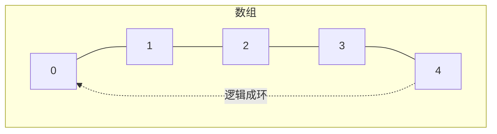
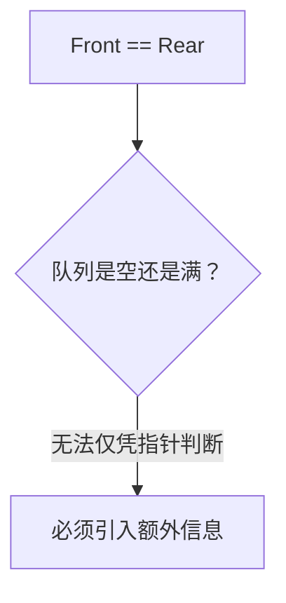

# 循环队列的实现（队头队尾指针取模运算）

## 循环队列的实现（队头队尾指针取模运算）

### 为什么需要循环队列

用顺序结构实现队列时，最容易想到的做法是：入队往数组尾部放，出队从数组头部取。但随着入队、出队交替进行，会出现一种尴尬局面：数组尾部已经满了，但数组头部却空出了一大片位置。这种现象称为**假溢出**。

解决假溢出的直观想法是：能不能让队尾“拐弯”回到数组开头？把数组在逻辑上看成一个环，这就是**循环队列**。



### 核心机制：取模运算

循环队列用两个指针维护队头和队尾：

- `Front`：指向==队头元素==所在位置
- `Rear`：指向==队尾元素的下一个位置==（即下一个入队的位置）

“循环”的关键在于**取模**。设队列容量为 `MaxSize`：

$$
\text{入队后: } Rear = (Rear + 1) \bmod MaxSize
$$

$$
\text{出队后: } Front = (Front + 1) \bmod MaxSize
$$

> [!NOTE]
> 循环队列的“循环”不是靠指针自动回绕，而是靠取模运算把指针从 `MaxSize - 1` 拉回 `0`。

### 判空与判满的区分

取模之后，`Front` 和 `Rear` 都只在 $0 \sim MaxSize-1$ 之间转圈。于是出现一个必须小心处理的问题：**空和满时，`Front == Rear` 都成立**。



区分方法通常有两种：

| 方法 | 判别条件 | 代价 |
|---|---|---|
| 牺牲一个存储单元 | 满：$(Rear + 1) \bmod MaxSize == Front$ | 少用一个空间 |
| 引入长度计数器 `count` | 空：`count == 0`；满：`count == MaxSize` | 多维护一个变量 |

南邮课件中常用第一种，因此：

- **判空**：`Front == Rear`
- **判满**：$(Rear + 1) \bmod MaxSize == Front$

> [!IMPORTANT]
> 循环队列判空条件是 `Front == Rear`，==判满绝不能写成 `Rear + 1 == Front`==，必须写成 $(Rear + 1) \bmod MaxSize == Front$。因为 `Rear` 在数组末尾时，`Rear + 1` 会越界。

### 常用运算实现

设 `MaxSize = 6`，初始时 `Front = Rear = 0`。

**入队**（先判断满，再放入元素，再移动 `Rear`）：

```c
if ((Rear + 1) % MaxSize == Front) {
    // 队满，无法入队
} else {
    Q[Rear] = x;
    Rear = (Rear + 1) % MaxSize;
}
```

**出队**（先判断空，再取元素，再移动 `Front`）：

```c
if (Front == Rear) {
    // 队空，无法出队
} else {
    x = Q[Front];
    Front = (Front + 1) % MaxSize;
}
```

> [!TIP]
> 记忆口诀：**入队动 `Rear`，出队动 `Front`；入队先看满，出队先看空。**

### 算例

设 `MaxSize = 5`（实际可存放 4 个元素），依次执行：入队 `a, b, c`，出队一次，入队 `d, e`。

初始：`Front = 0, Rear = 0`

| 操作 | 说明 | 操作后 `Rear` | 操作后 `Front` |
|---|---|---|---|
| 入队 `a` | `Q[0] = a` | $1$ | $0$ |
| 入队 `b` | `Q[1] = b` | $2$ | $0$ |
| 入队 `c` | `Q[2] = c` | $3$ | $0$ |
| 出队 | 取出 `a` | $3$ | $1$ |
| 入队 `d` | `Q[3] = d` | $4$ | $1$ |
| 入队 `e` | $(4+1)\bmod 5 = 0 \neq Front$，可入 | $0$ | $1$ |

最后一次入队时 `Rear` 从 `4` 取模回到 `0`，正是“循环”的体现。此时若再入队一个元素，$(0+1)\bmod 5 = 1 == Front$，队满。

### 常见坑

> [!WARNING]
> 1. **忘记取模**：`Rear = Rear + 1` 在 `Rear = MaxSize - 1` 时越界，必须写 `(Rear + 1) % MaxSize`。
> 2. **用 `Front == 0 && Rear == MaxSize` 判满**：这是顺序队列（非循环）的判满方式，循环队列不适用。
> 3. **混淆 `Rear` 的含义**：课件中 `Rear` 指向队尾元素的**下一个位置**，不是队尾元素本身。

> [!CAUTION]
> 填空题中出现“队头指针是 `Front`，队尾指针是 `Rear`，则 ______ 时为空队列”，直接填 `Front == Rear`。若题目问的是判满条件，则需要写 $(Rear + 1) \bmod MaxSize == Front$，两者不可混用。

## 指针约定必须与存取顺序一致

本节约定 $Front$ 指向队头元素、$Rear$ 指向下一次写入位置，所以先存取元素，再移动相应指针。另一种常见约定让 $front$ 指向队头元素的前一位置、$rear$ 指向当前队尾；此时入队先移动 $rear$ 再写入，出队先移动 $front$ 再读取。采用空出一个单元时，两种约定的判空、判满与长度公式相同，但代码的存取顺序不能混用。
