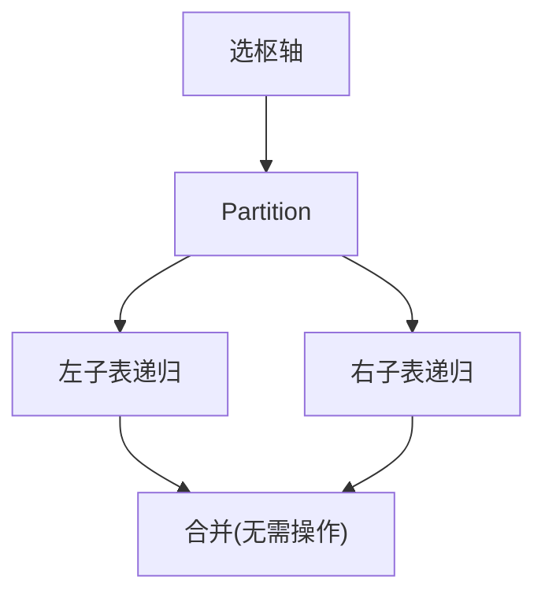

# 快速排序的分割思想、递归算法实现及避免最坏情况的策略

## 分割思想与递归框架

如果每次都能把序列均匀分成两半，排序效率是否就能逼近 $O(n \log n)$？快速排序的核心正是==分治策略==：选定一个**枢轴（pivot）**，将序列划分为“小于枢轴”和“大于枢轴”两个子表，再递归处理。

> [!IMPORTANT]
> ==一趟划分后，枢轴元素的最终位置即被确定==，这是快排区别于其他排序的本质特征。



南邮教材中 `Partition` 通常采用**双指针交替扫描法**：取 `list[low]` 为枢轴暂存，`high` 指针左移找小元素填至 `low` 位，`low` 指针右移找大元素填至 `high` 位，直至 `low==high`，最后将枢轴填入该空位。此过程时间复杂度为 $O(n)$。

## 代码实现关键细节

算法填空题常考 `Partition` 的边界与赋值逻辑。注意内层循环必须包含 `low < high` 判断，否则指针越界。

```c
int Partition(List* list, int low, int high) {
    int pivot = list->r[low]; // 暂存枢轴
    while (low < high) {
        while (low < high && list->r[high] >= pivot) --high;
        list->r[low] = list->r[high]; // 小元素前移
        while (low < high && list->r[low] <= pivot) ++low;
        list->r[high] = list->r[low]; // 大元素后移
    }
    list->r[low] = pivot; // 枢轴归位
    return low;
}
```

> [!WARNING]
> 内层 `while` 条件中 `>=` / `<=` 不可省略等号，否则==相同元素会导致死循环==或错误交换。

## 性能分析与优化策略

| 情况 | 时间复杂度 | 触发条件 |
| :--- | :--- | :--- |
| 最好/平均 | $O(n \log n)$ | 枢轴近似中值 |
| 最坏 | $O(n^2)$ | 序列有序且取端点为枢轴 |

如何避免退化到 $O(n^2)$？核心思路是==让枢轴尽量接近中位数==。常用策略包括：**三数取中法**（取首、尾、中三者之中值）、**随机选取枢轴**。当子表长度较小时切换为直接插入排序，也可减少递归开销。

> [!TIP]
> 选择题常考“最好情况渐进复杂度最小”，快排、归并均为 $O(n \log n)$，但==快排常数因子更小==，实践中通常最快。

## 手算示例与避坑指南

以简答题序列 $\{45, 80, 55, 40, 42, 85\}$ 为例，取首元素 $45$ 为枢轴：

1.  `high` 左移：$85>45$ 跳过，$42<45$ → `list[0]=42`，`low=0, high=4`
2.  `low` 右移：$42≤45$ 跳过，$80>45$ → `list[4]=80`，`low=1, high=4`
3.  `high` 左移：$40<45$ → `list[1]=40`，`low=1, high=3`
4.  `low` 右移：$40≤45$ 跳过，$55>45$ → `list[3]=55`，`low=2, high=3`
5.  `high` 左移：`low==high==2`，退出；`list[2]=45`

第一趟结果：$\{42, 40, \mathbf{45}, 55, 80, 85\}$，==45 已就位==。

> [!CAUTION]
> 手算时务必区分“比较次数”与“移动次数”。填空与简答只要求写出==每趟结束后的序列状态==，不要混淆中间暂存步骤。
