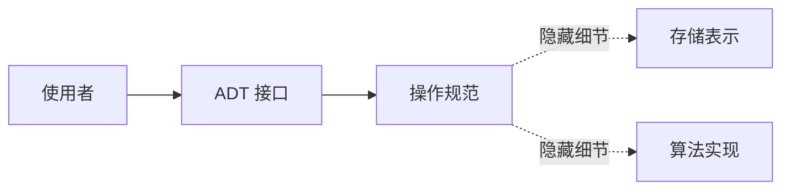

# 抽象数据类型（ADT）的定义与描述方法

## 抽象数据类型是什么

抽象数据类型（Abstract Data Type，ADT）是一个数据类型，其核心特征是：**该类型的对象及其操作的规范，与对象的表示和操作的实现相分离**，实行封装和信息隐蔽，即“使用和实现分离”。

换句话说，ADT 只回答“**是什么、能做什么**”，不回答“**怎么存、怎么做**”。例如复数类型，使用者只需知道可以创建复数、取实部、求模、做加法，不必关心内部用两个 `double` 变量存储，还是用其他方式表示。

> [!IMPORTANT]
> ==ADT 描述的是接口规范，而不是具体存储结构和算法代码。==

## 为什么需要数据抽象

如果程序直接依赖数据的内部表示，一旦存储方式改变，所有使用它的代码都可能需要修改。ADT 把变化限制在实现部分，使使用者只依赖稳定的操作规范。

这种分离带来三个好处：

- **封装**：把数据及其相关操作组织成一个整体。
- **信息隐蔽**：隐藏内部表示和算法细节。
- **降低耦合**：更换实现时，只要接口不变，使用代码通常无需改变。

## 怎样描述一个 ADT

本课程把数据结构看成抽象数据类型，用**格式化的自然语言**描述。ADT 描述的是接口，主要包括：

1. **ADT 名称**：说明所定义的数据类型，如 `Complex`。
2. **数据对象与数据关系**：说明有哪些数据，以及数据之间有什么关系。
3. **一组基本运算的规范**：说明每个操作的名称、参数、初始条件和执行结果。

例如，复数 ADT 可以规定：

- 数据对象：实部与虚部均为实数的复数；
- 基本操作：构造复数、销毁复数、取实部、取虚部、复数相加等；
- 对“复数相加”，只规定输入两个复数，返回其和，而不限定具体代码。

随后再用 C 语言的结构、数组和指针描述存储表示，并用 C 语句实现各运算。这才是该 ADT 的一种具体实现。

## 与相近概念的区别

| 概念 | 关注内容 | 是否依赖具体实现 |
|---|---|---|
| 抽象数据类型 | 数据对象、关系及操作规范 | 不依赖 |
| 数据结构的存储表示 | 数据在计算机中如何存放 | 依赖 |
| 算法实现 | 各操作具体怎样执行 | 依赖 |
| C 语言数据类型 | 语言提供的表示与操作手段 | 属于实现工具 |

> [!NOTE]
> 同一种 ADT 可以有多种实现。例如线性表既可采用顺序存储，也可采用链式存储；存储方式不同，不等于线性表的逻辑定义不同。

## 一个描述正确的例子

要设计“栈”类型，先规定其数据元素具有**后进先出**的关系，并给出 `InitStack`、`Push`、`Pop`、`GetTop` 等操作规范。其中 `Pop` 应说明：若栈非空，删除并返回栈顶元素；若栈为空，则不能按正常出栈处理。

之后可以选择数组实现顺序栈，也可以选择链表实现链式栈。两种实现的代码不同，但只要都满足上述操作规范，就都是同一个栈 ADT 的实现。

> [!WARNING]
> 常见误区是把“用数组存栈”写进栈的定义，或把 ADT 等同于一段 C 代码。==数组、链表是实现选择，不是 ADT 本身。==另外，操作规范不能只写函数名，还应写清参数、前提和结果，尤其不能遗漏空栈、满栈等边界条件。
