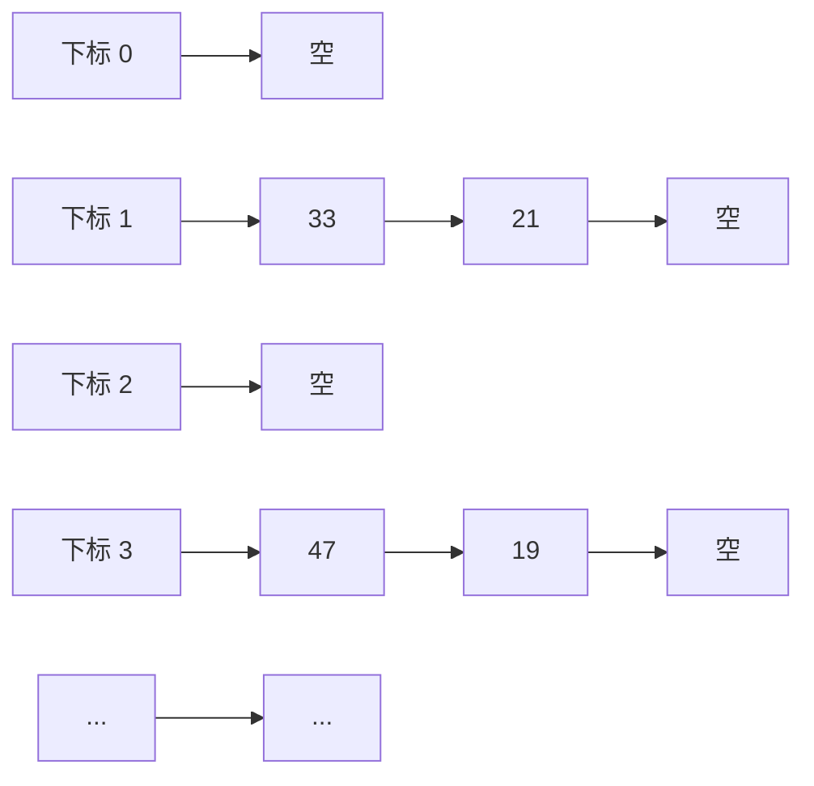
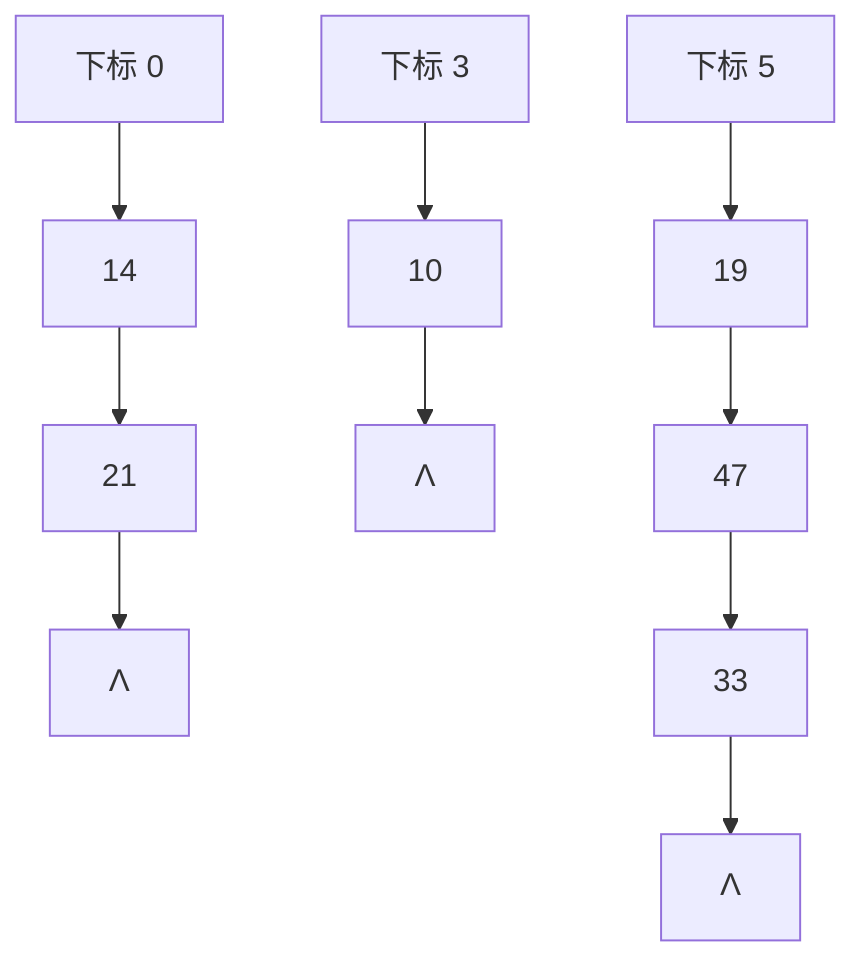

# 处理冲突的拉链法（链地址法）

## 冲突从哪里来

散列表的基本思想是：用散列函数 $h(key)$ 把关键字直接映射到地址区间 $[0, m-1]$ 中的某个位置。但关键字的取值范围通常远大于表长 $m$，不同关键字可能被映射到同一个下标，这就是**冲突**。

冲突无法绝对避免，所以关键不是“不冲突”，而是**冲突之后怎么办**。

先想一个问题：如果两个同义词已经占据了同一个地址，第二个人到了以后，表里能不能把两个人“并排放在一起”？如果数组每个位置只能存一条记录，显然放不下；但如果每个位置后面可以**接一串**呢？

这就是拉链法的直觉来源。

## 拉链法是什么

==拉链法（链地址法）==：把散列表的每个基本单元 $T[i]$ 设置为一个**单链表的头指针**，所有散列地址为 $i$ 的关键字都插入到第 $i$ 条链表中。

查找时：先算 $h(key)$，再到对应的链表中**顺序查找**。插入时一般插在表头，删除时直接在链表里摘除。

> [!IMPORTANT]
> 拉链法属于“找空位”思路之外的另一条路线：==冲突的元素不离开本地址，而是在同一地址下排队==。因此所有同义词都能放在同一条链上，不会出现“二次聚集”。

## 为什么需要拉链法

开放地址法（线性探查、二次探查、双散列）要求表中有空位，一旦装填因子 $α$ 增大，冲突链变长，探测次数急剧上升，还可能出现**堆积**。

拉链法的优势在于：

- 表里“满”了也能继续存：每个位置后面可以挂任意长的链表；
- 删除记录简单，不破坏其他元素的查找路径；
- 平均查找长度受装填因子影响比开放地址法平缓。

代价是需要额外的指针空间，且链上结点的查找时间是**顺序**的，不能随机访问。

## 和相近方法的区别

| 方法 | 冲突后怎么走 | 是否依赖空位 | 删除难度 | 额外空间 |
|---|---|---|---|---|
| 拉链法 | 在原地挂到链表 | 否 | 易 | 需指针 |
| 线性探查法 | 顺次探测下一单元 | 是 | 难（要特殊标记） | 无 |
| 双散列法 | 用第二个散列函数决定步长 | 是 | 难 | 无 |
| 除留余数法 | —— | 它只是散列函数，不是处理冲突的方法 | —— | —— |

> [!CAUTION]
> 选择第 10 题中的“除留余数法”是**散列函数**的构造方法，不是处理冲突的方法；处理冲突的方法是拉链法、线性探查法、双散列法等。这正是常见易混点。

## 一个算对的例子

设散列表长 $m=7$，散列函数 $h(key)=key\bmod 7$。依次插入关键字：

$$33,\ 21,\ 47,\ 19,\ 14,\ 10$$

各关键字的散列地址：

- $33 \bmod 7 = 5$
- $21 \bmod 7 = 0$
- $47 \bmod 7 = 5$，与 33 冲突，链在第 5 条链上
- $19 \bmod 7 = 5$，继续接在第 5 条链上
- $14 \bmod 7 = 0$，与 21 冲突，链在第 0 条链上
- $10 \bmod 7 = 3$

若采用**表头插入**，查找成功时链上顺序与插入顺序相反。例如在 $T[5]$ 上查找 $33$，需要依次比较 $19$、$47$、$33$，查找长度为 $3$。

> [!TIP]
> 记“开”与“闭”的经典口令：==地址自己的链表是“闭散列”不存在——拉链法也叫“开散列”，因为冲突元素“开”到表外结点去；开放地址法叫“闭散列”，因为所有元素都“关”在表内。==
