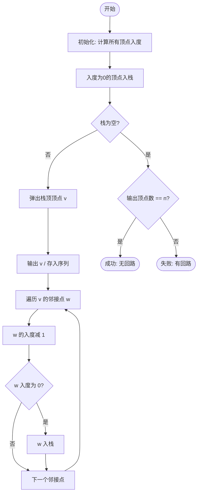

# AOV网与拓扑排序算法（基于入度数组与栈的实现）

# AOV网与拓扑排序算法（基于入度数组与栈的实现）

## 什么是AOV网？

**AOV网**（Activity On Vertex Network）是用**顶点表示活动**、**有向边表示先后关系**的有向图。例如课程先修关系：若课程 $A$ 是课程 $B$ 的先修课，则存在有向边 $\langle A, B \rangle$。

> [!IMPORTANT]
> AOV网必须是**有向无环图（DAG）**。若存在回路，意味着某活动以自身为前提，逻辑上不可行。

## 为什么需要拓扑排序？

拓扑排序主要解决两个问题：
1. **可行性检测**：判断AOV网中是否存在回路。
2. **线性序列生成**：将偏序关系转化为线性序列，使得对于任意边 $\langle i, j \rangle$，$i$ 在序列中必位于 $j$ 之前。

> [!NOTE]
> 拓扑序列**不唯一**。只要满足所有前驱约束，不同的执行顺序都是合法的。

## 算法核心：入度与栈

基于**邻接表**存储，利用**入度数组** `InDegree[]` 和**栈** `S` 实现。

### 算法流程

### 关键步骤解析

1. **初始化**：统计每个顶点的入度 `InDegree[i]`。
2. **入栈**：将所有 `InDegree[i] == 0` 的顶点压入栈。
3. **循环处理**：
   - 弹出栈顶顶点 $v$，将其加入拓扑序列。
   - 遍历 $v$ 的所有邻接点 $w$，执行 `InDegree[w]--`。
   - 若 `InDegree[w]` 变为 0，则将 $w$ 入栈。
4. **判环**：若最终输出的顶点数小于图中顶点总数 $n$，则说明图中**存在回路**。

> [!TIP]
> 使用**栈**而非队列，得到的拓扑序列取决于出栈顺序（通常与邻接表存储顺序有关）。若使用队列，则类似BFS层次遍历。

## 常见坑与辨析

| 概念 | 区别点 |
| :--- | :--- |
| **AOV网** | 顶点=活动，边=优先关系，关注**拓扑排序** |
| **AOE网** | 边=活动，顶点=事件，关注**关键路径** |
| **DFS/BFS** | 通用遍历，不能直接用于判环或生成拓扑序（需配合完成时间） |

> [!WARNING]
> **易错点**：拓扑排序只能用于**有向图**。无向图无法定义“前驱”与“后继”的严格领先关系。

## 实例演练

参考真题选择13，假设AOV网结构如下（简化示意）：
- $3 \to 0, 3 \to 2$
- $0 \to 1$
- $2 \to 1, 2 \to 5$
- $1 \to 4, 1 \to 6$
- $5 \to 4, 5 \to 7$
- $4 \to 8, 6 \to 8, 7 \to 8$

**推导过程**：
1. 初始入度为0的顶点：仅 $3$。序列开头必为 $3$。排除A、C。
2. 移除 $3$，更新入度：$0$ 和 $2$ 入度变为0。栈中有 $\{0, 2\}$（假设2先入或先出，顺序可变）。
3. 若 next 取 $0$，则 $1$ 入度减1；若 next 取 $2$，则 $1, 5$ 入度减1。
4. 观察选项B：`3, 0, 2...`。$3$ 后接 $0$，合法。但选项B中出现了两次 $3$，明显错误（顶点不可重复）。
5. 观察选项D：`3, 0, 2, 1, 6, 5, 4, 7, 8`。
   - $3$ (ok) $\to$ $0$ (ok, 3已出) $\to$ $2$ (ok, 3已出) $\to$ $1$ (ok, 0,2已出) $\to$ $6$ (ok, 1已出) $\to$ $5$ (ok, 2已出) $\to$ $4$ (ok, 1,5已出) $\to$ $7$ (ok, 5已出) $\to$ $8$ (ok, 4,6,7已出)。

> [!IMPORTANT]
> 正确答案是 **D**。选项B因重复顶点直接排除；A、C起始顶点非入度为0的点。

==核心结论==：拓扑排序的本质是**不断移除入度为0的顶点**，若最后仍有顶点剩余，则存在回路。
