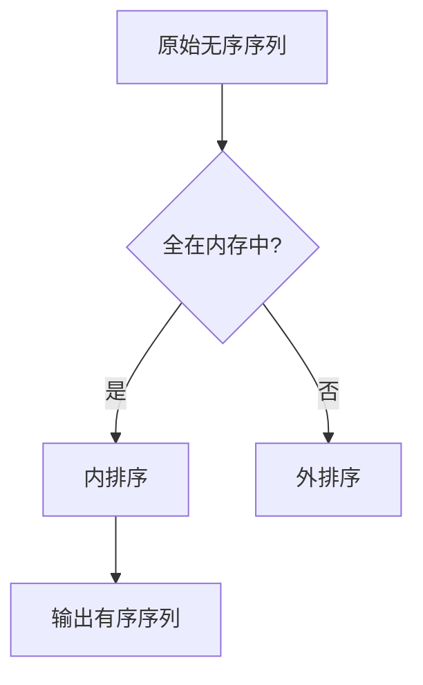
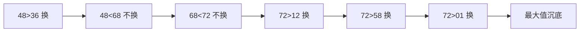

# 内排序的基本概念与排序算法的稳定性

> [!IMPORTANT]
> ==内排序==是指待排序记录全部存放在内存中进行的排序过程。与之相对的是外排序（数据量大，需借助外存）。

## 基本概念与时间下界

排序的本质是将一个无序序列调整为按关键字有序（升序或降序）的序列。

如果一个表长为 $n$ 的线性表已经有序，我们只需遍历一遍确认即可，因此其排序时间最快为 $O(n)$。但在一般情况下，基于比较的内排序算法平均时间复杂度下界为 $O(n \log n)$。

## 什么是排序算法的稳定性

假设序列中有两个记录 $R_i$ 和 $R_j$，它们的关键字相等（$K_i = K_j$），且排序前 $R_i$ 在 $R_j$ 前面。如果排序后 $R_i$ 仍然在 $R_j$ 前面，则称该排序算法是**稳定的**；否则称为**不稳定的**。

为什么需要关注稳定性？当记录包含多个字段时（如先按成绩排，再按学号排），使用稳定排序能保证前一次排序的结果在后一次排序中被保留。

### 常见算法稳定性对比

| 排序算法 | 稳定性 | 记忆提示 |
| :--- | :--- | :--- |
| 直接插入排序 | 稳定 | 相邻比较不跨越 |
| 冒泡排序 | 稳定 | 相邻交换不跨越 |
| 快速排序 | ==不稳定== | 枢轴交换会跨越 |
| 简单选择排序 | ==不稳定== | 最小值交换会跨越 |
| 归并排序 | 稳定 | 合并时左优先 |
| 堆排序 | 不稳定 | 父子调整会跨越 |

> [!TIP]
> 口诀：“==快选希堆==”是不稳定的（快速、简单选择、希尔、堆排序），其余常见的比较类排序通常是稳定的。

## 怎么判断一个算法是否稳定

面对选择题“如何认定一个算法是不稳定的”，正确的逻辑是什么？

要证明算法**稳定**，必须通过严格的数学推导证明对所有输入都成立；但要证明算法**不稳定**，==只要举出一个反例即可==。

以真题中的**简单选择排序**为例：
已知序列 `(45, 80, 55, 40, 42, 85)`，其中没有相同关键字，我们构造一个有相同关键字的序列来验证：`(45, 80a, 55, 40, 80b, 85)`。
第一趟寻找最小值 `40`，将其与第一个元素 `45` 交换。若用选择排序处理含重复元素的序列，跳跃式的交换极易破坏原有相对顺序，因此简单选择排序是**不稳定**的。

## 算对了的例子：一趟冒泡排序

> [!NOTE]
> 冒泡排序是典型的==稳定排序==，因为它的交换只在相邻元素间发生，相等元素不会交换位置。

对线性表 `(48, 36, 68, 72, 12, 58, 01)` 进行一趟一般升序冒泡排序：

逐步推演：
1. `48` 与 `36` 比，逆序，交换 $\to$ `(36, 48, 68, 72, 12, 58, 01)`
2. `48` 与 `68` 比，正序，不换
3. `68` 与 `72` 比，正序，不换
4. `72` 与 `12` 比，逆序，交换 $\to$ `(36, 48, 68, 12, 72, 58, 01)`
5. `72` 与 `58` 比，逆序，交换 $\to$ `(36, 48, 68, 12, 58, 72, 01)`
6. `72` 与 `01` 比，逆序，交换 $\to$ `(36, 48, 68, 12, 58, 01, 72)`

最终结果为 `(36, 48, 68, 12, 58, 01, 72)`，最大元素 `72` 已“冒泡”到末尾。

> [!WARNING]
> 注意区分“一趟”和“一次”。一趟冒泡排序包含 $n-1$ 次相邻比较，结果是确定一个最终位置的元素；而快速排序的一趟（Partition）则是围绕枢轴将序列划分为左右两部分。
