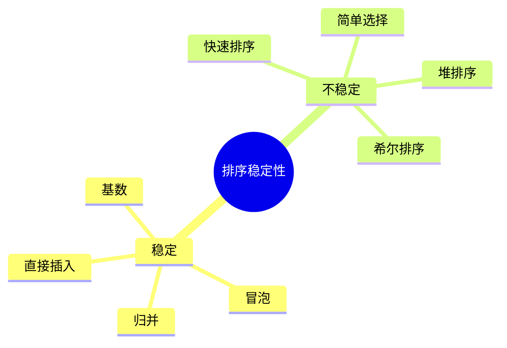

# 各种内部排序算法的时间复杂度、空间复杂度与稳定性综合比较

# 内部排序算法综合比较

在数据规模 $n$ 较大时，选择何种排序算法直接决定了程序的运行效率与资源消耗。我们需要从**时间复杂度**（最好/最坏/平均）、**空间复杂度**及**稳定性**三个维度进行权衡。

## 核心指标对比表

下表总结了南邮《数据结构》课程中常见的7种内部排序算法性能：

| 排序算法 | 最好时间 | 最坏时间 | 平均时间 | 空间复杂度 | 稳定性 |
| :--- | :---: | :---: | :---: | :---: | :---: |
| **直接插入** | $O(n)$ | $O(n^2)$ | $O(n^2)$ | $O(1)$ | ✅ 稳定 |
| **冒泡排序** | $O(n)$ | $O(n^2)$ | $O(n^2)$ | $O(1)$ | ✅ 稳定 |
| **简单选择** | $O(n^2)$ | $O(n^2)$ | $O(n^2)$ | $O(1)$ | ❌ 不稳定 |
| **快速排序** | $O(n \log_2 n)$ | $O(n^2)$ | $O(n \log_2 n)$ | $O(\log_2 n)$ | ❌ 不稳定 |
| **堆排序** | $O(n \log_2 n)$ | $O(n \log_2 n)$ | $O(n \log_2 n)$ | $O(1)$ | ❌ 不稳定 |
| **归并排序** | $O(n \log_2 n)$ | $O(n \log_2 n)$ | $O(n \log_2 n)$ | $O(n)$ | ✅ 稳定 |
| **希尔排序** | 依赖增量 | 依赖增量 | 依赖增量 | $O(1)$ | ❌ 不稳定 |

> [!IMPORTANT]
> ==核心结论==：若要求**稳定**且效率高，首选**归并排序**；若内存受限且追求平均速度，首选**快速排序**；若数据基本有序，**直接插入**或**冒泡**可达 $O(n)$。

## 稳定性辨析

==稳定性==指相同关键字的元素在排序后相对次序保持不变。
- **稳定**：直接插入、冒泡、归并、基数排序。
- **不稳定**：快速、选择、堆、希尔排序。

> [!WARNING]
> **常见坑**：简单选择排序虽然看起来只是交换，但若最小元素与当前位置不同，交换会破坏原有相对顺序，故不稳定。

## 典型例题解析

**题目**：下列排序算法中，( ) 在最好情况下渐进时间复杂度最小。
A. 简单选择排序  B. 合并排序  C. 快速排序  D. 冒泡排序

**解析**：
1. **简单选择**：无论数据如何，均需遍历比较，最好为 $O(n^2)$。
2. **合并（归并）**：始终二分递归，最好为 $O(n \log_2 n)$。
3. **快速排序**：若每次划分均匀，最好为 $O(n \log_2 n)$。
4. **冒泡排序**：若序列已有序，仅需一趟扫描无交换即可结束，最好为 $O(n)$。

因此，**D** 选项正确。注意填空题中提到“排序时间最快为 $O(n)$”，通常指数据**基本有序**时的插入或冒泡排序。

## 快速排序实战演示

对序列 $\{27, 6, 32, 48, 26, 17, 63\}$ 进行升序快速排序（取首元素为枢轴）：

1. **第一趟**：枢轴 `27`。
   - 低位找大，高位找小，交替填充。
   - 结果：`[17, 6, 26] 27 [48, 32, 63]`
2. **第二趟**：左子表 `[17, 6, 26]` 枢轴 `17`；右子表 `[48, 32, 63]` 枢轴 `48`。
   - 左结果：`[6] 17 [26]`
   - 右结果：`[32] 48 [63]`
3. **最终结果**：`6, 17, 26, 27, 32, 48, 63`

> [!TIP]
> 快速排序在**数据随机分布**时表现最佳，但在**已有序**或**逆序**时退化为 $O(n^2)$，此时应改用堆排序或归并排序。
