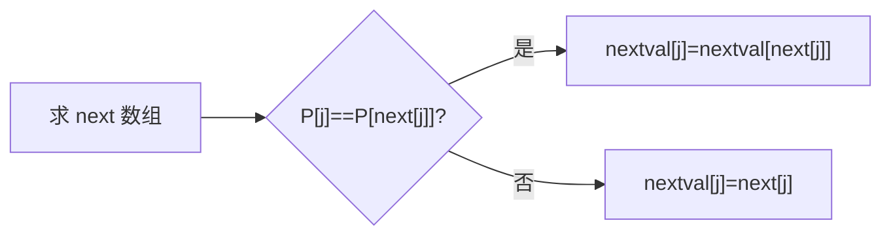

# 改进的KMP算法（nextval数组值的推导）

> [!IMPORTANT]
> `nextval` 数组是对 KMP 算法中 `next` 数组的进一步优化，用于消除模式串匹配过程中“已知必然失配”的冗余比较。

## 为什么需要 nextval

在标准 KMP 算法中，当主串与模式串第 $j$ 个字符失配时，模式串向右滑动，使 $j = next[j]$ 继续比较。但请思考一个问题：如果回退后的新位置字符与原位置字符**完全相同**，这次比较还有意义吗？

例如模式串 `"aaaab"`，若第 4 个 `'a'` 失配，按 `next` 会回退到第 3 个 `'a'`，再失配回退到第 2 个……连续比较相同的字符纯属浪费时间。`nextval` 就是为了==跳过这些无效回退==而设计的。

## next 与 nextval 的区别

| 对比项 | `next` 数组 | `nextval` 数组 |
| :--- | :--- | :--- |
| **定义** | 最长相等前后缀长度加 1（南邮教材常用定义） | 在 `next` 基础上消除同字符冗余回退 |
| **依赖关系** | 仅依赖模式串自身的前后缀结构 | 必须先求出 `next`，再结合字符推导 |
| **比较次数** | 可能存在多余的同字符比较 | 严格更少或相等 |

## 怎么求 nextval

求 `nextval` 必须分两步走：先算 `next`，再推 `nextval`。

> [!TIP]
> 记忆口诀：**字符相同取 val，字符不同取 next**。即判断 $P[j]$ 与 $P[next[j]]$ 是否相等，相等则继承 $nextval[next[j]]$，不等则直接照抄 $next[j]$。

具体规则（设下标从 1 开始，南邮课件常规约定 $next[1]=0, next[2]=1$）：

1. $nextval[1] = 0$。
2. 对于 $j > 1$：
   - 若 $P[j] == P[next[j]]$，则 $nextval[j] = nextval[next[j]]$；
   - 若 $P[j] \neq P[next[j]]$，则 $nextval[j] = next[j]$。

## 完整计算示例

以模式串 $P = \text{"abaabcac"}$ 为例，逐步推导。

| $j$ | 1 | 2 | 3 | 4 | 5 | 6 | 7 | 8 |
| :---: | :---: | :---: | :---: | :---: | :---: | :---: | :---: | :---: |
| $P[j]$ | a | b | a | a | b | c | a | c |
| $next[j]$ | 0 | 1 | 1 | 2 | 2 | 3 | 1 | 2 |
| $P[next[j]]$ | - | a | a | b | b | a | a | b |
| 是否相等 | - | $\neq$ | $=$ | $\neq$ | $=$ | $\neq$ | $=$ | $\neq$ |
| $nextval[j]$ | 0 | 1 | 0 | 2 | 1 | 3 | 0 | 2 |

**逐位解析关键点**：

- $j=3$：$P[3]=\text{'a'}$，$next[3]=1$，$P[1]=\text{'a'}$。两者相等，故 $nextval[3] = nextval[1] = 0$。
- $j=5$：$P[5]=\text{'b'}$，$next[5]=2$，$P[2]=\text{'b'}$。两者相等，故 $nextval[5] = nextval[2] = 1$。
- $j=7$：$P[7]=\text{'a'}$，$next[7]=1$，$P[1]=\text{'a'}$。两者相等，故 $nextval[7] = nextval[1] = 0$。
- $j=4$：$P[4]=\text{'a'}$，$next[4]=2$，$P[2]=\text{'b'}$。两者不等，直接照抄，$nextval[4] = next[4] = 2$。

> [!WARNING]
> 考试中最常见的坑有两个：一是**忘记先求 `next` 就直接写 `nextval`**，导致连环错误；二是遇到相等时，公式右边写成了 $next[next[j]]$ 而不是 $nextval[next[j]]$。记住，==等号右边一定是带 val 的递归取值==。

> [!CAUTION]
> 注意教材对 `next` 数组的定义差异！有些教材 `next[1]=-1`，而南邮《数据结构》课件通常采用 $next[1]=0$ 的版本。做题前务必确认题目给定的初始约定，否则整行数据全部错位。
