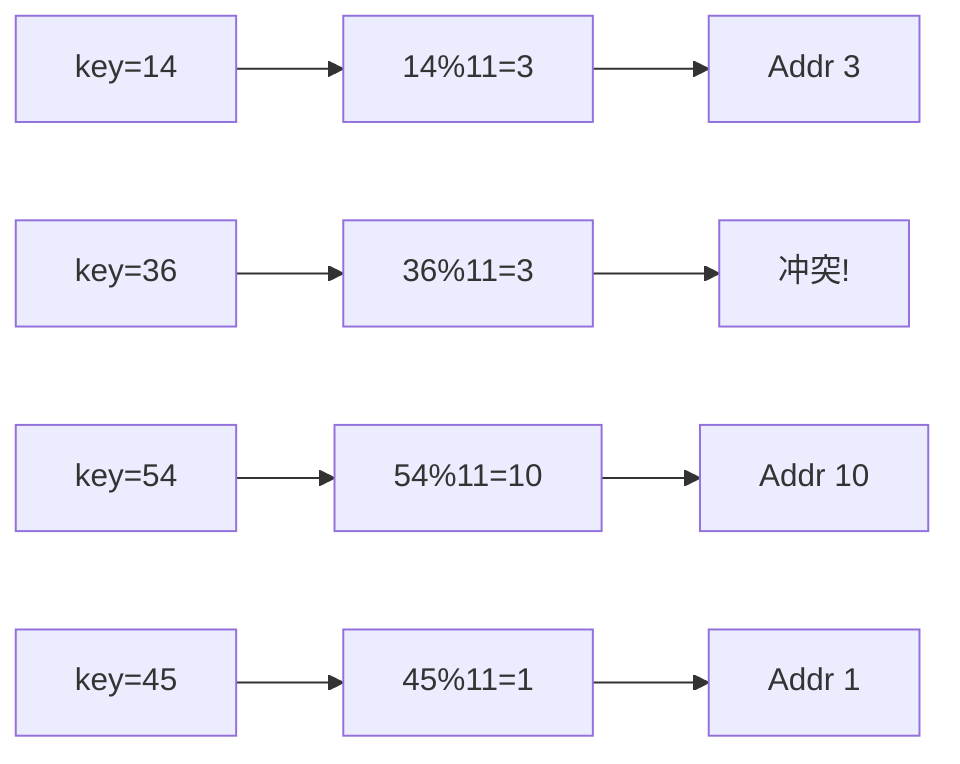

# 散列函数的构造方法（除留余数法、平方取中法、折叠法、数字分析法）

散列函数的核心目标是将关键字映射到有限的地址空间，且希望映射结果==均匀分布==以减少冲突。如果直接取关键字本身作为地址，当关键字范围远大于表长时显然不可行；若简单截取高位或低位，又可能因数据本身的规律性导致大量聚集。因此，我们需要一套能将关键字“打散”的构造方法。

## 四种常用构造方法

| 方法 | 核心思想 | 适用场景 | 注意事项 |
| :--- | :--- | :--- | :--- |
| 除留余数法 | $H(key) = key \bmod p$ | 最通用，南邮考题首选 | $p$ 应选 $\leq M$ 的最大素数 |
| 平方取中法 | 取 $key^2$ 的中间若干位 | 关键字位数较少且分布未知 | 中间位选取需固定 |
| 折叠法 | 将关键字分段叠加 | 关键字位数较多 | 分移位叠加或边界折叠 |
| 数字分析法 | 提取关键字中分布均匀的位 | 已知关键字集合及分布特征 | 依赖先验数据分析 |

> [!IMPORTANT]
> 除留余数法是考试与工程中最常用的方法，其关键在于除数 $p$ 的选择。==$p$ 必须取不大于表长 $M$ 的最大素数==，这样可使散列地址尽可能均匀，避免周期性冲突。

## 除留余数法的计算实例

以南邮真题为例：设散列表长 $M=11$，采用除留余数法，因 11 本身为素数，故取 $p=11$，即 $H(key) = key \bmod 11$。现依次插入关键字 14、36、54、45，计算过程如下：

- $H(14) = 14 \bmod 11 = 3$
- $H(36) = 36 \bmod 11 = 3$（与14冲突）
- $H(54) = 54 \bmod 11 = 10$
- $H(45) = 45 \bmod 11 = 1$

> [!WARNING]
> 若误将 $p$ 取为合数（如 $p=10$），当关键字均为偶数时，散列地址将全为偶数位，奇数地址永远空闲，造成严重的==聚集现象==。务必验证 $p$ 为素数。

## 与其他方法的辨析

数字分析法看似精准，但它要求事先掌握所有关键字的分布规律，在动态插入场景下不适用；平方取中法和折叠法虽不依赖先验知识，但计算开销较大且均匀性不如精心选择 $p$ 的除留余数法。因此，除非题目明确指定，==默认优先使用除留余数法==。

> [!TIP]
> 解题口诀：==“除留余数找素数，平方折叠看位数，数字分析需先知”==。在南邮考试中，若题干给出 $H(key)=key \bmod p$ 且未说明 $p$ 的取值，应先检查 $p$ 是否为 $\leq M$ 的最大素数，再代入计算。

> [!NOTE]
> 散列函数仅决定初始地址，冲突解决（如二次探查、双散列）是后续步骤。切勿将函数计算与冲突处理混淆——先算 $H(key)$ 得到基地址，再按冲突策略探测下一个可用位置。
