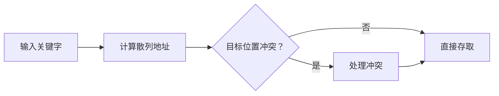

# 字典、散列表的基本概念与散列技术

## 字典与散列表

**字典**是记录的集合，每条记录由关键字标识，基本操作是搜索、插入和删除。若允许**有重复记录**，即多条记录具有相同关键字，就必须规定查找返回哪条、删除删哪条，以消除歧义。

顺序查找、二分查找和平衡搜索树主要依赖关键字比较；散列技术则尝试==由关键字直接计算存储位置==，从而减少比较次数。

## 散列技术与冲突

设散列表长度为 $M$，下标为 $0\sim M-1$，散列函数为

$$h(key)\rightarrow \{0,1,\ldots,M-1\}.$$

插入时先计算 $h(key)$，再按该地址访问记录。理想情况下，搜索、插入和删除都只需一次函数计算和少量探查，平均时间复杂度可接近 $O(1)$；但最坏情况仍可能退化为 $O(n)$。

由于不同关键字可能得到相同地址，即 $key_1\ne key_2$，却有

$$h(key_1)=h(key_2),$$

这就产生了**冲突**，这两个关键字称为该散列函数下的同义词。冲突通常无法彻底避免，因此需要“合适的散列函数＋冲突处理方法”。

> [!IMPORTANT]
> 除留余数法 $h(key)=key\bmod M$ 是==构造散列函数的方法==；拉链法、线性探查法和双散列法才是处理冲突的方法，二者不能混淆。

## 两类冲突处理方法

| 方法 | 基本做法 | 特点与注意点 |
|---|---|---|
| 拉链法（链地址法） | 散列地址相同的记录放入同一条链表 | 表项保存链表指针；查找时先定位链表，再在链内搜索 |
| 开地址法（开放地址法） | 冲突后按探查序列寻找其他空位 | 所有记录仍存放在散列表数组中 |

开地址法可写为

$$h_i(key)=(h(key)+d_i)\bmod M,\quad i=0,1,2,\ldots$$

其中线性探查法取 $d_i=i$，即依次检查下一位置，到表尾后绕回表头；二次探查法按平方增量改变探查位置；双散列法则用另一个散列函数确定探查步长。

> [!WARNING]
> 线性探查容易形成**聚集**：一段连续占用区越长，后续关键字越容易落入其中并继续探查。删除记录也不能简单清空，否则可能截断后续记录的探查链，通常应设置“已删除”标记。

## 线性探查计算示例

表长为 $11$，$h(key)=key\bmod 11$，依次插入 $7,38,10,21$：

| 关键字 | 初始地址 | 探查过程 | 最终下标 |
|---|---:|---|---:|
| $7$ | $7$ | $7$ 为空 | $7$ |
| $38$ | $5$ | $5$ 为空 | $5$ |
| $10$ | $10$ | $10$ 为空 | $10$ |
| $21$ | $10$ | $10$ 已占用，检查 $0$ | $0$ |

因此关键字 $21$ 存放在==下标 $0$==。这里最容易漏掉“从表尾绕回表头”：下标 $10$ 冲突后，下一位置是 $(10+1)\bmod 11=0$，而不是停止插入。

> [!TIP]
> 做插入题时逐个关键字计算，并立即把结果写回表中；后续探查必须使用**更新后的表**。二次探查还要严格采用题目规定的正负平方探查次序，不能套用线性探查。
