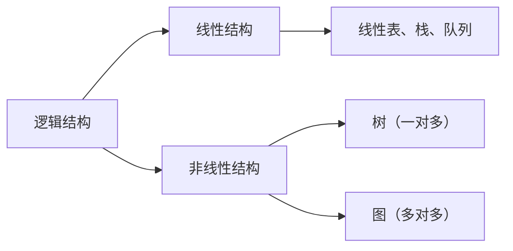
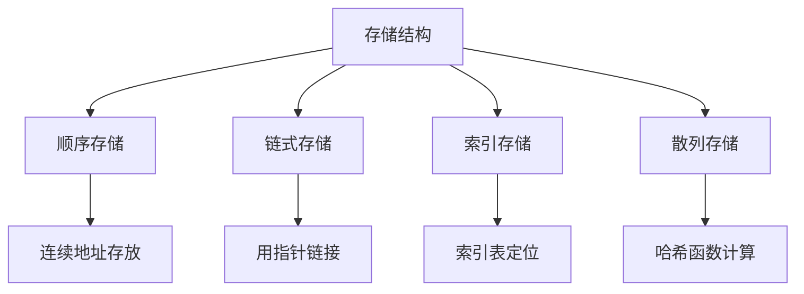

# 数据结构的基本概念（逻辑结构、存储结构、运算）

## 先从一个问题说起

你要写一个“学生成绩管理系统”，里面有若干学生记录。现在问你：这些记录之间按什么关系组织？它们在内存里怎么放？你能对它们做哪些操作？

这三个问题正好对应数据结构的三个侧面：==逻辑结构==、==存储结构==、==运算==。很多同学初学时把它们混为一谈，但考试恰恰喜欢考它们的区别。

[!IMPORTANT]
> 逻辑结构回答“数据之间是什么关系”，存储结构回答“关系在计算机里怎么表示”，运算是“能对数据做什么”。三者独立但又配套。

## 逻辑结构：只关心关系，不关心位置

数据的**逻辑结构**是从具体问题中抽象出来的数学模型，它只描述数据元素之间的逻辑关系，和计算机无关。

基本逻辑结构可以分为两大类：

| 分类 | 逻辑结构 | 特点 |
|------|----------|------|
| 线性结构 | 线性表、栈、队列 | 元素之间是一对一的前驱后继关系 |
| 非线性结构 | 树、图 | 一对多（树）或多对多（图） |

例如“把商品按价格从高到低排列”，这是一个线性逻辑结构；“学校组织架构”是树形结构；“城市间道路连接”是图结构。这些描述都没有涉及任何内存地址或指针。



[!TIP]
> 判断选择题里“逻辑结构是否依赖于计算机”的题，记住：==逻辑结构独立于计算机==，依赖于计算机的是存储结构。

## 存储结构：把关系落实到计算机里

**存储结构**是数据结构在计算机存储器中的表示形式，即数据元素及其关系如何存储。常见的有四种：



- **顺序存储**：所有元素存放在一段连续的存储单元中，逻辑相邻的元素物理上也相邻。数组就是典型。
- **链式存储**：元素可以离散存放，每个结点额外存储指向相关结点的指针。链表的 `next` 指针就是关系在计算机中的表示。
- **索引存储**：除数据区外，还建立一张索引表，通过索引快速定位。
- **散列存储**：根据关键字通过散列函数直接算出存储地址。

> [!WARNING]
> 同样的逻辑结构可以对应不同的存储结构。比如“线性表”这个逻辑结构，既可以用顺序存储实现（顺序表），也可以用链式存储实现（链表）。**逻辑结构只有一种，实现方式却可以有多种**。

## 运算：在数据上执行的操作

光有数据还不够，我们要能操作它们。**运算**是定义在数据上的操作集合，常见的有：

| 运算 | 含义 |
|------|------|
| 创建 | 建立一个空的数据结构 |
| 插入 | 在指定位置添加元素 |
| 删除 | 移除指定元素 |
| 搜索 | 查找满足条件的元素 |
| 访问 | 读取指定位置的元素 |
| 遍历 | 依次访问每个元素 |
| 清除 | 销毁整个结构 |

### 规范与实现分离

引入**抽象数据类型（ADT）**的概念后，可以这样理解：

- 逻辑结构 + 运算定义 = 数据结构的**规范**，回答“做什么”；
- 存储结构 + 运算实现 = 数据结构的**实现**，回答“怎么做”。

用 C 语言时，可以把数据和运算封装在一个结构体及其相关函数中，调用方只需知道函数功能，不必了解实现细节。这就是**信息隐蔽与重用**。

## 容易混淆的几组关系

[!CAUTION]
> 以下三个混淆点考试高频出现：
> 1. **“逻辑结构 = 数据结构”** 在大多数教材中成立，但在严格区分时，数据结构还应包含存储结构和运算。
> 2. **算法的优劣与计算机软硬件无关**，与算法描述语言也无关，只与算法本身的复杂度有关（对应选择题第 1 题）。
> 3. **程序 = 数据结构 + 算法**，这是经典的公式表述（对应填空题第 1 题）。

## 一个完整的例子：用 C 语言描述有理数

以“有理数”为例，走完“逻辑结构 → 存储结构 → 运算”的完整链条。

**逻辑结构**：一个有理数由分子和分母两个整数组成，它们之间是“同属于一个有理数”的结构关系，这是一个简单的双分量结构。

**存储结构**：用 C 结构体描述：

```c
typedef struct {
    int numerator;    // 分子
    int denominator;  // 分母
} Rational;
```

**运算**：定义加、减、乘、除等操作，例如加法运算的规范：

$$(a_1/a_2) + (b_1/b_2) = (a_1 b_2 + b_1 a_2)/(a_2 b_2)$$

其 C 实现封装为一个函数：

```c
Rational add(Rational a, Rational b) {
    Rational r;
    r.numerator = a.numerator * b.denominator + b.numerator * a.denominator;
    r.denominator = a.denominator * b.denominator;
    return r;
}
```

调用者不需要知道 `add` 内部做了什么，只需要知道它能把两个有理数加起来——这就是**运算规范与运算实现分离**的意义。

[!NOTE]
> 这个例子同时对应课件中“复数 ADT”的 C 语言实现思路：用结构体描述存储，用函数描述运算，整体封装成一个可用模块。
