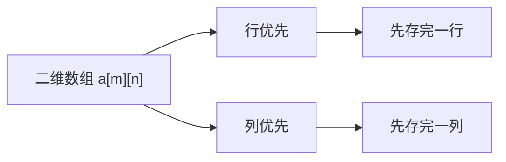

# 一维数组与二维数组的顺序表示及地址计算公式（行优先、列优先）

## 它是什么

数组是第4章“数组和字符串”里最基础的结构。一维数组可看作序对集合，例如课件中的 $A=\{(0,15),(1,24),(2,33),(3,21)\}$，即下标到元素的映射。二维数组用课件记号记为 $a[m][n]$，表示 $m$ 行、$n$ 列。

为什么需要顺序表示？==内存本身是一维连续空间==，多维数组必须“降维”存进去。于是有两种映射顺序：

- 行优先：PASCAL、BASIC、C、C++ 等大多数语言采用。
- 列优先：FORTRAN 采用。

## 怎么做地址计算

设基地址为 $Loc(a[0][0])$，每个元素占 $L$ 个存储单位，数组为 $a[m][n]$（下标从 $0$ 起）。

| 存储方式 | 地址公式 |
|---|---|
| 行优先 | $Loc(a[i][j])=Loc(a[0][0])+(i\times n+j)\times L$ |
| 列优先 | $Loc(a[i][j])=Loc(a[0][0])+(j\times m+i)\times L$ |

一维数组更简单：若下标从 $0$ 起，$Loc(A[i])=Loc(A[0])+i\times L$。

> [!IMPORTANT]
> ==行优先看“跳了几整行”：偏移 $=i\times n+j$；列优先看“跳了几整列”：偏移 $=j\times m+i$==。

## 和相近概念的区别

有人把“行三元组”和“行优先”混为一谈。它们不同：

- 行优先：二维数组整体在内存里的存放次序。
- 行三元组：稀疏矩阵用三元组按行存放非零元，转置后仍应保持行三元组形式。

另外，完全二叉树也可用一维数组顺序存放，利用下标关系定位父子，这也是“顺序表示”的延伸。

## 常见的坑

> [!WARNING]
> 两个高频坑：一是把 $n$ 和 $m$ 代反；二是忽略题目给的已知元素，不会用“相对地址差”反推。

尤其注意 C/C++ 默认行优先，别和 FORTRAN 弄混。

## 算对了的例子

取南邮考题：二维数组 $A[10][10]$，每个元素占 $4$ 个单位，$A[7][8]$ 位置是 $200$，求 $A[9][9]$。

先问一句：行优先时，从 $A[7][8]$ 到 $A[9][9]$ 中间跨过多少个元素？

用公式算偏移差：

$$Loc(A[9][9])-Loc(A[7][8])=[(9\times10+9)-(7\times10+8)]\times4$$

$$=(99-78)\times4=21\times4=84$$

所以：

$$Loc(A[9][9])=200+84=284$$

> [!NOTE]
> 若原题选项给的是 $240$ 等，往往是因为行列规模、已知下标或是否含 $A[0][0]$ 基准不同；本题按标准 $A[10][10]$ 与行优先推导结果应为上面步骤所示。

> [!TIP]
> 解题技巧：==不必先求基地址，直接用两个元素的偏移差乘 $L$ 做加减==，又快又不易错。
