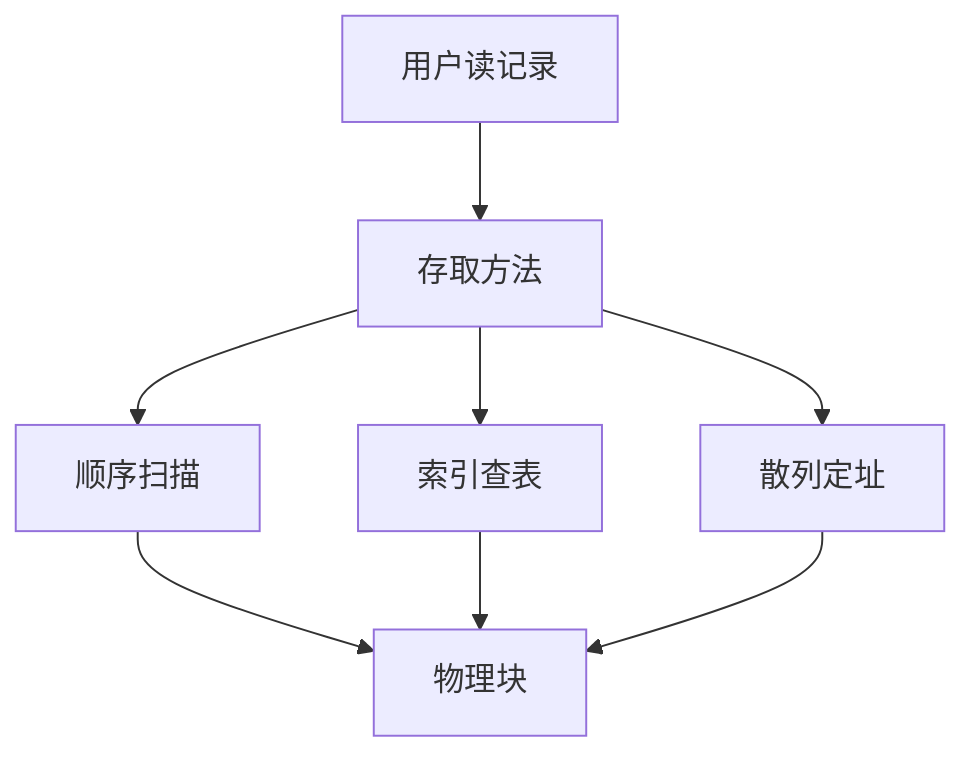

# 文件的基本概念与组织结构

## 是什么：外存上的数据集合

先问一句：内存里的数据断电就丢，若班级 5000 人的成绩要长期保存，该放哪？答案是**文件**——它是性质相同的记录的集合，存放在磁盘等**外存储器**上，是数据持久化的重要形式。

注意它和“表”不一样：表常指内存中的逻辑结构，而文件是==外存中带物理组织方式的数据集合==。

## 为什么需要：从存储到检索

有同学会问：都放进一个顺序表不行吗？可以，但文件要解决的不只是“存得下”，而是“找得快、插删方便”。这就引出了**文件的组织结构**：逻辑上是记录序列，物理上要按存取方法来组织。

| 组织/结构 | 关键点 | 适用 |
|---|---|---|
| 顺序文件 | 记录按关键字有序 | 批量存取 |
| 索引文件 | 索引表+主文件 | 随机查找 |
| 散列文件 | 哈希定址 | 等值查询 |

> [!IMPORTANT]
> 文件的基本单位是**记录**，记录由若干**数据项**组成；关键字用来标识记录。

## 怎么做：三类基本组织

文件的组织要解决“逻辑记录怎样映射到物理块”。看一个极简示意：

1. **顺序文件**：记录在存储介质上依次排列。若按关键字有序，查找第 $i$ 条要顺序跳过前面记录；插入往往要移动后续记录或另加溢出区。
2. **索引文件**：把“关键字—地址”做成索引表，查找时先在索引表定位，再读主文件。可把稠密/稀疏索引理解成书的目录。
3. **散列文件**：用哈希函数 $H(key)$ 直接算出桶号，适合等值检索，但冲突处理是必考点。

> [!TIP]
> 记忆口诀：**顺序靠扫、索引靠表、散列靠算**。看到“随机查找快”优先想索引或散列。

## 相近概念的区别

顺序文件 vs 有序表：前者在外存、受 I/O 块影响；后者常在内存。索引文件 vs 索引表：前者是完整文件组织，后者只是其中用于加速的一张表。

> [!WARNING]
> 常见坑：把“文件的逻辑结构”和“文件的物理结构”混为一谈。==逻辑结构面向用户是记录序列，物理结构面向磁盘是块与地址==。

## 算对了的例子

设顺序文件有 $n$ 个记录，采用顺序查找。若问查找成功的平均比较次数，答案为：
$$
ASL = \frac{1+2+\cdots+n}{n} = \frac{n+1}{2}
$$
当 $n=100$ 时，$ASL=50.5$ 次。若文件按关键字有序且用折半查找，则平均比较次数下降到约 $\log_2 n$ 量级。可见结构不同，代价差别很大。
