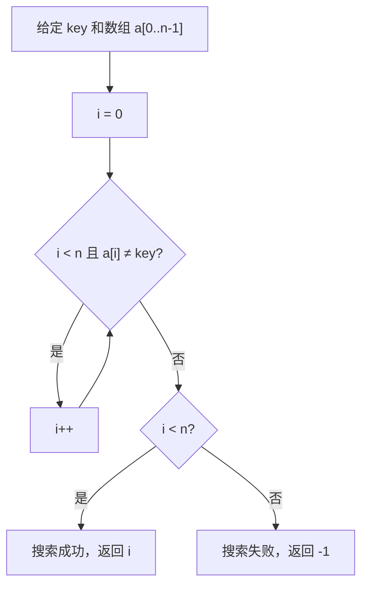

# 无序表的顺序搜索算法及平均搜索长度（ASL）

## 无序表的顺序搜索

在查找一个指定数据时，我们做的核心操作就是把表中的记录<u>一个一个地</u>和给定值做“关键字比较”，直到找到匹配项或确认表中无该项。这就是顺序搜索。

它不需要表事先排好序，也不限制表的存储方式（顺序存储或链式存储均可）。

[!IMPORTANT]
> 顺序搜索是唯一可用于**无序表**的通用查找算法——当表无任何顺序信息时，你必须从头到尾逐个比对。

### 搜索过程

算法流程非常直观：

对于无序表，我们既可以用 `while` 循环实现，也可以设一个“监视哨”（把 `key` 暂存在 `a[n]` 位置）来减少边界检查。

### 平均搜索长度（ASL）的计算

**为什么需要 ASL？**
我们要衡量一个搜索算法在“平均情况下”做多少次关键字比较，这比只看最好或最坏情况更能反映算法在大量数据下的真实开销。

在顺序搜索无序表时：
- **搜索成功**：要找的记录恰好是表中第 $i$ 个元素时，需要进行 $i$ 次关键字比较。
- **搜索失败**：需要遍历整张表，比较 $n$ 次才能下结论“没有找到”。

若假设每个元素的搜索概率相等，即 $P_i = \frac{1}{n}$，则搜索成功时的平均搜索长度为：

$$
\begin{aligned}
ASL_{\text{成功}} &= \sum_{i=1}^{n} i \cdot P_i \\
&= \frac{1}{n} \sum_{i=1}^{n} i \\
&= \frac{1}{n} \cdot \frac{n(n+1)}{2} \\
&= \frac{n+1}{2}
\end{aligned}
$$

[!TIP]
> $1+2+\cdots+n=\frac{n(n+1)}2$，乘以各位置相同的概率 $\frac1n$，得到 $\frac{n+1}2$。不要把“已经取过平均”与“还需乘概率”混为两次平均。

### 典型例题

> 填空 6：对有 $n$ 个元素的表进行顺序搜索时，若每个元素的搜索概率是相等的，则搜索成功时的平均搜索长度为 **$\frac{n+1}{2}$**。

这个结果是针对**无序表搜索成功**的情形。对于有序表的顺序搜索，其成功 ASL 与无序表相同（依然是 $\frac{n+1}{2}$），但**失败 ASL** 可以提前终止，因此会更优。

### 与对半搜索的关键区别

| 对比项 | 无序表顺序搜索 | 对半搜索（二分搜索） |
| :--- | :--- | :--- |
| 表的前提条件 | 无要求 | 必须**有序**且**随机存取** |
| 成功 $ASL$ | $\frac{n+1}{2} = O(n)$ | 约 $\log_2 n$，即 $O(\log n)$ |
| 失败 $ASL$ | $n$ | 约 $\log_2 n$ |
| 存储结构 | 顺序表或链表均可 | 只能顺序表（需随机访问） |

[!WARNING]
> **常见的坑**：题目问“顺序搜索失败时的 ASL”，很多人会写成 $\frac{n+1}{2}$。  
> 请记住：==无序表搜索失败时，必须查完整个表，因此平均比较次数就是 $n$。==

### 失败的 ASL 推导

搜索失败意味着 $key$ 不在表中。对于无序表，我们无法在检测到某个元素小于或大于目标值时就提前停止，必须将表中全部 $n$ 个元素都比较一遍。因此每种失败情况都固定比较 $n$ 次，$ASL_{\text{失败}} = n$。

---

**小结**：无序表的顺序搜索是实现最简单的查找算法，但平均需要检查约一半的元素（成功时）或全体元素（失败时），时间复杂度为 $O(n)$。当数据量巨大或查找频繁时，应考虑排序后改用更高效的搜索策略。

## 监视哨是否计入比较

上面的失败代价 $n$ 只统计与表内真实元素的关键字比较。若实现另设一个值等于待查关键字的监视哨，失败时还会与监视哨比较一次；把这次也计入时是 $n+1$ 次。监视哨减少的是循环内的边界判断，并没有把搜索变为常数时间。
