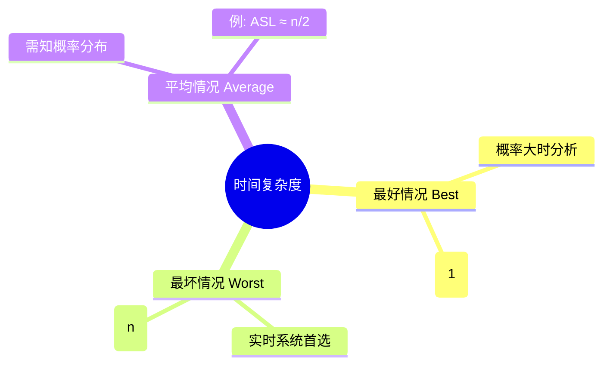

# 算法的时间复杂度与渐近时间复杂度（最好、最坏、平均）

# 算法的时间复杂度与渐近时间复杂度

## 核心概念辨析

算法的时间复杂度并非指程序运行的绝对秒数，而是指**基本操作执行次数**随问题规模 $n$ 增长的变化趋势。我们通常使用**大O记号**（Big-O）来描述这种==渐近时间复杂度==，它忽略了常数系数和低阶项，只关注最高阶项。

> [!IMPORTANT]
> 为什么关注渐近复杂度？
> 因为硬件速度、编译器优化等因素会影响绝对时间，但无法改变算法随数据量增长的本质趋势。$O(n^2)$ 的算法在 $n$ 极大时永远慢于 $O(n \log n)$。

对于没有循环或循环次数固定的代码段，其复杂度为常数阶 $O(1)$。

## 三种情况分析：最好、最坏与平均

同一算法在不同输入下的表现可能截然不同。以**顺序查找**为例：

| 情况 | 定义 | 示例（长度为 $n$） | 应用场景 |
| :--- | :--- | :--- | :--- |
| **最好情况** | 最有利的输入分布 | 第1个即命中，$T(n)=1$ | 概率较大时参考 |
| **最坏情况** | 最不利的输入分布 | 最后1个或不存在，$T(n)=n$ | ==实时系统/安全关键== |
| **平均情况** | 所有输入的期望值 | 假设均匀分布，$T(n) \approx n/2$ | 一般性能评估 |

> [!TIP]
> **考试策略**：除非题目明确要求计算平均情况，否则**一般按最坏情况**分析算法的时间复杂度，因为它提供了性能的上界保证。



## 常见考点与避坑指南

### 1. 嵌套循环的计算
对于多层嵌套循环，时间复杂度通常是各层循环次数的乘积。

> [!CAUTION]
> **高危误区**：不要只看循环变量名，要看循环条件的实际执行次数。若内层循环依赖外层变量，需通过求和公式计算。

**真题解析**：
```c
for (i = 0; i < n; i++)       // 执行 n 次
    for (j = 0; j < n; j++)   // 每次执行 n 次
        x = x + 1;            // 基本操作
```
总执行次数为 $n \times n = n^2$，故时间复杂度为 ==$O(n^2)$==。

### 2. 排序算法的特例
不同排序算法在特定输入下的表现差异巨大。例如**冒泡排序**：
- **最坏/平均**：$O(n^2)$
- **最好**：当序列已有序时，仅需一轮比较且无交换，复杂度为 ==$O(n)$==。

这也是为什么填空题中问“表长为 $n$ 的线性表，排序时间最快为”时，答案可以是 $O(n)$（针对特定算法的最好情况或插入排序等）。

### 3. 平均搜索长度（ASL）
在顺序表中插入元素，平均移动元素个数为 $\frac{n}{2}$；删除元素同理。这是计算平均时间复杂度的基础模型。

> [!NOTE]
> **稳定性关联**：时间复杂度分析常与排序算法的**稳定性**结合考查。例如，快速排序平均 $O(n \log n)$ 但不稳定；归并排序始终 $O(n \log n)$ 且稳定。
