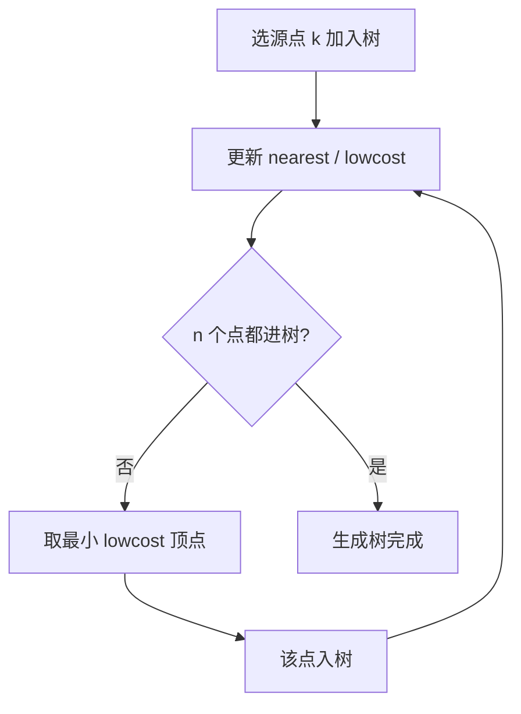
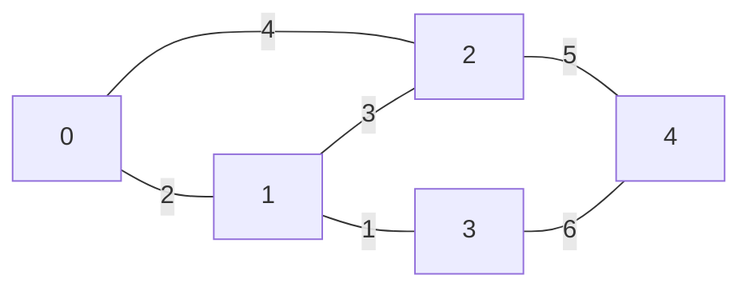

# 最小代价生成树与普里姆（Prim）算法

最小代价生成树（Minimum Cost Spanning Tree，MCST）是解决**带权连通图**连通所有顶点、且总权值最小的生成树问题。在网络设计（如通信线路规划）中，需要在所有顶点之间连通的前提下，尽量降低线路总成本，这正是最小代价生成树的应用场景。

## 基本概念

给定一个带权的连通无向图 $G=(V,E)$，其生成树包含 $V$ 中全部 $n$ 个顶点和 $n-1$ 条边，且==保证连通且无回路==。在所有生成树中，权值之和最小的那棵就是**最小代价生成树**。

> [!IMPORTANT]
> 最小代价生成树包含 $n$ 个顶点、$n-1$ 条边，==不存在回路==，且当边权互不相同时最小生成树唯一。

## 普里姆（Prim）算法

### 核心思想

Prim 算法采用**贪心策略**，从某一顶点 $k$ 出发，每次从连接生成树与外部顶点的边中选择权值最小的那条，将其另一端点加入生成树，直到 $n$ 个顶点全部进入。

打个比方：想象生成树是一个"部落"，每次邀请离部落最近的那个"邻居"加入，直到所有人都到齐。

### 算法步骤

### 数据结构

C++ 实现中定义两个辅助一维数组：

| 数组 | 含义 |
|------|------|
| `nearest[i]` | 顶点 $i$ 在生成树中的最近邻接点（父节点） |
| `lowcost[i]` | 顶点 $i$ 到生成树的最小边权值 |

初始化时，源点 $k$ 的 `lowcost[k]=0`、`mark[k]=true`；其余顶点 `lowcost[i]=INFTY`。

### 时间复杂度

采用邻接矩阵存储时，Prim 算法每轮需扫描全部 $n$ 个顶点找最小值并更新，共 $n$ 轮，时间复杂度为 $O(n^2)$，与边数无关，==适合稠密图==。

> [!TIP]
> Prim 像"长出一棵树"，每次加入一个离树最近的顶点；Kruskal 像"拣树枝"，全局选最小边且不成环。稠密图选 Prim，稀疏图选 Kruskal。

## 与 Kruskal 算法的对比

| 对比项 | Prim | Kruskal |
|--------|------|---------|
| 策略 | 从一个顶点向外扩展 | 全局选最小边，不成环则加入 |
| 时间复杂度 | $O(n^2)$ | $O(e \log e)$ |
| 适用场景 | 稠密图 | 稀疏图 |
| 回路控制 | 天然无回路 | 需显式判断回路 |

## 逐步示例

下面以一个 5 顶点无向图为例演示 Prim 算法的构造过程（以顶点 0 为源点）：

**逐步执行：**

| 步骤 | 已入树顶点 | 选入顶点 | 加入边 | 权值 |
|------|-----------|---------|--------|------|
| 初始 | $\{0\}$ | — | — | — |
| 1 | $\{0\}$ | 1 | $(0,1)$ | 2 |
| 2 | $\{0,1\}$ | 3 | $(1,3)$ | 1 |
| 3 | $\{0,1,3\}$ | 2 | $(0,2)$ 或 $(1,2)$ | 3 |
| 4 | $\{0,1,2,3\}$ | 4 | $(2,4)$ | 5 |

最终生成树的边集为 $\{(0,1),(1,3),(1,2),(2,4)\}$，总代价为 $2+1+3+5=11$。

> [!WARNING]
> 每步选边时必须在"连接已入树顶点与未入树顶点"的边中选最小的，==不能全局选最小边==（否则可能选到不连通的边，那是 Kruskal 的做法）。另外，若图不连通，则不存在最小代价生成树，Prim 算法只能求出生成森林。

> [!NOTE]
> 当所有边权互不相同时，最小代价生成树唯一；若存在相同权值的边，可能有多棵最小代价生成树，但总代价相同。

## 常见坑

> [!CAUTION]
> - 起始顶点任意选取均可，最终总代价相同，但生成树形状可能不同（边权相同时）。
> - 每次更新 `lowcost` 后，==下一轮取最小值时必须从未入树的顶点中取==，已入树的顶点 `lowcost=0`，不要误当作最小值选中。
> - 算法运行结束后应检查是否恰好选取了 $n-1$ 条边；若不足，说明原图不连通。
