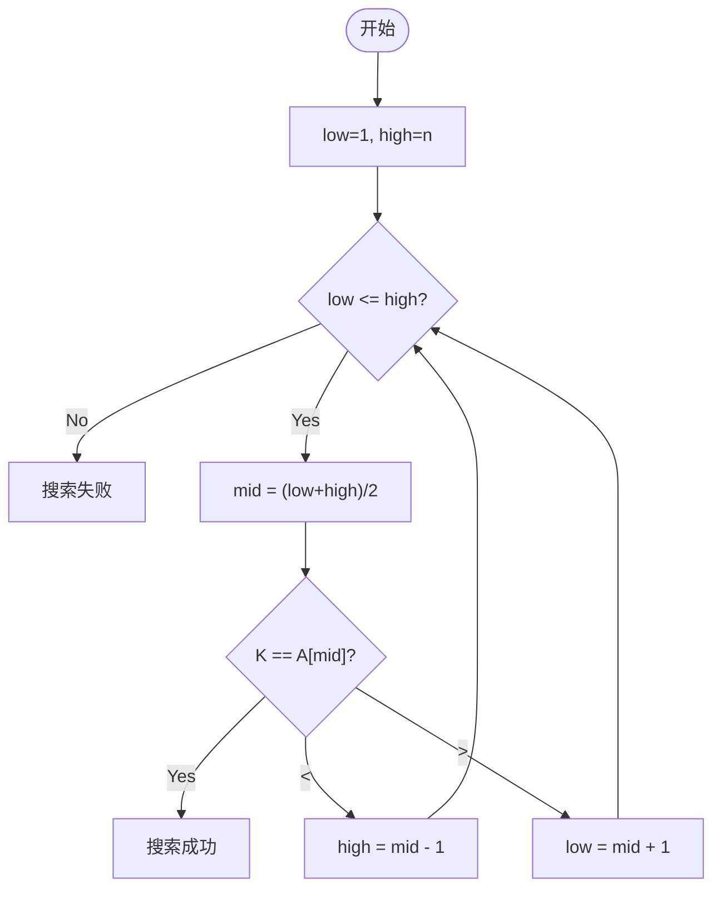

# 有序表的顺序搜索算法及平均搜索长度（ASL）

# 有序表的顺序搜索与对半搜索

在静态查找表中，如何高效定位关键字？这取决于表是否有序以及采用的算法。本节重点解析**顺序搜索**与**对半搜索**的核心逻辑及平均搜索长度（ASL）计算。

## 顺序搜索：基础与ASL推导

顺序搜索（Sequential Search）既适用于无序表，也适用于有序表。其核心是从表的一端开始，逐个比较关键字，直到找到目标或遍历完整个表。

> [!IMPORTANT]
> **搜索成功时的ASL**：若表中 $n$ 个元素被搜索概率相等（$P_i = 1/n$），则搜索成功时的平均比较次数为：
> $$ \mathrm{ASL}_{success} = \sum_{i=1}^{n} i \cdot P_i = \frac{1}{n} \sum_{i=1}^{n} i = \frac{n+1}{2} $$
> ==核心结论==：顺序搜索的时间复杂度为 $O(n)$。

[!WARNING]
注意区分“有序”与“无序”对**失败**搜索的影响。在**有序表**中，若当前元素关键字大于待查值，可提前终止搜索（失败）；而在无序表中，必须遍历所有元素才能确认失败。

## 对半搜索：高效的前提与流程

对半搜索（Binary Search，又称二分搜索）仅适用于**有序顺序表**。它通过不断缩小搜索区间来降低比较次数。

> [!TIP]
> **判定树视角**：对半搜索的过程对应一棵平衡二叉判定树。查找成功时的比较次数等于该节点在树中的层数。

## 典型例题解析

### 1. 顺序搜索 ASL 计算
**题目**：对有 $n$ 个元素的表进行顺序搜索，等概率下搜索成功的 ASL 为？
**解析**：直接套用公式 $\frac{n+1}{2}$。这是南邮《数据结构》填空题的高频考点。

### 2. 对半搜索路径追踪
**题目**：对有序表 `(10, 30, 36, 41, 52, 54, 66, 73, 84, 97)` 搜索关键字 `34`，比较序列是？
**解析**：
1.  $low=1, high=10, mid=(1+10)/2=5$。$A[5]=52 > 34$，转向左半区。
2.  $low=1, high=4, mid=(1+4)/2=2$（向下取整）。$A[2]=30 < 34$，转向右半区。
3.  $low=3, high=4, mid=(3+4)/2=3$。$A[3]=36 > 34$，转向左半区。
4.  $low=3, high=2$，此时 $low > high$，搜索失败。
比较过的元素依次为：**52, 30, 36**。故选 **B**。

> [!CAUTION]
> **常见坑**：计算 $mid$ 时务必注意**向下取整**规则（即 $(low+high)/2$ 的整数部分）。不同教材对 $mid$ 取值可能略有差异，但南邮课程通常采用向下取整。若选错 $mid$，后续路径将完全错误。

## 对比总结

| 特性 | 顺序搜索 | 对半搜索 |
| :--- | :--- | :--- |
| **前提条件** | 无（有序/无序均可） | **必须有序**且为顺序存储 |
| **成功 ASL** | $\frac{n+1}{2}$ | $\approx \log_2(n+1) - 1$ |
| **时间复杂度** | $O(n)$ | $O(\log_2 n)$ |
| **适用场景** | 小规模或动态频繁插入 | 大规模静态或少变动态表 |

==核心高亮==：对半搜索虽快，但维护有序性的插入/删除代价高（$O(n)$）。若需频繁动态操作，应考虑第7章的**搜索树**结构。
