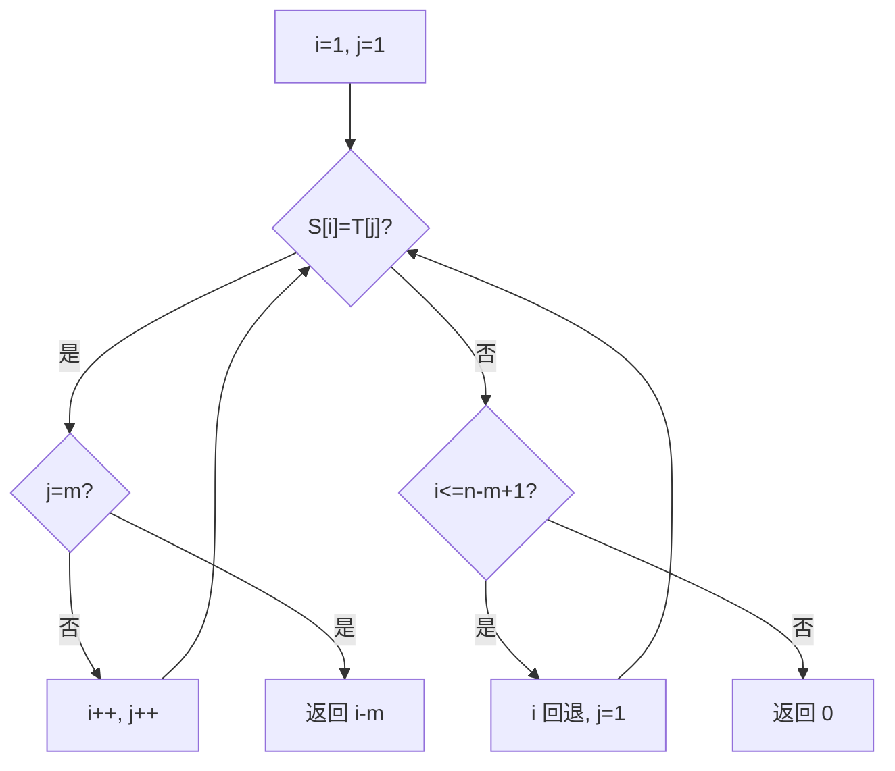

# 简单（朴素）模式匹配算法思想及实现

在《数据结构》里，==模式匹配==（Pattern Matching）要回答的问题是：**给定主串 $S$ 和模式串 $T$，找出 $T$ 在 $S$ 中首次出现的位置**（下标从 1 开始时返回起始下标，找不到返回 0）。这正是很多文本查找、编译器词法分析的基础动作。

最直接的思路叫 ==简单（朴素）模式匹配算法==，也叫 BF 算法（Brute-Force）。它的想法几乎不用解释：从主串的第 1 个字符开始，和模式串逐个字符对齐比较；一旦失配，就把模式串整体往右滑动一位，==主串的下标回退到本轮起点的下一位==，重新比较。

## 算法流程



用伪代码写出来就是：

```c
int Index_BF(String S, String T) {
    int i = 1, j = 1;
    while (i <= S.length && j <= T.length) {
        if (S[i] == T[j]) { i++; j++; }
        else { i = i - j + 2; j = 1; }   // 回溯
    }
    if (j > T.length) return i - T.length;
    else return 0;
}
```

==关键一步就是 `i = i - j + 2`==：本趟从 $i-j+1$ 处开始，失配后下一次从它的下一位重来，这正是"回溯"的来源。

## 一个算对了的例子

主串 $S=$ `ababcabcacbab`，模式串 $T=$ `abcac`（$n=13, m=5$）。

| 趟 | 对齐起点 | 比较过程 | 结果 |
|---|---|---|---|
| 1 | 1 | `ababc` vs `abcac`：$b \ne c$ | 失配 |
| 2 | 2 | `babc…` vs `abcac`：首字符即失配 | 失配 |
| 3 | 3 | `abcab` vs `abcac`：$b \ne c$ | 失配 |
| 4 | 6 | `abcac` vs `abcac` | ==匹配成功==，返回 $6-5=1$? 实际返回起始下标 **6** |

正确答案是 **6**（从 $S[6]$ 开始命中 $T$）。

## 复杂度与常见坑

课件中的结论：==while 循环最多进行 $n-m+1$ 趟，每趟最多比较 $m$ 次==，总比较次数最多 $(n-m+1)\times m$；又因为 $(n-m+1)m \le n\cdot m$，所以

$$
T_{\text{worst}} = O(n\times m)
$$

最好情况 $O(n+m)$（几乎每次首字符就失配，或很快命中），最坏 $O(nm)$（例如 $S=\texttt{aaa}\cdots$、$T=\texttt{aa}\cdots\texttt{b}$）。

> [!WARNING]
> - 复杂度记号写 `O(n*m)` 或 $O(nm)$ 都可以，但不要写成 $O(n+m)$（那是 KMP 才能做到的）。
> - 下标从 1 还是从 0 开始会影响 `return i - m` 还是 `return i - m + 1`，做题前先看清题目约定。
> - 回溯发生在**主串** $i$ 上，不是 $j$（$j$ 是直接归 1）。

> [!TIP]
> 记忆口诀：**"失配一次，i 回退，j 归零"**。回溯是简单匹配效率不高的根源；后续 KMP 通过 $next$ 数组==消除回溯==，把复杂度降到 $O(n+m)$。

> [!NOTE]
> 与 KMP 的区别：简单匹配每次失配只"猜"下一个起点，丢弃了前面已匹配字符的信息；KMP 则利用已匹配前缀构造 $next$ 数组，让 $i$ 不动、只移动 $j$，从而无回溯。考试若问"简单匹配为何效率不高"，标准答案就是 ==有回溯==。
