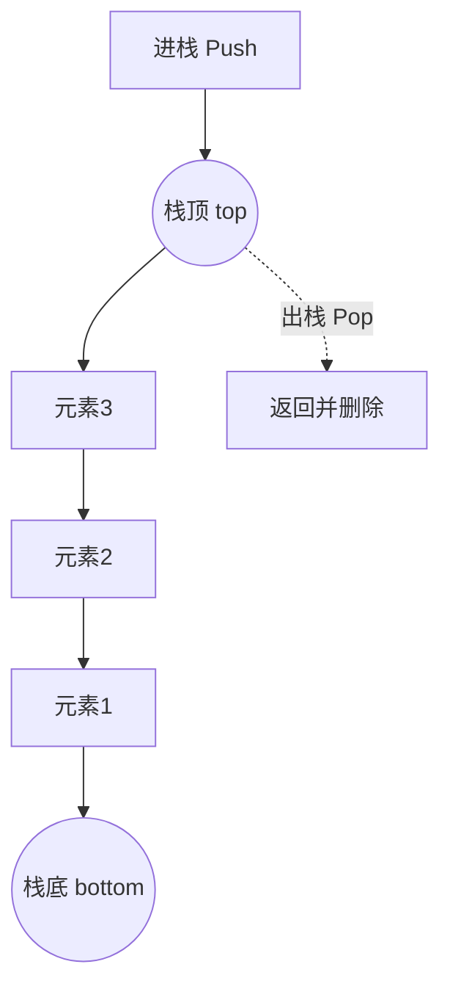

# 堆栈的抽象数据类型（ADT）及顺序表示（进栈、出栈）

---
requires: [数据结构/线性表]
---

如果你只能用一个数组来存数据，但要求**最后放进去的必须最先拿出来**，你会怎么设计？

## 堆栈的抽象数据类型

堆栈（Stack）是一种==后进先出（LIFO）==的受限线性表。它的“受限”体现在：插入和删除操作只能在表的同一端（称为**栈顶**）进行，另一端称为**栈底**。



其 ADT 定义如下：

```text
ADT Stack {
    数据对象：D = { a_i | a_i ∈ ElemSet, i=1,2,...,n }
    数据关系：R = { <a_{i-1}, a_i> | a_{i-1}, a_i ∈ D, i=2,...,n }
    基本操作：
        InitStack(&S)      // 构造空栈
        Push(&S, e)        // 进栈
        Pop(&S, &e)        // 出栈
        GetTop(S, &e)      // 取栈顶元素
        StackEmpty(S)      // 判空
}
```

> [!IMPORTANT]
> 核心考点：堆栈的特点是==后进先出（LIFO）==。这与队列的先进先出（FIFO）形成本质区别。

| 特性 | 堆栈 (Stack) | 队列 (Queue) |
| :--- | :--- | :--- |
| 操作原则 | 后进先出 (LIFO) | 先进先出 (FIFO) |
| 进出位置 | 均在栈顶 | 队尾进、队头出 |

## 顺序表示与进出栈实现

顺序栈利用一组地址连续的存储单元依次存放自栈底到栈顶的数据元素，同时附设指针 `top` 指示栈顶元素的当前位置。通常用一维数组实现，约定 `top = -1` 表示空栈。

**进栈（Push）**：先判断是否栈满，若未满则 `top++`，再将元素存入 `data[top]`。
**出栈（Pop）**：先判断是否栈空，若非空则取出 `data[top]`，再执行 `top--`。

> [!WARNING]
> 边界条件极易错：进栈前必须判满（上溢），出栈前必须判空（下溢）。顺序写反会导致越界访问！

## 经典应用：后缀表达式求值

为什么需要栈？因为计算机处理表达式时，需要暂存中间结果。课件中给出了后缀表达式的求值规则：
(2) 遇到操作数就进栈；
(3) 遇到操作符就从栈中弹出两个操作数，执行运算后将结果进栈；
(4) 重复直到结束，弹出栈顶即为最终结果。

以课件表格中的序列为例，我们一步步算对它：

| 当前项 | 操作 | 栈内状态（左为底右为顶） |
| :--- | :--- | :--- |
| `6` | 6进栈 | `[6]` |
| `4` | 4进栈 | `[6, 4]` |
| `2` | 2进栈 | `[6, 4, 2]` |
| `-` | 弹出2、4，计算 $4-2=2$，结果进栈 | `[6, 2]` |
| `/` | 弹出2、6，计算 $6/2=3$，结果进栈 | `[3]` |
| `3` | 3进栈 | `[3, 3]` |
| `2` | 2进栈 | `[3, 3, 2]` |
| `*` | 弹出2、3，计算 $3 \times 2=6$，结果进栈 | `[3, 6]` |
| `+` | 弹出6、3，计算 $3+6=9$，结果进栈 | `[9]` |

最终弹出栈顶元素 `9`，即为结果。注意调用类似 `void PushOperand(double);` 函数将浮点操作数压入栈中。

> [!CAUTION]
> 高危误区：遇到操作符弹出两个数时，==先弹出的是右操作数，后弹出的是左操作数==！例如减法和除法，若搞反顺序（如算成 $2-4$ 或 $2/6$），结果完全错误。

## 常见坑：出栈序列合法性判定

考试中常考给定输入序列，判断哪个输出序列不可能。例如：输入序列为 1, 2, 3, 4, 5，选项 C 为 1, 4, 5, 2, 3。

> [!TIP]
> 解题技巧：模拟进出栈过程。对于输出序列 14523：
> 1. 输出1：1进栈并立即出栈，栈空。
> 2. 输出4：2, 3, 4依次进栈，4出栈，栈内剩余 `[2, 3]`（3在顶）。
> 3. 输出5：5进栈并立即出栈，栈内仍为 `[2, 3]`。
> 4. 下一个要输出2，但此时栈顶是3！必须先出3才能出2。因此 14523 ==不可能==是合法输出序列。
