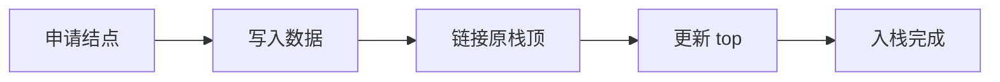

# 堆栈的链接表示（链栈）

## 链栈是什么

顺序栈把元素放在一片连续数组里，需要预先估计容量；**堆栈的链接表示**则用链表保存元素，称为**链栈**。每个结点包含数据域和指针域，各结点可分散存放，通过指针链接。

链栈通常采用不带头结点的单链表，并用栈顶指针 `top` 指向栈顶结点：

```text
top → [5|next] → [4|next] → [3|next] → ... → NULL
```

栈顶设在链表头端，因为插入、删除头结点都只需修改少量指针，时间复杂度为 $O(1)$；若设在尾端，删除栈顶前还要寻找前驱。

> [!IMPORTANT]
> 链栈的==插入和删除都只在栈顶进行==，仍遵循后进先出（LIFO）。链接表示改变的是存储方式，不改变栈的运算规则。

## 为什么需要链栈

| 比较项 | 顺序栈 | 链栈 |
|---|---|---|
| 存储结构 | 连续数组 | 分散结点 |
| 容量 | 受预设空间限制 | 可动态申请 |
| 入栈 | 可能栈满 | 可能内存申请失败 |
| 出栈 | 判断栈空 | 判断 `top == NULL` |
| 额外开销 | 可能有闲置空间 | 每结点需指针域 |

链栈适合栈深难以预先估计、需要动态伸缩的场合，但并非“绝不会满”：可用内存耗尽时仍无法继续入栈。

## 基本操作怎么做

设结点类型为 `Node`，栈顶指针为 `top`。

**入栈**：申请新结点 `p`，写入元素 `x`，再执行

```c
p->next = top;
top = p;
```

顺序不能颠倒，否则原栈链表会失去入口。

**出栈**：先判断 `top != NULL`，保存栈顶元素，再执行

```c
p = top;
top = top->next;
free(p);
```

**取栈顶**只读取 `top->data`，不修改 `top`，也不释放结点。



## 和相近概念的区别

链栈不是“可以任意插入、删除的链表”，而是**运算受限的链表**；它也不等于递归栈。递归栈是函数调用时系统维护的运行机制，链栈则是一种可由程序员实现的数据结构，二者可以有关联，但不是同一概念。

> [!WARNING]
> 常见错误：出栈前不判空、出栈后忘记 `free`、把取栈顶误写成出栈，以及认为链栈不存在上溢。

## 出栈序列例题

设输入序列为 $1,2,3,4,5$，判断 `14523` 是否可能。

- 输出 `1`：1 入栈后立即出栈。
- 输出 `4`：依次压入 2、3、4，再弹出 4，栈内从底到顶为 $2,3$。
- 输出 `5`：5 入栈后立即出栈，栈顶仍为 3。
- 此时下一次只能输出 `3`，不能输出 `2`。

所以 `14523` 不可能；若后续输出 `3、2`，得到 `14532`，则合法。

> [!TIP]
> 判断出栈序列时，按目标顺序模拟“需要则入栈、匹配则出栈”。==当前目标不在栈顶，且后续输入也无法把它送到栈顶，即不可能。==
