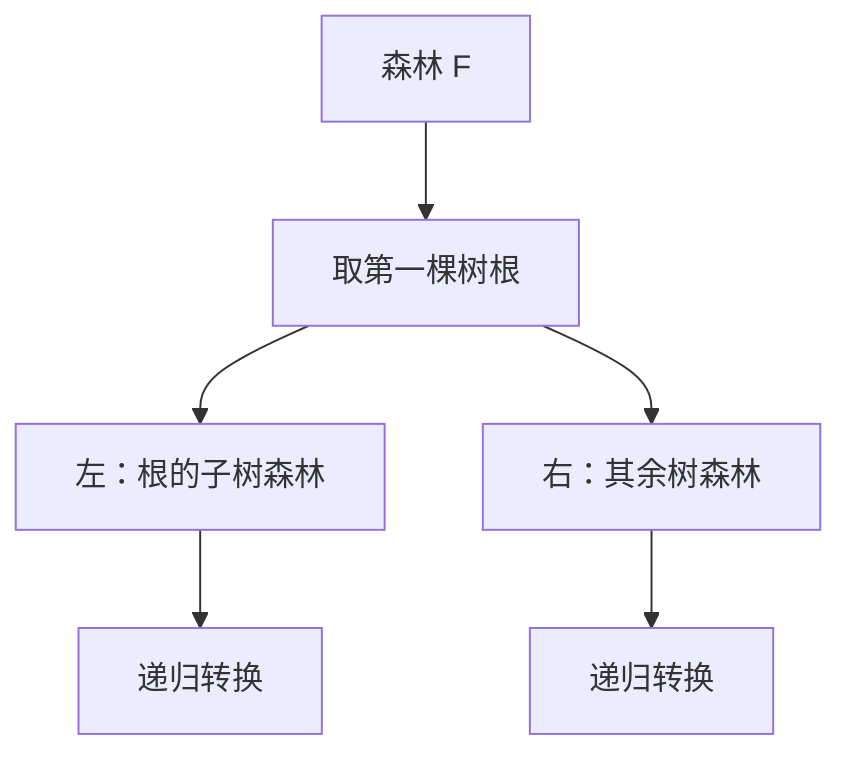
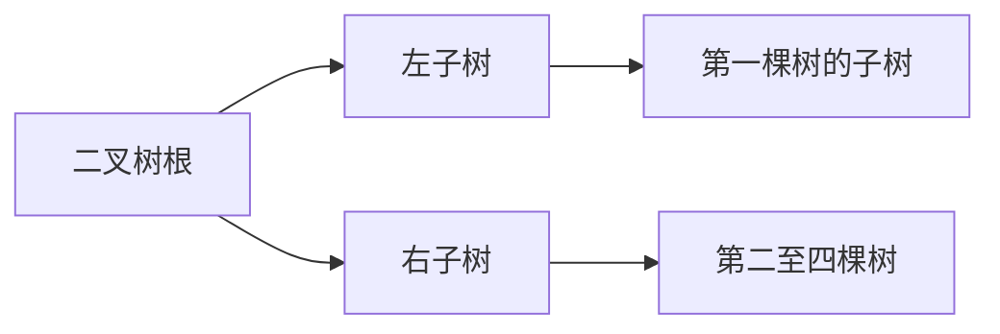

# 树、森林与二叉树的相互转换方法

## 概念与转换意义

森林是若干棵互不相交的树的集合；树则可以看成“只有一个根结点的森林”。一般树没有固定的“左孩子”“右孩子”概念，而二叉树严格区分左右子树，因此需要在森林各棵树之间确定顺序，即讨论==有序森林==。

把森林转换为二叉树后，就可以直接利用二叉树已有的存储、遍历和算法工具处理一般树与森林，这是本章转换规则的核心价值。

> [!IMPORTANT]
> 森林与二叉树可以相互转换，而且转换结果是唯一的。

## 森林转换为二叉树

设森林由按从左到右排列的树 $T_1,T_2,\ldots,T_n$ 组成，各树根分别为 $r_1,r_2,\ldots,r_n$。

转换规则如下：

1. 将 $T_1$ 的根 $r_1$ 作为二叉树的根。
2. $r_1$ 的==左子树==由 $T_1$ 中根的各棵子树组成的森林转换得到。
3. $r_1$ 的==右子树==由剩余森林 $T_2,T_3,\ldots,T_n$ 转换得到。

递归执行即可完成整棵森林的转换。

树转换成森林时，只需去掉树根，并把根的各棵子树依次作为森林中的树。

## 二叉树转换为森林

转换时把二叉树看成“根—右链”结构：

- 二叉树的根是森林第一棵树的根。
- 根的左子树转换为第一棵树根的子树森林。
- 根的右子树转换为森林中剩余的树。

因此，森林中树的棵数，等于从二叉树根开始沿右孩子向下，直到没有右孩子为止所经过的结点数。

> [!TIP]
> 记法：**森林转二叉树看“左孩子—右兄弟”**。一个结点的左孩子表示它的第一个孩子，右孩子表示它的下一个兄弟。

## 遍历关系

森林的先序和中序遍历与对应二叉树的同名遍历等价。

| 森林遍历 | 等价的二叉树遍历 |
|---|---|
| 先序遍历 | 先序遍历 |
| 中序遍历 | 中序遍历 |

森林先序遍历的步骤是：

1. 访问第一棵树的根；
2. 先序遍历该根的子树森林；
3. 先序遍历剩余的树。

> [!WARNING]
> 有的教材把这里的森林中序遍历称为后根遍历：先遍历第一棵树根的子树森林，再访问该根，最后遍历其余树。名称应结合定义理解，不能直接把二叉树的后序序列当作这个森林遍历的结果。

## 例题计算

森林中有四棵树，结点数分别为 $n_1,n_2,n_3,n_4$。对应二叉树的根来自第一棵树，而它的左子树由第一棵树根的子树组成，因此该左子树结点数为

$$
n_1-1
$$

其余 $n_2+n_3+n_4$ 个结点位于二叉树的右子树部分。

> [!CAUTION]
> 常见错误是把左子树结点数写成 $n_1$。根结点本身不属于它的左子树，所以必须减去 $1$。
