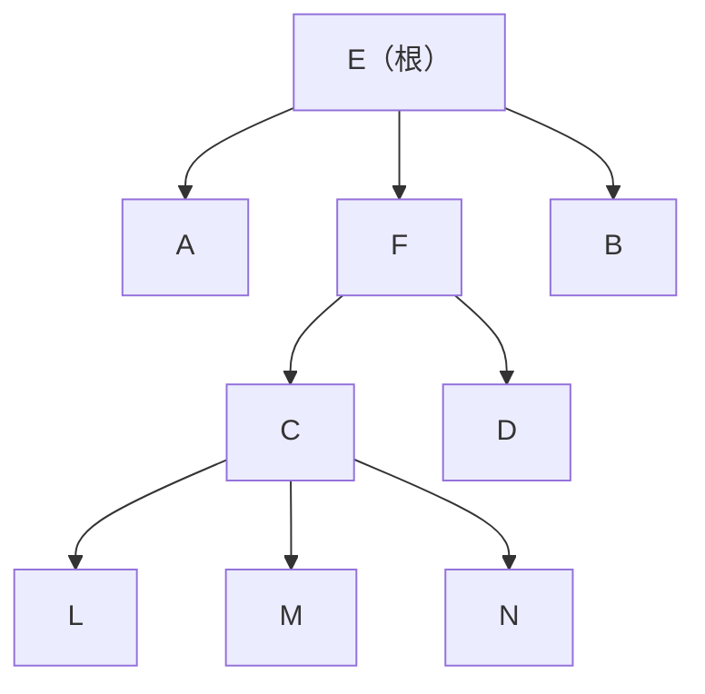

# 树的定义、基本术语（双亲、后裔、度、层次、有序树、无序树、森林）

## 树是什么

先看一个日常问题：文件夹里可以放子文件夹，子文件夹里还能再放。这种“一层套一层”的结构，在数据结构中就叫**树**。

定义 5.1 给出：树不为空，至少有一个**根结点**，根结点没有前驱，其余每个结点都有且仅有一个前驱。于是整棵树自然形成层次结构。

树是递归定义的——树由根和若干子树组成，子树本身又是树。正因为定义中引用了自身，树被称为**递归数据结构**。

> [!IMPORTANT]
> 结点数 $n$ 与边数 $e$ 的关系恒为 $e=n-1$。这是判断“这到底是不是一棵树”的快速方法。

## 基本术语

| 术语 | 含义 | 图中示例 |
|------|------|----------|
| 双亲 parent | 若结点有子树，该结点是子树根的双亲 | E 是 A、F、B 的双亲 |
| 兄弟 sibling | 有相同双亲 | A、F、B 互为兄弟 |
| 后裔 descendant | 某结点所有子树上的任何结点 | C 的后裔是 L、M、N |
| 结点的层次 | 根为第 1 层，其余等于双亲层次加 1 | M 的层次为 5 |
| 树的高度 | 树中结点的最大层次 | 图中为 5 |

**有序树与无序树的区别**：若各子树从左到右有次序，就是有序树；否则是无序树。两棵无序树若子树可交换位置后相同，视为同一棵；但有序树则视为两棵不同的树。

**森林**：$m$（$m\ge 0$）棵不相交的树组成的集合。把树的根去掉，根的子树们就组成森林；反之，给森林各树加一个公共的新根，森林就变成树。

> [!WARNING]
> 树和二叉树的根本区别：二叉树有**左右孩子之分**，树没有。所以一棵度为 2 的树不等价于一棵二叉树。

## 为什么要有“森林→二叉树”

二叉树性质好、存储方便、算法成熟。如果我们能把任意树或森林唯一地转换成二叉树，就能==用二叉树的全部成果去处理一般树和森林==。

转换规则只有一句话：**左孩子，右兄弟**。

森林转二叉树的具体做法：
1. 将森林中各树的根用线连起来——让前一棵树的根成为后一棵树根的“兄弟”；
2. 对每棵树，只保留双亲到第一个孩子的连线；
3. 断绝非长子与双亲之间的连线；
4. 以第一棵树的根为整棵二叉树的根，其余树的根依次挂在右链上。

反过来，若二叉树根结点沿右链经过 $k$ 个结点，则对应的森林中有 $k$ 棵树。

## 遍历如何对应

| 森林 | 等价于 |
|------|--------|
| 先序遍历 | 对应二叉树的先序遍历 |
| 中序遍历 | 对应二叉树的中序遍历 |

以上图森林为例，先序遍历结果：`A B C K D E H F J G`。它恰好等于转换成的二叉树的先序遍历序列。

## 一个算对了的例子

图 4 的森林有三棵不相交的树。按“左孩子右兄弟”转换后：
- 第一棵树的根作二叉树的根；
- 其第一孩子作左子树的根；
- 第二棵树、第三棵树的根依次作右子树的根、右子树的右子树的根。

此时判断二叉树的叶结点条件也一致：某结点**左孩子指针和右孩子指针均为空**，则该结点为叶结点。

> [!TIP]
> 记忆口诀：**根连根，留长子，断次子，左孩右兄变二叉**。转换后，树的“孩子”关系在二叉树中用*左子树的右链*表示。
