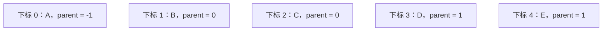
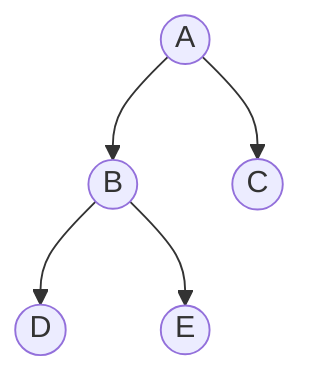
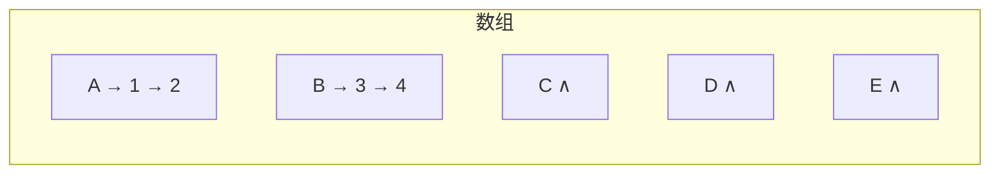
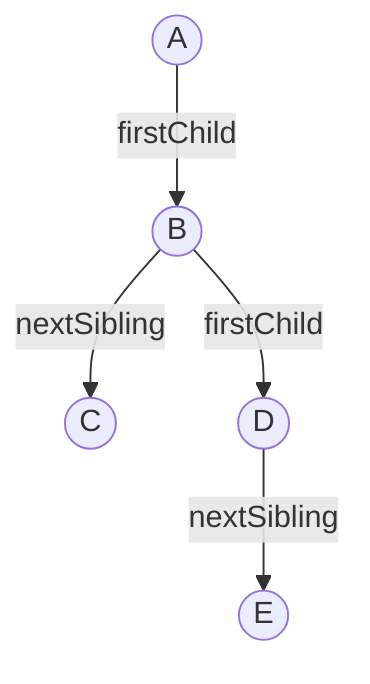
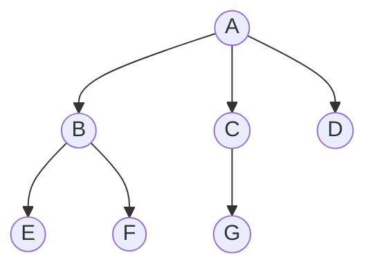
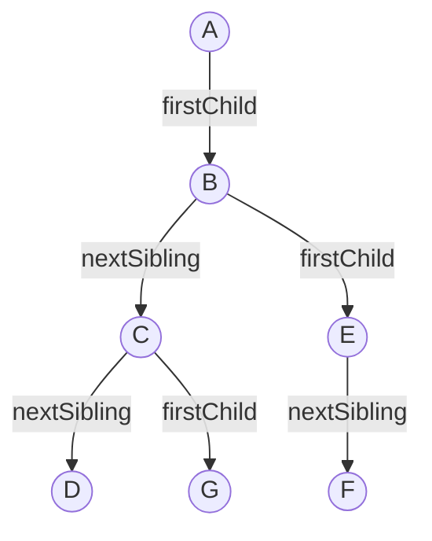

# 树和森林的存储表示（孩子兄弟表示法、双亲表示法等）

## 树和森林的存储表示

前两节我们重点讲了二叉树。二叉树每个结点最多两棵子树，存储时用 `lchild` 和 `rchild` 两个指针就够了。但一般的树，每个结点的孩子数量不定，==没法用固定数量的指针域直接表示==。那怎么办？有两个思路：

- 顺着“孩子”去找——**孩子表示法**
- 顺着“双亲”去找——**双亲表示法**
- 把“孩子”和“兄弟”串起来——**孩子兄弟表示法**

下面分别讲清楚。

---

## 双亲表示法

### 它是什么

每个结点只存一个信息：**它的双亲是谁**。用一维数组存储所有结点，数组下标就是结点编号。



对应这棵树：



存储结构如下：

```c
typedef struct {
    DataType data;
    int parent;      // 双亲结点在数组中的下标
} PTNode;

typedef struct {
    PTNode nodes[MAXSIZE];
    int n;           // 结点数
} PTree;
```

### 为什么需要它

很多应用场景只关心“**从下往上找**”。比如并查集里判断两个结点是否属于同一集合，只需要不断向上找根；文件系统中获取某个文件的父目录。此时不需要从父结点向下扫描，双亲表示法最直接。

### 常见坑

[!WARNING]
双亲表示法**很难找孩子**。要列举某个结点的所有孩子，必须从头到尾扫描整个数组，逐个检查 `parent` 是否等于当前下标，时间复杂度 $O(n)$。

---

## 孩子表示法

### 它是什么

每个结点维护一个**孩子链表**，把所有孩子串起来；同时用数组保存所有结点，每个数组元素带一个指向其孩子链表头结点的指针。



存储结构：

```c
typedef struct ChildNode {   // 孩子链表结点
    int child;               // 该孩子结点的下标
    struct ChildNode *next;
} ChildNode;

typedef struct {
    DataType data;
    ChildNode *firstChild;   // 孩子链表头指针
} CTBox;

typedef struct {
    CTBox nodes[MAXSIZE];
    int n;
} CTree;
```

### 特点

孩子表示法**找孩子容易**：沿着 `firstChild` 链表走即可。但==找双亲又困难了==——必须扫描全部链表。

> [!NOTE]
> 可以结合两者，在 `CTBox` 里加一个 `int parent` 字段，形成**双亲孩子表示法**，这样向上、向下查找都方便。

---

## 孩子兄弟表示法

### 它是什么

这是南邮这门课的重点，也是**树、森林与二叉树相互转换的桥梁**。

每个结点只有两个指针：

- **firstChild**：指向该结点的**第一个孩子**
- **nextSibling**：指向该结点的**下一个兄弟**

```c
typedef struct CSNode {
    DataType data;
    struct CSNode *firstChild;   // 第一个孩子
    struct CSNode *nextSibling;  // 下一个兄弟
} CSNode, *CSTree;
```

上面的树用孩子兄弟表示法存储后，逻辑结构变成：


存放方式如下：



[!IMPORTANT]
孩子兄弟表示法的核心：把**“父子关系”放在左指针（firstChild）**，把**“兄弟关系”放在右指针（nextSibling）**。这样任意一棵树都变成了**每个结点最多两个指针域**的结构——本质就是一棵**二叉树**。

### 为什么需要它

回到最初的问题：一般树的孩子数量不确定，没法用固定长度的指针数组存。孩子兄弟表示法用**两个指针统一了所有情况**，使得：

- 树的存储结构简单统一
- ==树 / 森林可以直接转换成二叉树==，从而复用二叉树的所有算法（遍历、查找等）

这就是 5.5 节后面要讲的“森林与二叉树的转换”的基础。

### 与二叉树的区别

[!CAUTION]
孩子兄弟表示法得到的二叉树，其**左孩子 = 原树的第一个孩子**，**右孩子 = 原树的下一个兄弟**。它与“把树当二叉树”的逻辑不同：二叉树中右孩子是“孩子”，而这里右指针指向的是**兄弟**，只是存储结构上长得像二叉树。

---

## 一个算对了的例子

**题目**：给定树 $T$ 如下，写出其孩子兄弟表示法的二叉树形态。



**解答**：

1. 找每个结点的第一个孩子与下一个兄弟：

| 结点 | 第一个孩子 | 下一个兄弟 |
|------|-----------|-----------|
| A    | B         | 无        |
| B    | E         | C         |
| C    | G         | D         |
| D    | 无        | 无        |
| E    | 无        | F         |
| F    | 无        | 无        |
| G    | 无        | 无        |

2. 按“左孩子 = firstChild，右孩子 = nextSibling”画出二叉树：



[!TIP]
记忆口诀：**“左儿子，右兄弟”**。画图时先确定每个结点的 firstChild 作为左子树根，再沿 nextSibling 逐个挂到右链上。森林转二叉树时，先把每棵树转成二叉树，再把后一棵树挂到前一棵树的**根结点右链末尾**。
