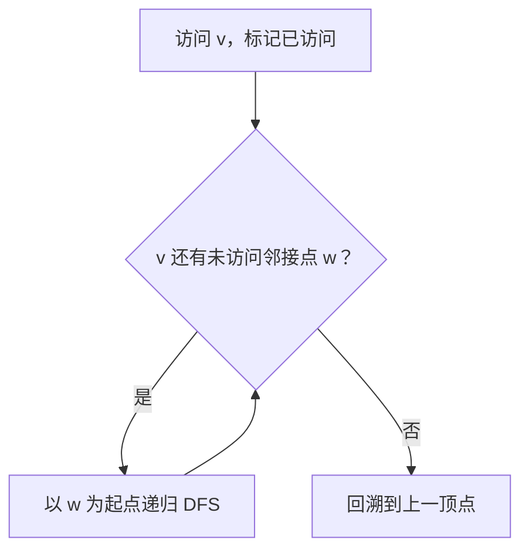

# 图的深度优先遍历（DFS）递归算法

## 深度优先遍历（DFS）递归算法

### 什么是 DFS

深度优先搜索就像==走迷宫时“一条路走到黑”==的策略：从起点出发，每到一个岔路口就选择一条未走过的路一直走下去，直到前方无路可走，再原路退回到上一个岔路口，尝试其他未走过的路。

在图论中，DFS 从起始顶点 v 出发：
1. 访问 v，标记为“已访问”
2. 在 v 的所有邻接顶点中，挑一个未访问过的 w
3. 以 w 为新起点，重复 1、2 两步
4. 当 v 的所有邻接顶点都已访问，则==退回==到调用 v 的那个顶点，继续上述过程

> [!IMPORTANT]
> ==DFS 的核心是“递归”——每次访问一个邻接顶点时，都以它为新的起点重新发起 DFS，直到无路可走才回溯。==



### 为什么需要 DFS

很多图论问题本质上就是“遍历所有可能路径”：
- 判断图的连通性、求连通分量
- 拓扑排序（DFS 实现的另一思路）
- 寻找图中是否存在环
- 生成树/生成森林的构建

DFS 递归算法用邻接表存储时，时间复杂度为 ==$\mathcal{O}(n + e)$==，非常高效。

### 算法实现（邻接表）

南邮教材中使用的是 `ExtLGraph` 类，两层函数配合：

**公有接口 `DFS()`**——负责初始化 `visited` 数组，并处理非连通图的剩余顶点：

```cpp
template<class T>
void ExtLGraph<T>::DFS()
{
    bool* visited = new bool[n];
    for(int i = 0; i < n; i++) visited[i] = false;
    for(int i = 0; i < n; i++)
        if (!visited[i])
            DFS(i, visited);   // 调用私有递归函数
    delete[] visited;
}
```

**私有递归函数 `DFS(int v, bool* visited)`**——真正执行深度优先遍历：

```cpp
template<class T>
void ExtLGraph<T>::DFS(int v, bool* visited)
{
    visited[v] = true;
    cout << " " << v;
    for (ENode<T>* w = a[v]; w; w = w->nextArc)
        if (!visited[w->adjVex])
            DFS(w->adjVex, visited);
}
```

> [!NOTE]
> 外层 `for` 循环中的 `if(!visited[i])` 保证非连通图的每个连通分量都被遍历到。一次完整的 DFS 调用得到一棵==生成树==，多次调用得到==生成森林==。

### DFS vs BFS 对比

| 方面 | DFS（深度优先） | BFS（广度优先） |
|------|----------------|----------------|
| 数据结构 | 递归（隐式栈） | 显式队列 |
| 策略 | 一条路走到底 | 层层向外扩散 |
| 邻接表时间 | $\mathcal{O}(n+e)$ | $\mathcal{O}(n+e)$ |
| 邻接矩阵时间 | $\mathcal{O}(n^2)$ | $\mathcal{O}(n^2)$ |
| 生成树 | 深度优先生成树 | 广度优先生成树 |

### 序列唯一吗？——常见误区

> [!WARNING]
> 从同一顶点出发的 DFS 序列==不唯一==，取决于邻接表或邻接矩阵中顶点的排列顺序。做题目时，必须按照==给定邻接表的边结点顺序==来遍历。

举个正确的例子，判断依据是“每个邻接点按存储顺序先后递归”：

**问题**：在如下邻接表上，从顶点 0 开始 DFS，求遍历序列。

```
0 → 2 → 1 → ∧
1 → 0 → 4 → ∧
2 → 0 → 6 → ∧
3 → 5 → ∧
4 → 1 → 6 → → ∧
5 → 3 → ∧
6 → 2 → 4 → 5 → ∧
```

**推导过程**：

1. 访问 0，邻接点顺序：2, 1。==先递归 2==。
2. 访问 2，邻接点顺序：0（已访问）, 6。==递归 6==。
3. 访问 6，邻接点顺序：2（已）, 4, 5。==递归 4==。
4. 访问 4，邻接点顺序：1（未）, 6（已）。==递归 1==。
5. 访问 1，邻接点顺序：0（已）, 4（已）。回溯至 4，再回溯至 6。
6. 回到 6，下一个邻接点 5 未访问。==递归 5==。
7. 访问 5，邻接点 3 未访问。==递归 3==。
8. 访问 3，邻接点 5 已访问。

> [!TIP]
> ==关键判断法==：每一步严格按邻接表顺序扫描，`visited` 数组决定是否跳到下一个。

**答案**：0, 2, 6, 4, 1, 5, 3 → 对应选项 **B**。

### 一道填空题让你彻底搞懂

已知无向图 $V=\{a,b,c,d,e\}$，$E=\{(a,b),(a,d),(a,c),(d,c),(b,e)\}$，序列 `abecd` 是哪种遍历？

- 从 a 出发，邻接点一般顺序为 b, d, c
- DFS 的话：a → b → e → 回溯到 b → 回溯到 a → d → c，序列为 `abedc`，不匹配
- BFS 的话：a → b, d, c → e，序列为 `abdce`，也不匹配

但实际考试答案为“深度优先”，因为邻接表顺序可能为 b, c, d。若 a 指向 b → c → d，则 DFS 路径为 a → b → e → 回溯 → c → 回溯 → d，出现序列 `abecd`。==填空答案为“深度优先”==，这体现了邻接表顺序对 DFS 序列的影响。
