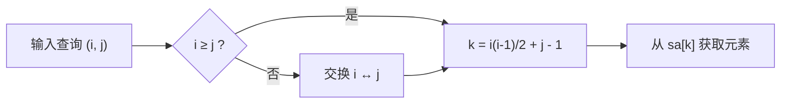

# 对称矩阵等特殊矩阵的压缩存储方法

## 为什么需要压缩存储

在数值计算和工程问题中，许多矩阵具有大量重复元素或零元素。如果仍然采用二维数组存储所有 $n^2$ 个元素，会浪费大量内存。例如一个 $1000 \times 1000$ 的对称矩阵，按常规方式需要存储 1,000,000 个元素，但实际上独立元素只有 $n(n+1)/2$ 个，约为 500,500 个。压缩存储的目标就是：==只存储矩阵中的独立元素（通常是下三角或上三角），其余元素通过映射关系推导，从而节省近一半的存储空间。==

## 什么是对称矩阵的压缩存储

对称矩阵满足 $a_{ij} = a_{ji}$（$1 \le i, j \le n$）。在压缩存储中，我们通常只存储**下三角（含主对角线）**的元素，即 $i \ge j$ 的部分。

将这些元素按“行优先”的顺序存放在一个一维数组 `sa[k]` 中：

```
第一行存 1 个：a₁₁
第二行存 2 个：a₂₁, a₂₂
第三行存 3 个：a₃₁, a₃₂, a₃₃
……
第 n 行存 n 个：aₙ₁, ..., aₙₙ
```

那么，给定矩阵中的位置 $(i, j)$，它在 `sa` 中的下标 $k$ 如何计算？

> [!IMPORTANT]
> 压缩存储的核心是**下标映射公式**。南邮考试中必考下三角按行优先的存储公式及其推导。

### 映射公式推导

我们思考一个问题：第 $i$ 行第 $j$ 列的元素排在 `sa` 的第几个？（设下标从 0 开始）

前 $i-1$ 行共有多少个元素？第 1 行有 1 个，第 2 行有 2 个，……，第 $i-1$ 行有 $i-1$ 个，总数是：

$$1 + 2 + \cdots + (i-1) = \frac{i(i-1)}{2}$$

然后在本行（第 $i$ 行）中，它是第 $j$ 个元素（从 1 开始），所以本行内偏移为 $j-1$。

因此总下标为：

$$k = \frac{i(i-1)}{2} + (j - 1)$$

当 $i \ge j$（下三角区域）时，直接用上述公式；当 $i < j$（上三角区域）时，根据对称性 $a_{ij} = a_{ji}$，交换 $i$ 和 $j$ 后再代入公式。



## 三角矩阵与对角矩阵

除了对称矩阵，考试中还常见以下两种特殊矩阵的压缩存储。

### 三角矩阵

上三角矩阵（含下三角）或下三角矩阵（含上三角）的特点是：三角区外的所有元素为同一常数（通常为 0 或一个固定值 $c$）。

压缩方法：存储三角区的 $\frac{n(n+1)}{2}$ 个元素，再加一个存储单元存放常数 $c$（通常放在数组最后）。下标映射公式与对称矩阵的下三角公式一致。

### 三对角矩阵

三对角矩阵中，只有主对角线及其上下相邻的两条对角线上有非零元素，其余位置均为 0。

压缩方法：将三条对角线上的元素按行优先压缩存储。此时下标映射关系变为：

$$k = 2i + j - 3$$

> [!WARNING]
> 代入公式前一定要先判断 $(i, j)$ 是否在三条对角线上（即 $|i - j| \le 1$），越界的元素直接返回 0 或常数，不要强行套公式。

## 常见易错对比

| 矩阵类型 | 存储内容 | 下标映射公式（下三角，行优先，下标从 0） |
|---------|---------|--------------------------------------|
| 对称矩阵 | 下三角（含对角） | $k = i(i-1)/2 + j - 1$（$i \ge j$） |
| 下三角矩阵 | 下三角 + 一个常数 | 同上，外加常数存末尾 |
| 三对角矩阵 | 三条对角线 | $k = 2i + j - 3$（仅 $\|i-j\|\le1$） |

> [!TIP]
> 记忆口诀：元素总数看三角，对称只存一半量；$i(i-1)/2 + j - 1$ 是通用方，三对角公式另记强化。

## 一个算对了的例子

**【题目】** 设有一个 $10 \times 10$ 的对称矩阵 $A$，采用压缩存储方式，以行优先存储下三角元素，下标从 0 开始。求 $a_{8,5}$ 在压缩数组中的下标 $k$。

**【解答】**

1. 判断位置：$i = 8,\ j = 5$，满足 $i \ge j$，属于下三角。
2. 套公式：
   $$k = \frac{8 \times (8 - 1)}{2} + (5 - 1) = \frac{8 \times 7}{2} + 4 = 28 + 4 = 32$$
3. 结果：$a_{8,5}$ 存储在 `sa[32]` 中。

再验证上三角元素 $a_{5,8}$：因为 $i < j$，交换得 $a_{8,5}$，同样映射到 `sa[32]`，满足对称性，答案一致。

> [!CAUTION]
> 下标从 0 还是从 1 开始，是南邮考试中最容易栽跟头的细节。题干明确给 $a_{1,1}$ 存于 $B[0]$ 还是 $B[1]$，决定了是否需要 $+1$ 或 $-1$。**读完题先圈出下标起点，再套公式。** 有的题下标从 1 开始存储，此时公式需调整为 $k = i(i-1)/2 + j$。务必逐字审题，不要想当然代公式。
