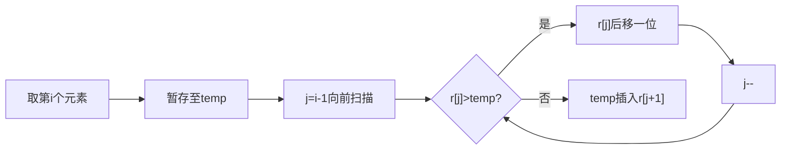

# 直接插入排序算法思想、最坏情况比较次数与稳定性分析

## 算法思想与核心逻辑

直接插入排序（Straight Insertion Sort）是最直观的排序方法。想象你在打扑克牌时整理手牌：每次摸起一张新牌，从右向左扫描已排好的牌，找到合适位置插入，并将比它大的牌依次后移。

> [!IMPORTANT]
> ==核心思想==：将待排序记录逐个插入到前面已经排好序的子序列中，直到所有记录插入完毕。初始时，第一个元素默认有序，从第二个元素开始执行“查找+移动+插入”三步操作。



## 复杂度与稳定性分析

若原始序列为 $n$ 个元素的==逆序==状态，则触发最坏情况。此时第 $i$ 趟需比较 $i$ 次、移动 $i+1$ 次。总比较次数为：

$$
C_{max} = \sum_{i=2}^{n} i = \frac{n(n+1)}{2} - 1 = O(n^2)
$$

> [!NOTE]
> 最好情况（正序）仅需 $n-1$ 次比较，0 次移动，时间复杂度为 $O(n)$。平均时间复杂度仍为 $O(n^2)$。

关于稳定性：由于只在 `r[j] > temp` 时才后移，==相等元素不会交换相对位置==，因此直接插入排序是**稳定**的。这一点区别于简单选择排序（不稳定）。

| 指标 | 直接插入排序 | 冒泡排序 | 简单选择排序 |
| :--- | :--- | :--- | :--- |
| 最坏比较次数 | $n(n+1)/2-1$ | $n(n-1)/2$ | $n(n-1)/2$ |
| 稳定性 | 稳定 | 稳定 | **不稳定** |
| 适用场景 | 小规模/基本有序 | 教学演示 | 不关心稳定性 |

## 编程实现与常见陷阱

在顺序表上实现改进版直接插入排序时，常考代码填空。关键是用 `temp` 暂存待插元素，避免被覆盖：

```c
void InsertSort(SqList &L) {
    for (int i = 2; i <= L.length; ++i) {
        if (L.r[i].key < L.r[i-1].key) { // 优化：仅逆序时才处理
            L.r[0] = L.r[i];             // r[0]作哨兵兼暂存
            int j = i - 1;
            while (L.r[0].key < L.r[j].key) {
                L.r[j+1] = L.r[j];       // 后移而非交换
                j--;
            }
            L.r[j+1] = L.r[0];           // 插入正确位置
        }
    }
}
```

> [!WARNING]
> ==高频易错点==：① 循环条件误写为 `<=` 导致越界；② 忘记用哨兵/临时变量暂存，原值被移位覆盖；③ 内层循环结束后插入位置应为 `j+1` 而非 `j`。

> [!TIP]
> 验证示例：对 `{5,3,4,2}` 排序。第2趟：3<5，5后移，3插→`{3,5,4,2}`；第3趟：4<5，5后移，4>3停，4插→`{3,4,5,2}`；第4趟：2依次比5、4、3均小，全后移，2插首→`{2,3,4,5}`。全程相等元素未换位，稳定性得证。
