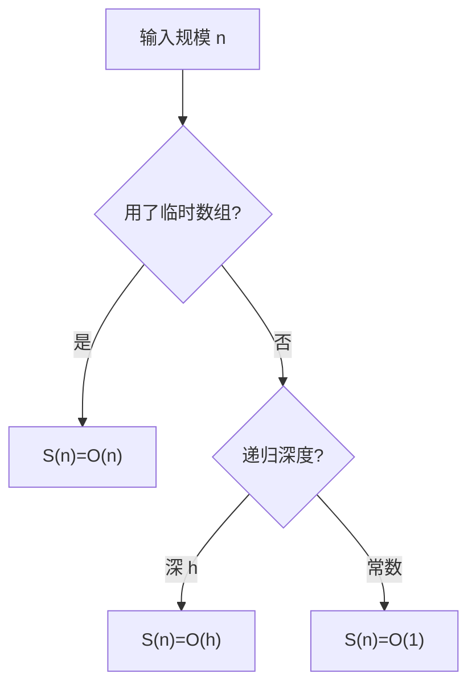

# 算法的空间复杂度

## 它是什么

你想估算一个程序在机器上跑起来要“借”多少内存。算法运行期间要占的空间包括：程序代码本身、输入数据、以及==执行时临时占用的辅助空间==。南京邮电大学《数据结构》第 1 章说的“空间复杂度”，通常只关注最后这部分。

## 为什么需要

时间复杂度回答“跑多久”，空间复杂度回答“借多少地方”。做题、写递归、申请数组时，如果不预估，可能爆栈或超内存限制。

> [!IMPORTANT]
> 核心结论：空间复杂度 $S(n)$ 是==问题规模 $n$ 的辅助存储函数==，常用大 $O$ 表示。

## 怎么做

先看算法里哪些变量、数组、递归栈随 $n$ 变化：



若只用了 `i`、`temp` 等有限个变量，则 $S(n)=O(1)$，叫==原地工作==。若开了大小 $n$ 的辅助数组，则 $S(n)=O(n)$。递归算法的空间还要算==递归栈深度==。

## 和相近概念的区别

| 比较 | 时间复杂度 | 空间复杂度 |
|---|---|---|
| 问题 | 运行时间随 $n$ 怎么长 | 辅助空间随 $n$ 怎么长 |
| 记号 | $T(n)=O(f(n))$ | $S(n)=O(g(n))$ |
| 例 | 一层循环 $O(n)$ | 单变量 $O(1)$ |

> [!NOTE]
> 程序总存储 ≠ 空间复杂度；课内一般指“辅助空间”。

## 常见的坑

> [!WARNING]
> 易错坑：递归写得好，也不代表空间省。每次调用都要存返回点、实参、局部变量。

> [!CAUTION]
> 高危误区：把输入数组本身的存储算进 $S(n)$。考试通常只算辅助。

## 一个算对了的例子

题：求下面程序段的空间复杂度。

```c
int sum(int a[], int n) {
    int i, s = 0;
    for (i = 0; i < n; i++) s += a[i];
    return s;
}
```

逐步看：`a[]` 和 `n` 是输入，不算辅助。`i`、`s` 只有固定 2 个变量，不随 $n$ 变。循环不递归，无栈增长。

> [!TIP]
> 解题技巧：只数“随 $n$ 变的临时帮手”。没有就是 $O(1)$。

所以该算法辅助空间为常数级，$$S(n)=O(1)$$。若改成 `int b[n]` 来存中间结果，则变成 $S(n)=O(n)$。
