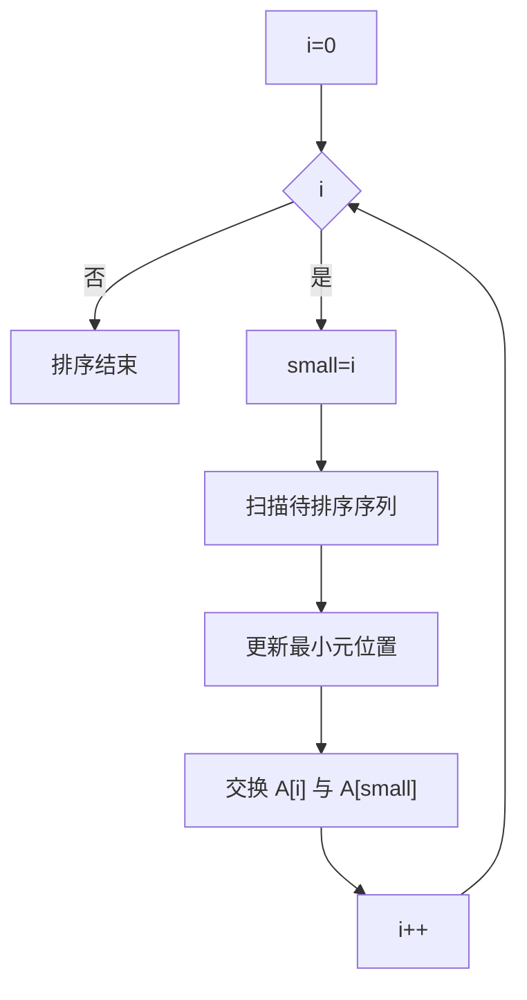

# 简单选择排序算法思想、比较次数与稳定性分析

简单选择排序是一种基于“选择”思想的排序方法。它的核心思路是：每一趟从当前待排序序列中选出最小元素，与待排序序列的第一个元素交换位置，从而逐步确定有序序列。

## 算法思想与执行过程

设待排序元素存放在数组 `A[0..n-1]` 中。第 $i$ 趟开始时，前 $i$ 个元素已经有序，待排序序列为 `A[i..n-1]`。算法先令 `small=i`，再用 `small` 记录当前最小元素的位置，依次比较 `A[j]` 与 `A[small]`。若发现更小的元素，就更新 `small`。本趟比较结束后，执行 `Swap(A[i], A[small])`。

例如，对序列 $(49,38,65,97,76)$ 排序：

| 趟数 | 本趟选出的最小元 | 交换后的序列 |
|---|---:|---|
| 第1趟 | 38 | $(38,49,65,97,76)$ |
| 第2趟 | 49 | $(38,49,65,97,76)$ |
| 第3趟 | 65 | $(38,49,65,97,76)$ |
| 第4趟 | 76 | $(38,49,65,76,97)$ |

可以看到，==每趟结束后，当前最小元素被放到其最终位置==，因此经过 $n-1$ 趟后，前 $n-1$ 个元素均已就位，最后一个元素也自然有序。

## 比较次数与时间复杂度

第 $i$ 趟（$i$ 从 $1$ 开始计数）需要在剩余的 $n-i+1$ 个元素中选最小元，共比较 $n-i$ 次。因此总比较次数为

$$
\sum_{i=1}^{n-1}(n-i)
=(n-1)+(n-2)+\cdots+1
=\frac{n(n-1)}{2}.
$$

无论初始序列有序、逆序还是随机，算法都要完成这些比较，所以最好、最坏和平均情况下的时间复杂度均为

$$
O(n^2).
$$

每趟最多进行一次交换，一次交换通常需要 $3$ 次元素移动，因此最多交换 $n-1$ 次，移动元素 $3(n-1)$ 次。若某趟最小元已经在 `A[i]` 处，则不必实际交换。

> [!IMPORTANT]
> 简单选择排序的比较次数固定为 $\dfrac{n(n-1)}{2}$，==交换次数最多为 $n-1$ 次==。它虽然比较次数较多，但元素交换次数较少。

## 稳定性分析与常见误区

排序的稳定性是指：关键字相同的元素，排序后相对先后次序不变。简单选择排序在交换最小元时，可能把前面的元素越过同关键字元素放到后面，因此它==不稳定==。

例如序列 $(2_a,2_b,1)$：第一趟选出最小元 $1$，与 $2_a$ 交换，得到 $(1,2_b,2_a)$。原来 $2_a$ 在 $2_b$ 前，排序后却位于其后，所以稳定性被破坏。

> [!WARNING]
> “每趟只交换一次”不代表稳定。稳定性取决于相同关键字的相对次序是否可能改变，而不是交换次数多少。

与相近算法比较如下：

| 算法 | 一趟后的特点 | 稳定性 |
|---|---|---|
| 简单选择排序 | 选出的最小元确定最终位置 | 不稳定 |
| 冒泡排序 | 通常有一个元素到达最终位置 | 稳定 |
| 直接插入排序 | 只扩大前部有序区，不保证任何元素到达最终位置 | 稳定 |

因此，选择题“经过一趟排序后，不能确定任何一个元素最终位置的排序算法”应选 **直接插入排序**。
