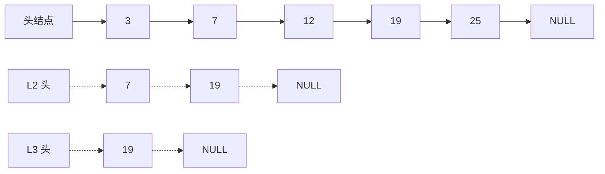

# 跳表（Skip List）的基本概念

## 跳表的基本概念

链表在查找上有个先天不足：即使链表本身有序，查找一个结点仍需从头到尾一个个比较，时间复杂度 $O(n)$。数组可以用二分查找做到 $O(\log n)$，但链表没有下标，没法直接“跳到中间”。

跳表（Skip List）的思路很直接：==给链表增加若干层“快速通道”==，让查找过程可以跳过大量结点，从而把有序链表的查找时间降到 $O(\log n)$。

> [!IMPORTANT]
> 跳表是在**有序链表**之上叠加多层索引而构成的一种**随机化数据结构**，查找、插入、删除的期望时间复杂度均为 $O(\log n)$，最坏情况退化为 $O(n)$。

### 它是什么

跳表由若干层链表组成：

- **第 0 层（L0）**：包含全部结点的普通有序链表。
- **第 1 层（L1）**：包含 L0 中约一半的结点，作为“快速通道”。
- **第 2 层（L2）**：包含 L1 中约一半的结点。
- 以此类推，最高层只剩极少结点（通常 2 个左右）。

每个结点在插入时通过**随机掷硬币**的方式决定它向上“晋升”到哪一层：结点出现在 L0 的概率为 1，出现在 L1 的概率为 $\frac{1}{2}$，出现在 L2 的概率为 $\frac{1}{4}$，……第 $k$ 层的概率为 $\frac{1}{2^k}$。

> [!NOTE]
> 跳表是“以空间换时间”的典型：多层索引占用额外指针空间，换来接近二分查找的效率。与完全平衡的二叉搜索树（如 AVL 树）相比，跳表**不需要旋转调整**，实现更简单，且支持高效的范围查找。

### 为什么需要跳表

有序链表无法二分查找，而跳表通过多层索引让链表“可跳跃”。比如查找 25：

1. 从最高层 L3 的头结点出发，看下一个结点 19 —— 比 25 小，可以前进。
2. 19 的下一个是 NULL，说明方向不对，下降一层到 L2。
3. 在 L2 从 19 继续看下一个 NULL，再下降到 L1。
4. L1 中 19 的下一个是 NULL，降到 L0。
5. L0 中 19 的下一个正是 25，命中。

整个过程只比较了约 $O(\log n)$ 次，而不必从 3 一路扫过去。

### 怎么用

**查找**：从最高层头结点出发，在当前层尽量向右走，直到下一个结点的关键字大于目标值，则下降一层继续；到 L0 后若找到则返回，否则查找失败。

**插入**：先随机决定新结点的层数 $k$（掷硬币：正面就升一层，反面停止），然后从最高层向下逐层找到每一层的插入位置，修改指针。需要更新沿途各层的前驱指针。

**删除**：类似查找，在每一层找到该结点后摘除，并调整前驱指针。

### 与散列表的区别

| 方面 | 跳表 | 散列表 |
|---|---|---|
| 查找依据 | 关键字**有序**，逐层比较 | 哈希函数直接计算地址 |
| 范围查找 | 天然支持（L0 有序遍历） | 不直接支持 |
| 最坏时间 | $O(n)$ | $O(n)$（冲突严重时） |
| 额外空间 | 多层指针 | 表长和装载因子相关 |

跳表属于第 8 章“跳表和散列表”的前半部分，与散列表是两种完全不同的查找技术：跳表依赖**有序性与多层索引**，散列表依赖**哈希函数与冲突处理**。

> [!TIP]
> 记忆要点：跳表 = 有序链表 + 多层索引 + 随机晋升；散列表 = 关键字映射 + 冲突解决。南邮考试中，跳表常考概念辨析和查找过程描述，散列表常考构造与冲突处理计算。

> [!WARNING]
> 常见坑：跳表要求**底层链表关键字有序**，否则“跳跃”会漏掉结点；插入时每层的指针都要正确更新，漏改某一层会导致索引失效；不要把“最坏 $O(n)$”等同于“总是 $O(n)$”，期望复杂度才是 $O(\log n)$。
