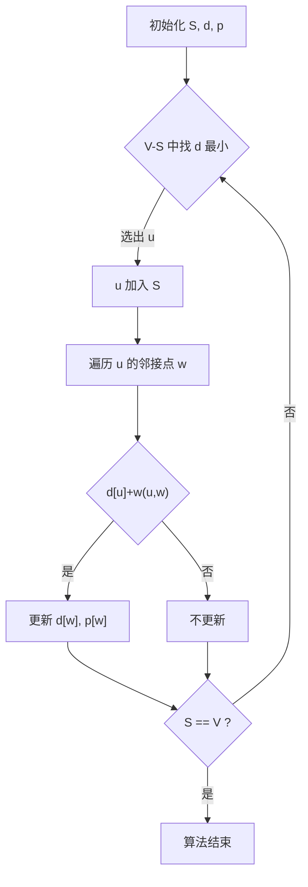

# 单源最短路径与迪杰斯特拉（Dijkstra）算法

> [!IMPORTANT]
> 单源最短路径问题：给定带权有向图 $G=(V,E)$ 和源点 $v$，求从 $v$ 到其余各顶点的最短路径。迪杰斯特拉（Dijkstra）算法采用==贪心策略==，按最短路径长度非递减次序逐步产生最短路径。

## 为什么不能直接用 BFS？

BFS 能求无权图的最短路径，但一旦边有了不同权值，层数少不代表总代价小。我们需要一种机制，每次挑出“当前离源点最近”的顶点，确认它的最短距离，再用它去更新别人。这正是 Dijkstra 算法的核心思想。

## 算法怎么做

将顶点集分为已确定最短路径的集合 $S$ 和未确定的 $V-S$。算法每一步从 $V-S$ 中选出 `d` 值最小的顶点加入 $S$，并对其邻接点进行**松弛**操作，直到 $S=V$。

课件中 C++ 函数签名为 `void Dijkstra(int v, T* d, int* p);`，用到的关键数据结构如下：

- **图存储**：采用==邻接矩阵==。
- **数组 `d`**：`d[i]` 存放源点 $v$ 到顶点 $i$ 的当前最短路径长度。若 $i \in V-S$，则 `d[i]` 定义为“由已产生的最短路径再扩充一条边”所形成的当前最短路径。
- **数组 `p`**（即课件中的 `path`）：记录最短路径上顶点的前驱，用于回溯完整路径。
- **标记数组 `mark`**：标识顶点是否已加入 $S$。

> [!TIP]
> 记忆口诀：“选最小、加入 S、松弛邻居”。与 Prim 算法对比着记：Prim 比较的是新点到**生成树**的距离（`lowcost`），Dijkstra 比较的是新点到**源点**的总距离（`d`）。

## 与相近概念的区别

| 对比维度 | Dijkstra 算法 | Prim 算法 | Floyd 算法 |
| :--- | :--- | :--- | :--- |
| **解决问题** | 单源最短路径 | 最小代价生成树 | 所有顶点间最短路径 |
| **核心数组含义** | `d[i]`：到源点的总路径长 | `lowcost[i]`：到树的最小边权 | 二维距离矩阵 |
| **适用图类型** | 带权有向图/无向图 | 带权无向连通图 | 任意两对顶点间 |
| **时间复杂度** | $O(n^2)$ | $O(n^2)$ | $O(n^3)$ |

> [!NOTE]
> 求所有顶点之间的最短路径时，可以以每个顶点为源点重复执行 Dijkstra 算法 $n$ 次，总时间同样为 $O(n^3)$，但形式上不如 Floyd 算法简洁直接。

## 常见的坑

> [!CAUTION]
> ==Dijkstra 算法要求图中不能有负权边！== 如果存在负权边，已加入 $S$ 的顶点可能通过负权边获得更短路径，导致贪心策略失效。

> [!WARNING]
> 即使只需求源点到**某一个**特定顶点的最短路径，最坏情况下仍需扫描整个图，时间复杂度依然是 $O(n^2)$。

## 手算示例

设有向图 4 个顶点 $\{0,1,2,3\}$，邻接矩阵权值如下（$\infty$ 表示无直达边）：

$$
\begin{matrix}
 & 0 & 1 & 2 & 3 \\
0 & 0 & 2 & 6 & \infty \\
1 & \infty & 0 & 3 & 5 \\
2 & \infty & \infty & 0 & 1 \\
3 & \infty & \infty & \infty & 0
\end{matrix}
$$

以顶点 $0$ 为源点执行 Dijkstra：

1. **初始**：$S=\{0\}$，`d = [0, 2, 6, ∞]`，`p = [0, 0, 0, -1]`。
2. **第 1 步**：$V-S$ 中 `d` 最小为顶点 $1$（`d[1]=2`），$1$ 加入 $S$。松弛 $1$ 的邻居：`d[2] > d[1]+3` 即 $6 > 5$，更新 `d[2]=5`, `p[2]=1`；`d[3] > d[1]+5` 即 $\infty > 7$，更新 `d[3]=7`, `p[3]=1`。
3. **第 2 步**：$V-S$ 中 `d` 最小为顶点 $2$（`d[2]=5`），$2$ 加入 $S$。松弛 $2$ 的邻居：`d[3] > d[2]+1` 即 $7 > 6$，更新 `d[3]=6`, `p[3]=2`。
4. **第 3 步**：顶点 $3$ 加入 $S$，算法结束。

最终结果：`d = [0, 2, 5, 6]`，源点 $0$ 到各顶点的最短路径长度分别为 $0, 2, 5, 6$。
