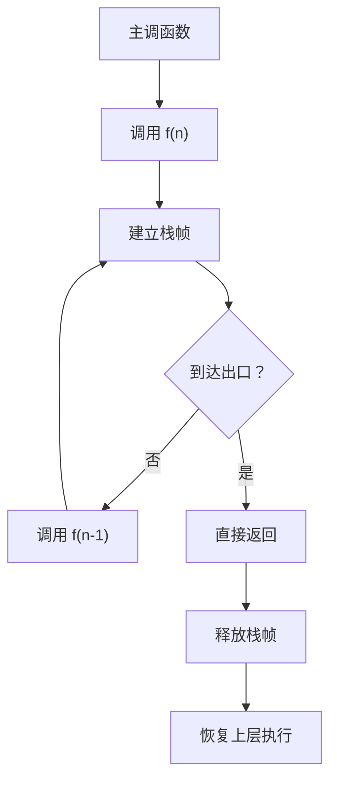

# 递归的概念、递归函数的执行过程与系统栈的活动记录（帧）

## 递归的概念

==递归==是指一个函数直接或间接调用自身，把原问题分解为规模更小、结构相同的子问题。递归定义通常包含两部分：

- **递归出口**：能够直接得到答案，不再继续调用自身；
- **递归体**：将问题转化为一个或多个更小的同类问题。

例如，二叉树的叶子数可定义为：

$$
L(T)=
\begin{cases}
0, & T=\varnothing\\[2pt]
1, & T\text{ 只有一个结点}\\[2pt]
L(T_l)+L(T_r), & \text{其他情况}
\end{cases}
$$

其中 $T_l,T_r$ 分别表示左、右子树。这里“空树”和“叶子结点”就是递归出口。

> [!IMPORTANT]
> 正确的递归必须同时满足：**问题规模不断缩小**，并且**最终能够到达递归出口**。否则可能无限递归，直至栈溢出。

## 递归函数的执行过程

调用递归函数时，系统并不是只保存一个返回地址，而是为每次调用建立一份独立的**活动记录**，也称**栈帧**。栈帧通常保存：

| 保存内容 | 作用 |
|---|---|
| 返回地址 | 指明调用结束后从哪里继续执行 |
| 局部变量 | 保存本次调用的临时数据 |
| 参数 | 保存本次调用的实参信息 |
| 返回值的传递信息 | 将子调用结果交回调用者 |
| 必要的现场信息 | 恢复寄存器等执行状态 |

这些活动记录按照“==后调用、先返回==”的顺序进入和退出系统栈，因此使用栈管理递归调用。



递归执行可分为两个阶段：**递推**是不断调用自身、压入栈帧；**回归**是逐层返回结果、弹出栈帧。每层调用都有自己的参数和局部变量，不能把它们理解为共用一份数据。

## 算对了的例子：统计叶子结点

在以二叉链表表示的二叉树类 `BinaryTree` 中，可增加如下递归成员函数：

```cpp
template <class T>
int BinaryTree<T>::LeavesInTree(TreeNode<T>* root) {
    if (root == NULL)
        return 0;

    if (root->leftChild == NULL && root->rightChild == NULL)
        return 1;

    return LeavesInTree(root->leftChild)
         + LeavesInTree(root->rightChild);
}
```

若题目只给出无参原型 `LeavesInTree()`，通常由它调用上述辅助函数，并传入树根指针，例如：

```cpp
template <class T>
int BinaryTree<T>::LeavesInTree() {
    return LeavesInTree(root);
}
```

这里假设类的数据成员 `root` 指向树根；具体名称以题目给定类定义为准。

对下面的二叉树：

```text
        A
       / \
      B   C
         / \
        D   E
```

调用过程为：

$$
\begin{aligned}
L(A)&=L(B)+L(C)\\
    &=1+(L(D)+L(E))\\
    &=1+(1+1)=3
\end{aligned}
$$

因此叶子结点为 `B、D、E`，答案是 **3**。计算 `L(C)` 时，必须先等待 `L(D)`、`L(E)` 返回；这正是系统栈保存各层调用现场的意义。

> [!TIP]
> 写二叉树递归题时，先问两句：**空树返回什么？当前结点能直接回答什么？** 剩下的通常就是“左子树结果与右子树结果如何合并”。

## 与相近概念的区别及常见坑

| 概念 | 主要特点 | 与递归的关系 |
|---|---|---|
| 递归 | 函数调用自身，代码贴近递归定义 | 依赖系统栈保存调用现场 |
| 循环 | 用 `for`、`while` 重复执行 | 某些递归可改写成循环 |
| 显式栈模拟 | 程序员自行建立栈保存状态 | 可消除递归，但控制更复杂 |

> [!WARNING]
> 常见错误有：漏写 `root == NULL`，导致空指针访问；把“只有一个孩子”的结点误判为叶子；重复统计当前结点；误认为每次递归调用共用局部变量。叶子结点的判定必须是**左、右孩子均为空**。

递归代码简洁，但并非没有代价：每次调用都需要建立和撤销栈帧，递归过深可能造成**栈溢出**。若递归树中存在大量重复子问题，还可能重复计算；此时可考虑记忆化、动态规划或显式栈，而不能简单地认为“递归一定比循环高效”。
