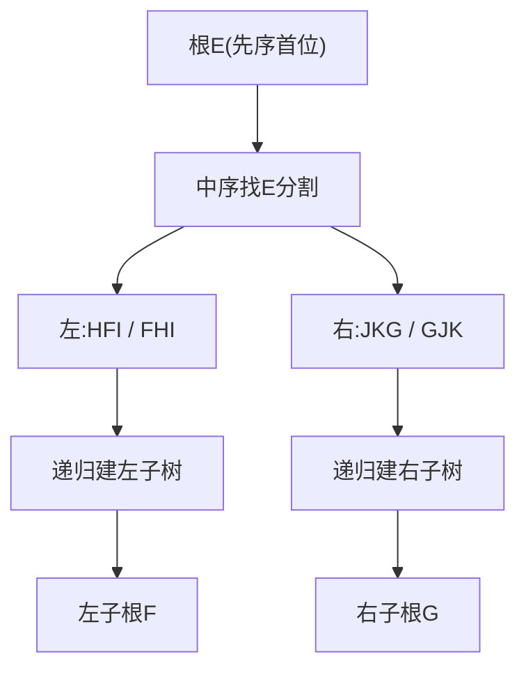

# 由遍历序列（如先序和中序）确定唯一二叉树

## 为什么需要两种序列才能确定二叉树？

仅凭先序序列 `A B C`，你能画出唯一的树吗？不能，它可能是左斜树、右斜树或完全二叉树。==单一遍历序列丢失了左右子树的边界信息==。中序遍历的核心价值在于提供“分割点”：根结点在中序序列中的位置，天然将序列划分为左子树和右子树两部分。因此，==必须包含中序遍历==，配合先序或后序（提供根结点信息），才能唯一重构二叉树。

> [!IMPORTANT]
> 唯一确定的充要条件：**中序 + 先序** 或 **中序 + 后序**。仅凭先序+后序无法唯一确定（除非是真二叉树）。

## 如何由先序和中序构造二叉树？

构造过程本质是递归地“找根-划分-建树”。以真题为例：先序 `EFHIGJK`，中序 `HFIEJKG`。

1.  **定根**：先序首字符 `E` 为整棵树的根。
2.  **划分**：在中序 `HFIEJKG` 中找到 `E`，其左侧 `HFI` 为左子树中序，右侧 `JKG` 为右子树中序。
3.  **对应**：左子树含3个结点，故先序中 `E` 之后3个字符 `FHI` 为左子树先序；剩余 `GJK` 为右子树先序。
4.  **递归**：对左子树（先序`FHI`/中序`HFI`）和右子树（先序`GJK`/中序`JKG`）重复上述步骤。

> [!TIP]
> 解题口诀：**先序定根，中序分左右，长度对齐再递归**。右子树的根永远是先序序列中“跳过左子树长度”后的第一个结点。上例中左子树长3，故右子树根为先序第 $1+3+1=5$ 位的 `G`。

## 后序+中序与先序+中序有何区别？

两者核心逻辑一致，唯一差异在于==根结点的位置==：先序的根在序列**首部**，后序的根在序列**尾部**。例如后序 `HIFKJGE` + 中序 `HFIEJKG`，根为后序末位 `E`，划分方式完全相同。

| 组合 | 根的位置 | 左子树序列提取 | 适用场景 |
| :--- | :--- | :--- | :--- |
| 先序+中序 | 先序首位 | 先序中紧随根之后k个 | 正向构建、表达式前缀 |
| 后序+中序 | 后序末位 | 后序中前k个 | 逆向验证、表达式后缀 |

> [!WARNING]
> 常见坑：划分时==左右子树结点数必须严格相等==。若先序左子树取了m个，中序左子树也必须是m个，否则说明序列有误或划分错误。考试中常在此处设置陷阱。

## 实战验证：求根结点右子树的根

回顾选择题：先序 `EFHIGJK`，中序 `HFIEJKG`，求右子树的根。

- 先序首位 `E` → 根
- 中序中 `E` 左侧 `HFI`（3个）→ 左子树
- 先序中跳过3个：`E`→`FHI`→**`G`** → 右子树根为 `G`

答案选 C。此题无需画出完整树，==只需一次划分即可定位==，这正是该知识点在考试中的高效解法。
