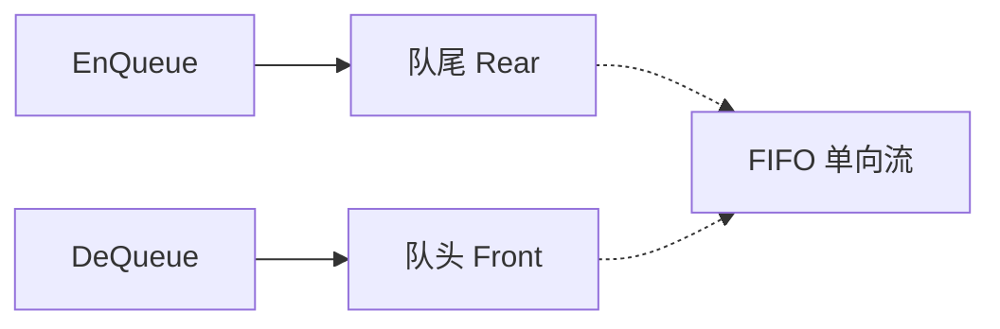

# 队列的抽象数据类型（ADT）及顺序表示（假溢出问题）

## 队列ADT与顺序存储的困境

队列（Queue）是一种==先进先出（FIFO）==的线性表。如果栈是“死胡同”，队列就是“单行道”。为什么不能直接用数组模拟？因为普通顺序队列在反复入队出队后，会出现“假溢出”：数组前端有空位，但 `Rear` 已指向末尾，无法继续插入。

> [!IMPORTANT]
> 队列ADT的核心操作约束
> `EnQueue` 仅在队尾插入，`DeQueue` 仅在队头删除。任何违背此原则的操作都破坏了队列抽象。

## 循环队列：破解假溢出

如何解决空间浪费？将数组逻辑上==首尾相接==构成环。此时指针移动不再是简单的 `+1`，而是取模运算：

$$
\text{Rear} = (\text{Rear} + 1) \bmod \text{MaxSize}
$$

$$
\text{Front} = (\text{Front} + 1) \bmod \text{MaxSize}
$$

| 对比项 | 普通顺序队列 | 循环队列 |
| :--- | :--- | :--- |
| 指针移动 | 线性递增 | 取模循环 |
| 空间利用 | 一次性，易假溢出 | 可重复利用 |
| 判空条件 | `Front == Rear` | `Front == Rear` |
| 判满条件 | `Rear == MaxSize-1` | `(Rear+1)%MaxSize==Front` |

> [!WARNING]
> 判空与判满的二义性陷阱
> 循环队列中 `Front == Rear` 既可能是空也可能是满。==必须牺牲一个存储单元==，规定队满条件为 `(Rear + 1) % MaxSize == Front`，以此区分两种状态。

## 真题实战：判空条件的本质

回顾填空题：“循环队列队头指针 `Front`，队尾指针 `Rear`，则 ______ 时为空队列。”

思考：在循环队列中，什么状态下头尾指针会重合？只有当所有元素都被 `DeQueue` 后，`Front` 才会追上 `Rear`。因此答案必然是 `Front == Rear`。

> [!TIP]
> 解题口诀
> “==空看相等，满看差一==”。判空直接比指针；判满先计算 `Rear + 1`，再对 `MaxSize` 取模，最后与 `Front` 比较。这里采用空出一个单元的方案，该空位不是搜索算法中的监视哨。

[!CAUTION]
> 高危误区：混淆物理下标与逻辑长度
> 计算队列元素个数时，切勿直接用 `Rear - Front`。正确公式为：
> $$
> \text{Length} = (\text{Rear} - \text{Front} + \text{MaxSize}) \bmod \text{MaxSize}
> $$
> 忘记加 `MaxSize` 会导致负数结果，这是考试与编程中最常见的低级错误。
