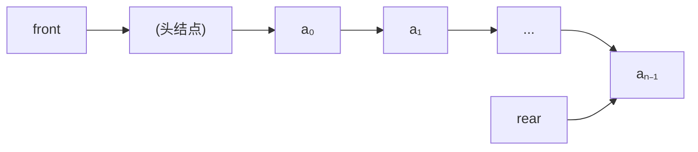

# 队列的链接表示（链队列入队、出队）

## 为什么需要链队列

顺序队列在出队时若不移动元素，`front` 指针会不断后移导致“假溢出”。虽然循环队列能缓解此问题，但仍需预设固定容量。若数据量波动大或无法预估上限，==链队列通过动态分配节点彻底消除溢出风险==，且入队、出队均为 $O(1)$ 操作，无需搬移元素。

## 结构与核心操作

链队列由两个指针维护：`front` 指向头结点（哨兵），`rear` 指向尾元结点。头结点不存数据，仅用于统一空队与非空队的操作逻辑。



> [!IMPORTANT]
> ==入队改 rear，出队改 front==，两者互不干扰，这是链队列高效的关键。

### 入队操作

新结点始终插入到 `rear` 之后，并更新 `rear` 指向新结点：

```c
void EnQueue(LinkQueue *Q, ElemType x) {
    QNode *s = (QNode *)malloc(sizeof(QNode));
    s->data = x; 
    s->next = NULL;
    Q->rear->next = s;  // 链接到队尾
    Q->rear = s;        // 更新尾指针
}
```

### 出队操作

删除 `front->next` 所指结点。**当队列仅剩一个元素时，出队后必须将 `rear` 重置为 `front`**，否则 `rear` 成为悬空指针：

```c
bool DeQueue(LinkQueue *Q, ElemType *x) {
    if (Q->front == Q->rear) return false; // 判空
    QNode *p = Q->front->next;
    *x = p->data;
    Q->front->next = p->next;
    if (Q->rear == p)       // ==关键边界==
        Q->rear = Q->front; // 队空时修正rear
    free(p);
    return true;
}
```

> [!CAUTION]
> 出队时若忽略 `if (Q->rear == p)` 判断，后续再入队会导致 `rear->next` 访问非法内存，程序崩溃。

## 与相近结构的区别

| 对比项 | 链队列 | 循环顺序队列 | 单链表 |
| :--- | :--- | :--- | :--- |
| 存储方式 | 动态链式 | 静态数组 | 动态链式 |
| 容量限制 | 无（受内存约束） | 固定 MAXSIZE | 无 |
| 出队时间 | $O(1)$ | $O(1)$ | $O(n)$（无前驱指针） |
| 空间开销 | 每结点额外 next 域 | 可能浪费一半空间 | 同链队列 |

> [!TIP]
> 判空条件永远是 `Q->front == Q->rear`，而非 `Q->front == NULL`，因为头结点始终存在。

## 正确执行示例

设初始空队，依次执行 `EnQueue(a)`, `EnQueue(b)`, `DeQueue(&x)`, `DeQueue(&y)`：

1.  入队 a：`rear->next = a_node`，`rear = a_node`
2.  入队 b：`rear->next = b_node`，`rear = b_node`
3.  出队 a：`p = front->next`(即 a)，`front->next = b_node`；因 `rear != p`，不改 rear；释放 a，`x = a`
4.  出队 b：`p = front->next`(即 b)，`front->next = NULL`；因 `rear == p`，执行 `rear = front`；释放 b，`y = b`

此时 `front == rear`，队列为空，状态正确。若第 4 步遗漏 `rear = front`，则 `rear` 仍指向已释放的 b 结点，下次入队将写入非法地址。

> [!NOTE]
> 南邮考题常以代码填空形式考查出队时的边界处理，务必熟记 `if (Q->rear == p) Q->rear = Q->front;` 这一行。
