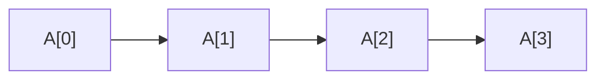
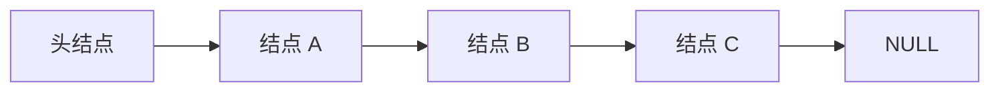
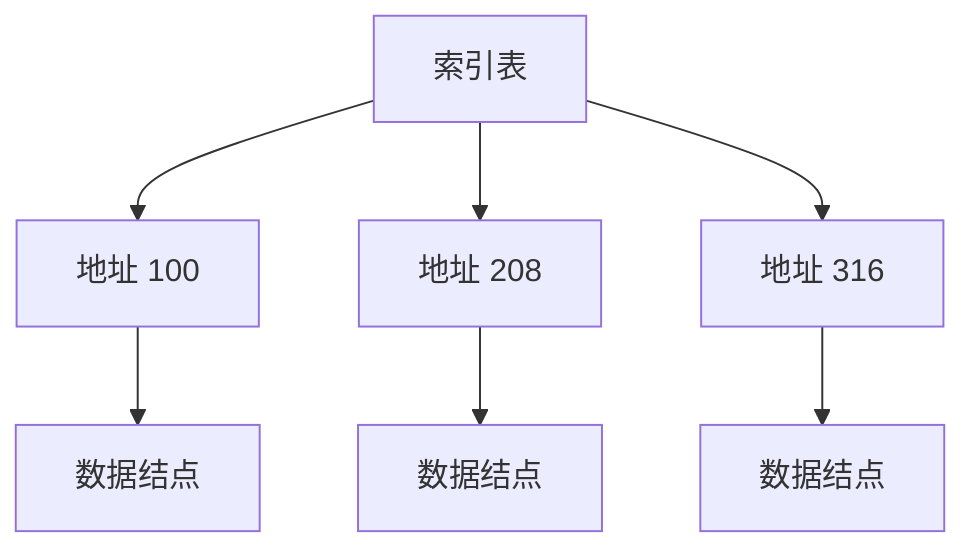

# 数据的存储表示（顺序存储结构、链接存储结构、索引与散列存储）

## 什么是数据的存储表示

同一组逻辑数据可以采用不同的方式在计算机内存放。数据的存储表示，就是把逻辑结构映射为具体的存储单元及其连接关系，主要包括：

- 顺序存储结构
- 链接存储结构
- 索引存储结构
- 散列存储结构

> [!IMPORTANT]
> 存储结构决定元素的物理位置及元素之间的访问方式，因此会直接影响各种基本运算的时间复杂度。

## 顺序存储结构

顺序存储结构把逻辑相邻的元素存放在物理地址相邻的存储单元中，通常使用 C 语言的**数组**实现。



若线性表首地址为 `base`，第 $i$ 个元素占用 $L$ 个存储单元，则其地址为：

$$
LOC(a_i)=LOC(a_1)+(i-1)\times L
$$

因此，按位置访问元素 `Find(i, x)` 可以直接计算地址，==时间复杂度为 $O(1)$==。

> [!TIP]
> 题目中的 `Find(i, x)`：先按序号 $i$ 定位，再比较或返回元素 $x$。顺序表中定位为 $O(1)$，若还要在表中查找值为 $x$ 的元素，则整体通常为 $O(n)$。

顺序存储结构需要预先分配连续空间，插入、删除往往要移动大量元素；但按下标访问方便，且空间利用率较高。

## 链接存储结构

链接存储结构把元素存放在任意位置的结点中，并通过**指针**表示逻辑关系，通常用 C 语言的**结构体和指针**实现。

```c
typedef struct LNode {
    int data;
    struct LNode *next;
} LNode, *LinkList;
```

单链表可表示为：



链表不要求结点连续存放，插入和删除结点时通常只需修改指针；但不能直接计算第 $i$ 个结点的地址，按序号查找需要从头遍历，为 $O(n)$。

> [!WARNING]
> “插入、删除是 $O(1)$”通常指已经获得插入位置或待删除结点指针的情况。若还要先按值查找该结点，整体仍为 $O(n)$。

## 索引存储结构

索引存储结构在数据结点之外，另外建立**索引表**。索引项一般包含关键字和指向相应结点的地址，以便快速定位数据。



索引类似书后的目录：数据本身仍按一定方式存放，索引表负责建立“关键字—地址”的对应关系。关键字有序时，可使用二分查找，使查找复杂度达到 $O(\log n)$；但索引表需要额外空间。

## 散列存储结构

散列存储结构也叫哈希存储结构。它通过**散列函数**把关键字映射为存储地址：

$$
addr=Hash(key)
$$

理想情况下，查找、插入和删除都可达到 $O(1)$；实际复杂度取决于散列函数、装载因子和冲突处理方法。

> [!IMPORTANT]
> 散列是==由关键字直接计算地址==，索引则==通过索引项查找地址==。两者都用于加速查找，但组织方式不同。

## 对比与常见坑

| 存储结构 | 定位方式 | 访问特点 | 主要代价 |
|---|---|---|---|
| 顺序存储 | 地址计算 | 按序号访问 $O(1)$ | 插入、删除需移动元素 |
| 链接存储 | 沿指针访问 | 按序号查找 $O(n)$ | 指针空间，缓存局部性较差 |
| 索引存储 | 查询索引表 | 有序索引可二分查找 | 需维护额外索引 |
| 散列存储 | 计算散列地址 | 平均查找 $O(1)$ | 可能冲突，需处理冲突 |

> [!CAUTION]
> 不要把“存储结构”和“逻辑结构”混为一谈。数组实现顺序表、指针实现链表，是具体存储表示；线性表、栈、队列、树等才是数据的逻辑结构。

## 例题

题目：当采用＿＿存储结构时，线性表中的基本操作 `Find(i, x)` 的算法时间复杂度为 $O(1)$。

答案：**顺序**。

原因：顺序表元素物理位置连续，可由首地址和下标 $i$ 直接计算目标地址，不需要逐个访问前面的元素。因此，仅按序号定位的 `Find(i, x)` 为 $O(1)$；若 `x` 还要求按值查找，则顺序表中通常仍需 $O(n)$。
