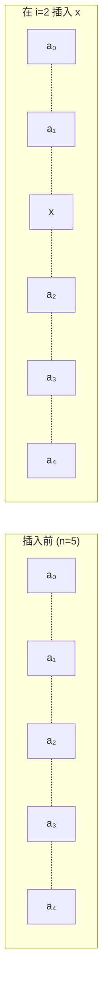

# 线性表的顺序存储表示及插入、删除等基本运算实现

## 顺序表是什么

顺序表是把线性表中的所有元素，按照其逻辑顺序依次存放在**一块地址连续的存储单元**中。在 C 语言里，通常用一个数组和一个记录当前长度的整型变量来实现。

```c
#define MaxSize 100       // 最大容量
typedef struct {
    int data[MaxSize];    // 存储元素的数组
    int length;           // 当前长度
} SqList;
```

**逻辑相邻 ⇔ 物理相邻**——这是顺序表最核心的特征。只要知道第一个元素的地址，表中任意元素的位置都可以直接算出来，所以它是一种**随机存取**的存储结构。

---

## 为什么需要顺序表

当我们需要频繁“按位置读取”数据时，顺序表是首选。它的寻址公式是：

$$\text{Loc}(a_i) = \text{Loc}(a_0) + i \times s$$

其中 $s$ 是每个元素占用的存储单元数。这意味着**读取任意位置元素的时间复杂度是 $O(1)$**。

> [!TIP]
> 选择题中遇到“首地址 + 元素大小 × 索引差”的题型，直接套用上式。不要把索引差算错——**$a_{11}$ 到 $a_{22}$ 相差 $22-11=11$ 个元素**，而不是 10 个。

---

## 插入运算

在顺序表的第 $i$（$0 \le i \le n$）个位置插入新元素，需要将索引为 $i$ 到 $n-1$ 的元素**全部后移一位**，再把新元素填入空位。



**移动元素个数的规律**：
- 在 $i=0$ 前插入：$n$ 个元素全部后移
- 在 $i=n-1$ 后插入（即表尾）：移动 0 个元素
- **一般公式**：在位置 $i$ **之后**插入，移动 $n - i - 1$ 个元素（$i$ 从 0 起）

> [!WARNING]
> 题目中“在位置 i **后**插入”与“在第 i 个位置插入”含义不同。前者 $i$ 是已有元素的下标，插入点在 $i+1$，移动量为 $n-i-1$；后者 $i$ 是目标插入位置序号（通常从 1 起），移动量为 $n-i+1$。**务必看清题目表述**。

**平均移动次数**（等概率插入）：
$$E_i = \sum_{i=0}^{n} \frac{1}{n+1}(n-i) = \frac{n}{2}$$

插入操作的时间复杂度为 $O(n)$。

---

## 删除运算

删除第 $i$（$0 \le i \le n-1$）个位置的元素，需要将 $i+1$ 到 $n-1$ 的元素**全部前移一位**。

**移动个数**：删除位置 $i$ 的元素，移动 $n - i - 1$ 个元素。

**平均移动次数**（等概率删除）：
$$E_d = \sum_{i=0}^{n-1} \frac{1}{n}(n-i-1) = \frac{n-1}{2}$$

删除操作的时间复杂度同样是 $O(n)$。

---

## 与链式存储的对比

| 特性 | 顺序表 | 单链表 |
|---|---|---|
| 存取方式 | 随机存取 $O(1)$ | 顺序存取 $O(n)$ |
| 插入 / 删除 | 需移动元素 $O(n)$ | 仅改指针 $O(1)$（找到位置后） |
| 空间利用 | 连续空间，需预分配 | 动态分配，有指针开销 |

==选择顺序表还是链表，本质上是在“按位置读”和“插入删除”的速度之间做取舍。==

---

## 算对一道题

> 已知顺序表存放 200 个元素，每个元素占 2 个存储单元。$a_{11}$ 首地址为 1022，求 $a_{22}$ 的存储地址。

**解法**：

$a_{22}$ 与 $a_{11}$ 相差 $22 - 11 = 11$ 个元素，每个元素 2 个单元：

$$\text{Loc}(a_{22}) = 1022 + 11 \times 2 = 1044$$

> [!NOTE]
> 常见错误：误把索引差算成 10，以为“第 11 个到第 22 个中间隔了 10 个”。**地址差 = 索引差 × 元素大小，而索引差就是 $j-i$，不需要减 1**。

答案：**B. 1044**
