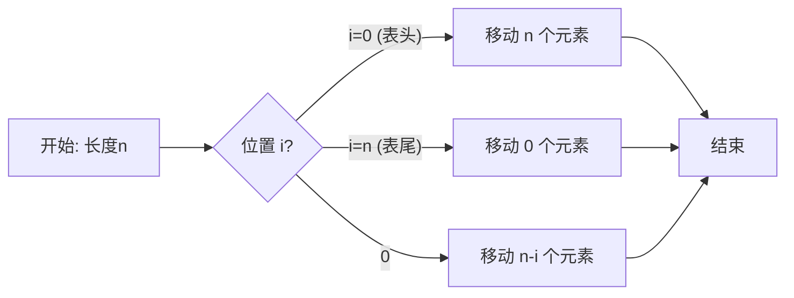

# 顺序表插入与删除操作的元素移动次数及时间复杂度分析

## 顺序表插入与删除的移动分析

在顺序表（Sequential List）中，数据元素在内存中**连续存储**。这一物理特性决定了其逻辑上相邻的元素在物理上也相邻。因此，当我们在中间位置插入或删除元素时，为了保持这种连续性，必须移动其他元素。

==核心结论==：插入和删除操作的时间开销主要取决于==元素移动的次数==，而非比较次数。

### 插入操作的移动规律

假设顺序表当前长度为 $n$，合法插入位置为 $i$ ($0 \le i \le n$)。
若要在位置 $i$ 插入新元素，原位置 $i$ 及之后的所有元素都必须向后移动一位，为新元素腾出空间。

- **移动元素个数**：从下标 $i$ 到 $n-1$ 的元素均需后移，共 $n - i$ 个元素。
- **边界情况**：
    - 表尾插入 ($i=n$)：移动 $0$ 个元素。
    - 表头插入 ($i=0$)：移动 $n$ 个元素。

> [!WARNING]
> 注意题目中对“位置”的定义。若题目定义位置 $i$ 为**第 $i$ 个元素之后**（即下标为 $i$ 的位置之后，或理解为插入到下标 $i+1$ 处），需仔细辨析下标对应关系。南邮考题中常考：在**下标** $i$ 处插入（即原 $a_i$ 变为 $a_{i+1}$），则移动 $n-i$ 个；若在**第 $i$ 个元素后**插入（通常指下标 $i$ 之后，即新元素下标为 $i+1$），则移动 $n-(i+1) = n-i-1$ 个。**务必看清题干是“下标”还是“序号”，以及“之前”还是“之后”。**

针对选择题 8：在位置 $i$（下标 $0 \dots n-1$）**后**插入。
原下标 $i$ 的元素不动，新元素放在 $i+1$。此时，原下标 $i+1$ 到 $n-1$ 的元素需要后移。
移动个数 = $(n-1) - (i+1) + 1 = n - i - 1$。
故选择 **A**。

### 平均移动次数与时间复杂度

假设在每个位置插入的概率相等。对于长度为 $n$ 的表，共有 $n+1$ 个可插入位置（$0$ 到 $n$）。

$$ E_{insert} = \sum_{i=0}^{n} P_i \cdot C_i = \sum_{i=0}^{n} \frac{1}{n+1} (n-i) = \frac{n}{2} $$

同理，删除操作中，删除第 $i$ 个元素（下标 $i$，$0 \le i \le n-1$）需移动 $n-i-1$ 个元素。平均移动次数也为 $\frac{n-1}{2} \approx \frac{n}{2}$。

> [!IMPORTANT]
> 无论插入还是删除，平均时间复杂度均为 ==$O(n)$==。这是顺序表相比链表的主要劣势。

### 常见误区与对比

| 特性 | 顺序表 (SeqList) | 单链表 (LinkedList) |
| :--- | :--- | :--- |
| **插入/删除核心操作** | **移动元素** | **修改指针** |
| **最好情况** | $O(1)$ (表尾) | $O(1)$ (已知节点) |
| **最坏情况** | $O(n)$ (表头) | $O(n)$ (查找前驱) |
| **平均复杂度** | $O(n)$ | $O(n)$ (含查找) |

> [!TIP]
> 记忆公式：
> 插入平均移动 $\frac{n}{2}$，删除平均移动 $\frac{n-1}{2}$。
> 考试填空若只需填近似值或通式，$\frac{n}{2}$ 是最常见的标准答案。

### 典型例题解析

**题目**：在顺序表长度为 $n$ 中，平均在表中插入一个元素需要移动元素的个数？

**解析**：
1.  确定概率：每个位置插入概率为 $\frac{1}{n+1}$。
2.  确定代价：在下标 $i$ 处插入，移动 $n-i$ 个元素。
3.  求期望：
    $$ E = \frac{1}{n+1} \sum_{i=0}^{n} (n-i) = \frac{1}{n+1} (n + (n-1) + \dots + 0) = \frac{1}{n+1} \cdot \frac{n(n+1)}{2} = \frac{n}{2} $$

**答案**：$\frac{n}{2}$
