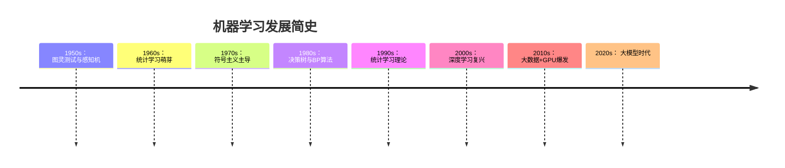
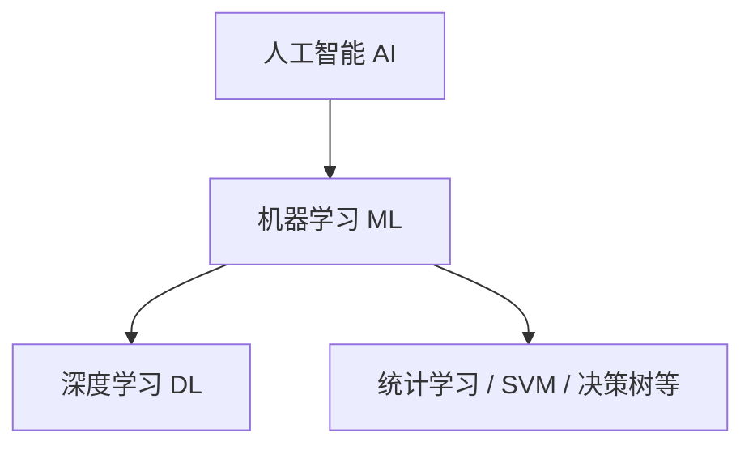

# AI入门学习路径（发展历程、应用领域）

## AI 入门学习路径：发展历程与应用领域

在正式进入模型与算法之前，先回答一个问题：**这门课到底在学什么，为什么现在学它？** 机器学习（Machine Learning, ML）是人工智能（Artificial Intelligence, AI）的核心分支，研究“如何让计算机从数据中自动学习规律，并用规律做预测或决策”。南邮《人工智能与机器学习》课程的第 1 章将它放在“机器学习和统计学习概论”中，意味着你首先要建立的是==全局地图==，而不是立刻陷入某个公式。

### 为什么需要了解发展历程

了解发展历程不是为了背年份，而是为了理解：**一个方法的兴衰往往由“数据规模 + 算力 + 理论突破”三者共同决定**。今天课堂上默认的“常识”，可能十年前还不存在；现在被冷落的方法，也曾在特定历史条件下是最优解。

> [!TIP]
> 记忆主线：1950s 奠基 → 1980s 连接主义回归 → 1990s 统计学习成熟 → 2010s 深度学习爆发。南邮考试若问“发展历程”，按这四段展开即可拿分。

### 发展历程中的关键转折

早期（1950–1960s）的代表是 Rosenblatt 的感知机，但 Minsky 在 1969 年指出单层感知机连 XOR 都学不了，直接导致神经网络研究进入寒冬。这个“坑”告诉我们：==模型容量不足时，再好的数据也救不了==。

1980s 连接主义回归，靠的是 Hopfield 网络与 Rumelhart 等人重新推广的反向传播（BP）算法。随后 1990s 统计学习逐渐成熟，Vapnik 等人提出的支持向量机（SVM）与统计学习理论，让“泛化误差界”“结构风险最小化”成为课程的核心概念——这也正是南邮第 1 章强调“统计学习”的原因。

2012 年 AlexNet 在 ImageNet 上大幅刷新记录，标志着深度学习第三次崛起。此后，数据规模、GPU 算力与网络结构三者形成正循环，延伸到今天的大模型。

### 应用领域：机器学习在做什么

机器学习几乎渗透了信息学科的每个角落。南邮课程中常见应用领域可以归纳为：

| 应用领域 | 典型任务 | 常用方法 |
|---------|---------|---------|
| 计算机视觉 | 图像分类、目标检测、人脸识别 | CNN、ResNet、YOLO |
| 自然语言处理 | 文本分类、机器翻译、问答 | RNN、LSTM、Transformer |
| 语音与音频 | 语音识别、说话人验证 | HMM、DNN、CTC |
| 数据挖掘与推荐 | 用户画像、点击率预估 | 逻辑回归、GBDT、FM |
| 控制与优化 | 自动驾驶、机器人规划 | 强化学习、DQN、PPO |
| 生物信息与安全 | 入侵检测、基因表达分析 | 聚类、随机森林、异常检测 |

> [!IMPORTANT]
> 应用领域考的通常不是“背下这张表”，而是**给定一个场景，让你判断它属于哪类学习问题**：有标签是监督学习，无标签是聚类，靠奖励信号是强化学习。这是第 1 章的基础分。

### 和相近概念的区别

学生最容易把三个词混为一谈：

- **人工智能**：让机器表现出智能行为的宏观目标。
- **机器学习**：实现 AI 的一类方法，核心是“从数据中学习”，而非手工写规则。
- **深度学习**：机器学习的一个子集，使用多层神经网络自动提取特征。

> [!WARNING]
> 不是所有 AI 都是机器学习：早期的专家系统靠人工规则，属于“符号主义 AI”，不学数据。考试若出“AI 与 ML 的关系”，务必强调==ML 是 AI 的子集，DL 又是 ML 的子集==，并用上图说明。

### 一个算对了的例子

假设你在复习时遇到这样一道题：

> 判断下列任务分别属于监督学习、无监督学习还是强化学习：
> (a) 根据历史房价数据预测新房价格；  
> (b) 将一堆新闻自动分成不同主题；  
> (c) 训练机器人走迷宫，到达终点给 +1 分。

正确回答：

- (a) ==监督学习==——有历史成交价作为标签 $y$，做回归。
- (b) ==无监督学习==——没有预先定义的主题标签，靠聚类发现结构。
- (c) ==强化学习==——通过奖励信号 $+1$ 学习策略，不是给定“每一步该怎么走”的正确标签。

> [!NOTE]
> 监督学习与强化学习的本质区别不是“有没有数据”，而是**反馈的形式**：监督学习给出“正确答案 $y$”，强化学习只给“奖励 $r$”，且奖励可能有延迟。

### 常见坑

- **把“发展历程”当成孤立历史背诵**：考试常考“为什么神经网络在 1970s 停滞”，必须答出==XOR 问题 + 算力不足==两条。
- **把应用领域与学习方法割裂**：同一个应用（如推荐系统）既可以用监督学习（点击率预估），也可以用到矩阵分解等无监督思路。
- **忽视统计学习的地位**：南邮课程名为“人工智能与机器学习”，但第 1 章标题强调“统计学习概论”，意味着 SVM、泛化误差、PAC 学习等内容后面都会出现，==统计学习理论是南邮这门课的理论底色==。
