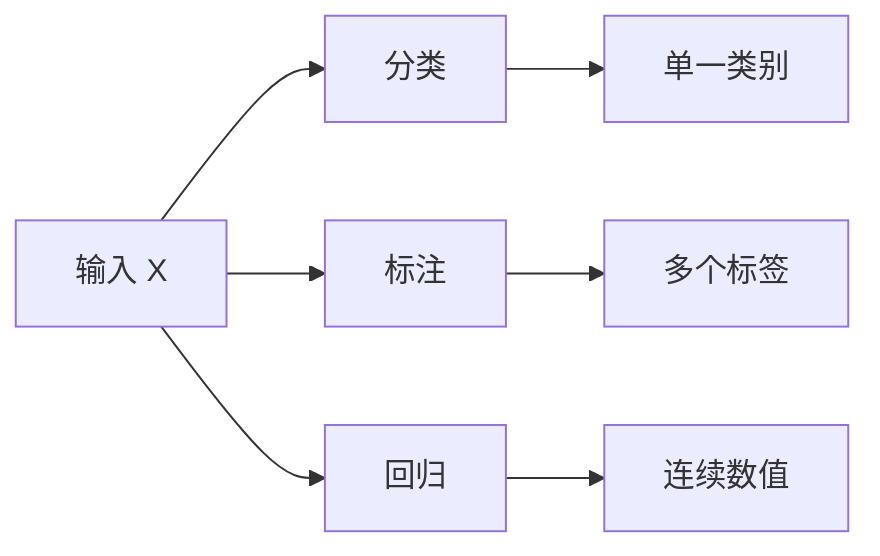

# 分类问题、标注问题与回归问题

## 三类监督学习任务

在机器学习中，监督学习通常根据训练数据 $(X,Y)$ 学习输入 $X$ 到输出 $Y$ 的映射。按照输出变量的类型，可分为==分类问题、标注问题与回归问题==。

| 任务 | 输出 $Y$ 的形式 | 目标 | 常见例子 |
|---|---|---|---|
| 分类问题 | 有限个离散类别 | 判断样本属于哪一类 | 垃圾邮件识别 |
| 标注问题 | 一组离散标签 | 为样本的多个位置或对象分别标类别 | 图像语义分割 |
| 回归问题 | 连续实数 | 预测数值大小 | 房价预测 |

## 分类问题

分类问题学习的是从输入变量到离散类别的映射。若只有两个类别，称为==二分类问题==。课件中常写成：

$$
X\in\mathbb{R}^{n},\qquad Y\in\{-1,+1\}
$$

其中，$X$ 可以由 $n$ 个特征组成，$Y$ 表示类别。例如，以邮件正文和发件人为特征，判断邮件是垃圾邮件还是正常邮件。

二分类模型常输出一个实数得分 $f(X)$，再根据阈值判断类别。例如：

$$
\hat Y=
\begin{cases}
+1,& f(X)\ge 0\\
-1,& f(X)<0
\end{cases}
$$

### 泛化误差上界

分类模型不仅要在训练集上表现良好，更重要的是对未见样本也表现正确。若分类器满足二分类问题的假设，常可用经验分类误差 $\hat R(\alpha)$ 对泛化误差 $R(\alpha)$ 作上界估计：

$$
R(\alpha)\le \hat R(\alpha)+\sqrt{\frac{\ln(2/\delta)}{2m}}
$$

其中，$m$ 为样本数，$\delta>0$ 为置信参数。该结论说明：训练误差越小、样本越多，泛化误差上界通常越低。

> [!IMPORTANT]
> 泛化误差上界不是模型在测试集上的实际误差，而是满足相应条件时可保证的上界。

## 标注问题

标注问题与分类问题相似，但一个样本对应多个标签，且标签之间可能存在结构关系。其目标不是只给整个样本一个类别，而是为样本中的不同位置、实体或像素分别预测标签。

例如，图像分割中，每个像素都属于“道路、车辆、行人、背景”等类别之一。序列标注还会利用相邻标签之间的依赖关系。

> [!NOTE]
> 普通分类是“一次给整个样本定类”；标注是“为样本中的多个对象分别定类”。多标签分类虽然也输出多个标签，但通常不强调标签之间的位置和结构关系。

## 回归问题

==回归模型是表示从输入变量到输出变量之间映射的函数，回归问题的学习等价于函数拟合==。其输出 $Y$ 通常是连续实数：

$$
X\in\mathbb{R}^{n},\qquad Y\in\mathbb{R}
$$

回归模型可写为：

$$
\hat Y=f(X;\theta)
$$

其中 $\theta$ 是待学习的参数。例如，根据面积、楼层和房龄预测房屋价格。

> [!TIP]
> 记忆方法：分类看“类别”，标注看“多个标签”，回归看“连续数值”。

回归学习最常用的损失函数是平方损失：

$$
L(Y,\hat Y)=(Y-\hat Y)^2
$$

在线性模型

$$
\hat Y=w^\mathsf{T}X+b
$$

中，最小化训练集平方损失：

$$
\min_{w,b}\sum_{i=1}^{m}\left(y_i-w^\mathsf{T}x_i-b\right)^2
$$

即可求得参数，这就是著名的==最小二乘法（least squares）==。

## 一个算对的例子

已知两个训练样本：

$$
(X_1,Y_1)=((1),(3)),\qquad (X_2,Y_2)=((2),(5))
$$

用直线 $\hat y=wx+b$ 做最小二乘拟合。模型应恰好通过两点，因此：

$$
w+b=3,\qquad 2w+b=5
$$

两式相减得 $w=2$，代回得 $b=1$。所以回归函数为：

$$
\boxed{\hat y=2x+1}
$$

输入 $X=4$ 时，预测值为 $\hat y=2\times4+1=9$。若目标数值是连续的“价格、温度、年龄”，这属于回归；若目标只有“高/低”两种类别，则应改造为二分类问题。
