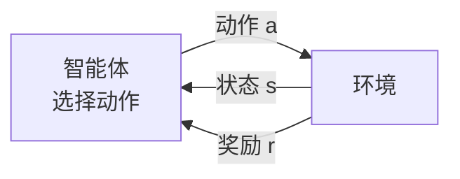

# 监督学习、无监督学习、强化学习与半监督学习

## 四种学习范式的核心区别

先想一个问题：给模型一堆邮件，有的标了“垃圾邮件”，有的没标，还能怎么学？答案取决于**有没有标注、有没有环境反馈**，这正是四种范式的分水岭。

> [!IMPORTANT]
> ==监督学习目的是学习一个由输入到输出的映射，称为模型==；无监督学习从无标注数据中发现结构；强化学习在与环境交互中学策略；半监督学习==利用未标注数据的信息，辅助标注数据，进行监督学习==。

| 范式 | 数据/反馈 | 学习目标 | 典型任务 |
|---|---|---|---|
| 监督学习 | 输入 $x$ 与标注 $y$ | 学输入到输出的映射（模型） | 分类、回归 |
| 无监督学习 | 只有输入 $x$，无 $y$ | 发现数据内在结构 | 聚类、降维 |
| 半监督学习 | 少量标注 + 大量未标注 | 借未标注信息辅助监督学习 | 标注昂贵场景 |
| 强化学习 | 状态、动作、奖励 | 学策略使长期累积奖励最大 | 序贯决策、控制 |

## 监督学习：学一个映射

训练数据写成 $\{(x_i,y_i)\}_{i=1}^{N}$，学习得到一个模型 $f$ 或条件分布 $P(y\mid x)$，使预测 $\hat y=f(x)$ 接近真实 $y$。分类的输出是离散类别，回归的输出是连续数值；两者都是监督学习，区别在输出空间，不在“有没有老师”。

## 无监督与半监督：标注从哪里来

无监督学习没有 $y$，只能根据样本之间的相似性、分布或低维结构组织数据，例如把用户聚成若干群。半监督学习并不是“没有监督”，而是仍有标注数据提供目标，再用未标注数据补充样本分布信息；==未标注数据是辅助，不是替代标注==。

> [!WARNING]
> 聚类后给簇起名字，不等于监督分类：簇编号通常没有预先规定的类别含义。半监督学习也不保证未标注数据越多越好，若辅助假设与真实分布不符，性能可能下降。

## 强化学习：从奖励中学决策

强化学习的马尔可夫决策过程是状态、奖励、动作序列上的随机过程，由五元组 $\langle S,A,P,r,\gamma\rangle$ 组成：$S$ 为状态集合，$A$ 为动作集合，$P$ 为状态转移概率，$r$ 为奖励，$\gamma$ 为折扣因子。智能体依据状态选动作，环境给出下一状态和奖励，反复交互以改进策略。

常用折扣回报为
$$G_t=r_{t+1}+\gamma r_{t+2}+\gamma^2r_{t+3}+\cdots,\qquad 0\le\gamma\le1.$$
$\gamma$ 越小越重视近期奖励；它不同于监督学习中的“正确答案”，奖励只评价行为后果，而且可能延迟出现。

## 一个算对的例子

某状态执行动作后，接下来三步奖励为 $2,0,4$，取 $\gamma=0.5$，则
$$G_t=2+0.5\times0+0.5^2\times4=3.$$
若把回报误算成 $2+0+4=6$，就是漏掉了折扣因子。再判断任务：用 100 封已标注邮件和 900 封未标注邮件训练垃圾邮件分类器，属于==半监督学习==；只有 900 封未标注邮件并分组，才是无监督学习。

> [!TIP]
> 做题先看反馈形式：有 $(x,y)$ 学映射是监督；只有 $x$ 找结构是无监督；两者都有且未标注辅助标注是半监督；按“状态—动作—奖励”序列交互是强化学习。
