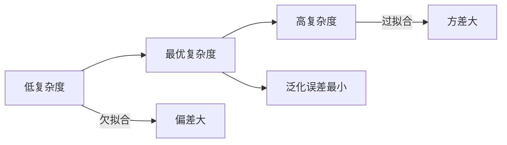
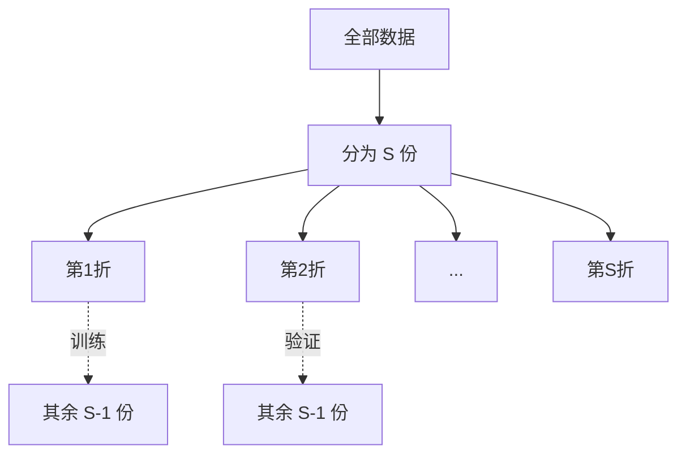

# 模型评估与模型选择（正则化与交叉验证）

## 模型评估与模型选择

前面我们已经知道，学习的目标是让模型在**未见过的数据**上表现好，即泛化误差小。但训练误差好的模型，泛化误差不一定好。给定一个数据集，如何选出一个泛化能力强的模型？这就涉及两个问题：**用什么标准评模型**，以及**用什么方法选模型**。

### 过拟合与结构风险最小化

假设我们用多项式拟合数据。次数越高，训练误差越小，但次数过高时模型把噪声也“背”了下来，测试误差反而上升——这就是**过拟合**。

> [!IMPORTANT]
> 模型选择的核心矛盾是**偏差与方差的权衡**：模型太简单则欠拟合（偏差大），太复杂则过拟合（方差大）。

为了防止过拟合，统计学习引入**结构风险最小化**：在经验风险基础上加一个表示模型复杂度的正则化项。一般形式为

$$
\min_f \ \frac{1}{N}\sum_{i=1}^{N}L(y_i,f(x_i)) + \lambda J(f)
$$

其中 $L$ 是损失函数，$J(f)$ 是正则化项（如 $L_1$ 范数 $\|w\|_1$ 或 $L_2$ 范数 $\|w\|_2$），$\lambda \geq 0$ 控制惩罚强度。

> [!NOTE]
> $L_1$ 正则化倾向于产生**稀疏**解（部分参数恰好为 0，可用于特征选择）；$L_2$ 正则化使参数整体变小但通常非零，也叫**权重衰减**。

### 正则化参数的作用

$\lambda$ 过大 → 模型过于简单 → 欠拟合；$\lambda$ 过小 → 正则化几乎不起作用 → 过拟合。因此 $\lambda$ 本身也是一个需要**选择**的超参数，这就是交叉验证的用武之地。

### 交叉验证

如果只用训练集选模型，训练误差会偏向复杂模型；如果只用测试集调参，测试集就“被污染”了。解决方法是把数据分成互不重叠的几部分，轮流做验证。

- **验证集**：专门划出一部分数据，用于超参数选择，不参与训练。
- **简单交叉验证**：随机把数据分为训练集与验证集，一次划分、一次评估。
- **S 折交叉验证**：将数据等分为 $S$ 份，每次用 $S-1$ 份训练、1 份验证，共训练 $S$ 次，取验证误差的平均值作为该超参数的评价。
- **留一交叉验证**：$S=N$ 的特殊情况，每次只留一个样本做验证。

### 一个算对了的例子

从《人工智能与机器学习》课件中取一道典型题：用 5 折交叉验证比较两个模型。

#### 题目：5 折交叉验证误差计算

**题目**：对某数据集做 5 折交叉验证。模型 A 在 5 次验证集上的误差分别为 $(0.1,\ 0.15,\ 0.2,\ 0.12,\ 0.13)$，模型 B 的误差分别为 $(0.09,\ 0.08,\ 0.35,\ 0.10,\ 0.11)$。请给出两个模型的交叉验证误差，并指出应选哪个模型。

**解答**：

模型 A 的平均验证误差：
$$
\bar e_A = \frac{0.1+0.15+0.2+0.12+0.13}{5} = \frac{0.70}{5} = 0.14
$$

模型 B 的平均验证误差：
$$
\bar e_B = \frac{0.09+0.08+0.35+0.10+0.11}{5} = \frac{0.73}{5} = 0.146
$$

因为 $\bar e_A = 0.14 < 0.146 = \bar e_B$，所以选择模型 A。

> [!WARNING]
> 不能只看单次验证的结果（如第 3 折 B 误差 0.35 很大、第 1 折 B 误差 0.09 比 A 小）。交叉验证看的是**多次验证的平均误差**，因为它估计的是模型在整个数据分布上的期望泛化误差。

### 常见的坑

- 把测试集当作验证集反复调参，最后测试误差过于乐观，==测试集只能用于最终评估==。
- 交叉验证的折数 $S$ 太小（如 $S=2$），验证误差的方差大，选择不稳定；折数太大，计算成本高。
- 正则化项的选择没有绝对标准，$L_2$ 通常作为默认选择，$L_1$ 在需要稀疏解时使用。
- 数据划分时若类别不平衡，应使用==分层抽样==，保证每折中各类别比例与原始数据一致。
