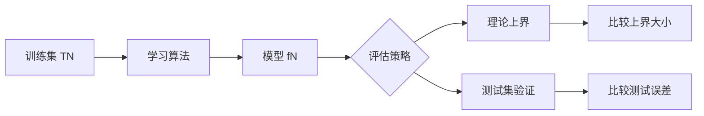

# 泛化能力（generalization ability）

## 什么是泛化能力

如果模型在训练集上表现完美，却在新数据上频频出错，这样的模型有用吗？显然没有。机器学习的终极目标不是“记住”训练样本，而是学习数据背后的真实规律。

> [!IMPORTANT]
> 泛化能力（generalization ability）是指学习得到的模型对==未知数据的预测能力==。它是评价学习方法优劣的根本标准，而非训练误差。

在统计学视角下，这对应着“test set performance”。我们追求的 $\hat{f}$ 必须在整个联合分布 $P(X,Y)$ 上表现良好，而不仅仅是在有限的训练集 $T_N$ 上拟合得漂亮。

## 泛化误差的数学定义

如何量化这种能力？我们需要一个不依赖于特定测试集的指标。

$$
R_{\exp}(\hat{f}) = E_P[L(Y, \hat{f}(X))] = \int_{\mathcal{X} \times \mathcal{Y}} L(y, \hat{f}(x)) P(x, y) \mathrm{d}x \mathrm{d}y
$$

其中 $L$ 为损失函数，$P(x,y)$ 为真实联合概率分布。

> [!NOTE]
> 泛化误差是模型关于==真实分布的期望风险==。由于 $P(x,y)$ 通常未知，实际中我们无法直接计算该积分值，只能通过理论推导或实验手段进行估计。

## 如何评估与比较

既然真值不可得，我们该如何判断模型 A 比模型 B 泛化能力更强？

-   **理论途径**：比较泛化误差上界。若方法 A 的上界始终低于方法 B，则 A 的泛化能力更有保障。这也是统计学习理论的核心贡献。
-   **实践途径**：使用独立的测试集估算 $R(f_N) \approx \frac{1}{M}\sum L(y_i, f_N(x_i))$。注意测试集绝不能参与训练或调参。

> [!TIP]
> 课件术语对照：Machine Learning 中的 "generalization" 对应 Statistics 中的 "test set performance"；"learning" 对应 "fitting"。理解这一映射有助于跨学科阅读文献。

## 与相近概念的区别

| 概念 | 关注对象 | 优化目标 | 典型陷阱 |
| :--- | :--- | :--- | :--- |
| 训练误差 | 已知样本 $T_N$ | 最小化经验风险 | 过拟合，死记硬背 |
| 泛化误差 | 未知分布 $P$ | 最小化期望风险 | 无法直接观测 |
| 验证误差 | 验证集 $V$ | 模型选择/调参 | 误当作最终性能 |

==训练误差低不代表泛化能力强==，二者甚至可能呈现相反趋势。当模型复杂度过高时，训练误差持续下降，但泛化误差先降后升，这就是过拟合的典型表现。

> [!WARNING]
> 切勿用训练误差代替泛化误差来评价模型！这是初学者最常犯的错误。即使训练准确率达到 100%，若测试准确率仅 60%，该模型的泛化能力依然很差。

## 计算示例

假设某分类模型在包含 5 个样本的独立测试集上的预测结果如下（0/1 损失）：

| 样本 | 真实标签 $y$ | 预测值 $\hat{f}(x)$ | 损失 $L$ |
| :--- | :--- | :--- | :--- |
| 1 | 1 | 1 | 0 |
| 2 | 0 | 1 | 1 |
| 3 | 1 | 0 | 1 |
| 4 | 0 | 0 | 0 |
| 5 | 1 | 1 | 0 |

泛化能力的点估计为：
$$
R(f_N) \approx \frac{1}{5}(0+1+1+0+0) = 0.4
$$

> [!CAUTION]
> 此处的 0.4 仅是基于 5 个样本的==经验估计==，并非真实的泛化误差 $R_{\exp}$。样本量越小，估计方差越大。在理论分析题中，应优先使用泛化误差上界公式进行比较，而非依赖小样本测试值。
