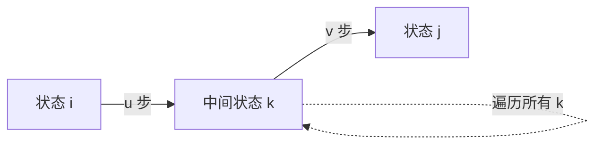

# Chapman-Kolmogorov方程（C-K方程）与n步转移概率

## 为什么要用 $n$ 步转移概率

一步转移概率矩阵 $P$ 只能回答“下一时刻到哪里”。若已知 $X_0=i$，要问“两步后到 $j$ 的概率”，就必须把第一步可能经过的所有状态都考虑进去。齐次马氏链中，$n$ 步转移概率记为
$$
p_{ij}(n)=P\{X_{m+n}=j\mid X_m=i\},
$$
相应的矩阵记为 $P(n)$。齐次性保证它与起始时刻 $m$ 无关。

## C-K方程：按中间状态分解

设状态空间为 $I$。从 $i$ 出发，经 $u+v$ 步到 $j$，可以在第 $u$ 步先到达某个中间状态 $k$，再用 $v$ 步到 $j$。于是
$$
\boxed{p_{ij}(u+v)=\sum_{k\in I}p_{ik}(u)p_{kj}(v)}.
$$
这就是 Chapman-Kolmogorov 方程，简称 C-K 方程。求和必须遍历所有可能的中间状态，而不是只取某一条路径。

> [!IMPORTANT]
> 矩阵形式为 $P(u+v)=P(u)P(v)$。特别地，==齐次马氏链的 $n$ 步转移概率矩阵就是 $P(n)=P^n$==，这里指矩阵乘法，不是把每个元素分别取 $n$ 次方。

## 怎样计算

以状态空间 $I=\{1,2,3\}$、初始分布 $(\frac14,\frac12,\frac14)$ 为例，设
$$
P=\begin{pmatrix}
\frac12&\frac12&0\\
\frac13&\frac13&\frac13\\
0&\frac12&\frac12
\end{pmatrix}.
$$
求 $p_{12}(2)$ 时，按第一步到达的状态分类：
$$
\begin{aligned}
p_{12}(2)
&=\sum_{k=1}^{3}p_{1k}p_{k2}\\
&=\frac12\cdot\frac12+\frac12\cdot\frac13+0\cdot\frac12
=\frac5{12}.
\end{aligned}
$$
若还要求 $P\{X_0=1,X_1=2,X_2=2\}$，则联合使用初始分布、马氏性和乘法公式：
$$
P\{X_0=1\}p_{12}p_{22}
=\frac14\cdot\frac12\cdot\frac13
=\frac1{24}.
$$
这里第二问不能再用 $p_{12}(2)$，因为题目已经指定了中间状态 $X_1=2$。

## 与相近量的区别

| 记号或问题 | 含义 | 常用算法 |
|---|---|---|
| $p_{ij}$ | 一步从 $i$ 到 $j$ | 直接查 $P$ |
| $p_{ij}(n)$ | $n$ 步从 $i$ 到 $j$ | 取 $P^n$ 的第 $(i,j)$ 元 |
| $P\{X_n=j\}$ | 第 $n$ 时刻处于 $j$ 的无条件概率 | 初始分布乘 $P^n$ |
| 指定整条路径的概率 | 初始状态及各中间状态均已给定 | 初始概率乘沿途一步概率 |

> [!WARNING]
> 常见错误有三类：把 $P^2$ 当成元素平方；C-K 方程漏掉中间状态；把 $p_{ij}(2)$ 与 $p_{ij}p_{jj}$ 混为一谈。前者允许两步间经过任何状态，后者只对应指定路径。

> [!TIP]
> 求单个二步概率时，用“$P$ 的第 $i$ 行 $\cdot$ 第 $j$ 列”最快；求完整 $P(2)$ 时再做矩阵乘法。算完可检查每行元素之和是否为 $1$，但这只能排查部分错误，不能代替计算。
