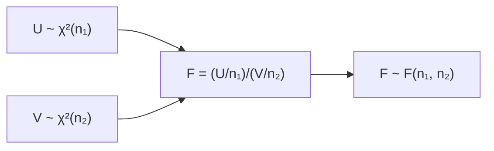

# F分布（定义、性质、上α分位点）

## 从“两个卡方之比”说起

前面已经学了 $\chi^2$ 分布和 $t$ 分布。现在问一个问题：如果要**比较两个总体的方差是否相等**，该怎么构造统计量？

一个自然的想法是：把两个样本方差 $S_1^2$ 和 $S_2^2$ 直接相减？不行——比值更能反映相对差异，而且比值的分布可以严格导出。

而样本方差的标准化恰好与 $\chi^2$ 分布有关：
$$
\frac{(n-1)S^2}{\sigma^2} \sim \chi^2(n-1)
$$
于是比较两个方差，等价于比较两个相互独立的 $\chi^2$ 变量（各自除以自由度之后）的比值。这个比值所服从的分布，就是 ==$F$ 分布==。

> [!IMPORTANT]
> $F$ 分布的本质：**两个相互独立的 $\chi^2$ 变量除以各自自由度之后的比值**，专门用来做方差比较。

## F 分布的定义

设 $U \sim \chi^2(n_1)$，$V \sim \chi^2(n_2)$，且 $U$ 与 $V$ 相互独立，则称
$$
F = \frac{U / n_1}{V / n_2}
$$
服从自由度为 $(n_1, n_2)$ 的 $F$ 分布，记为
$$
F \sim F(n_1, n_2)
$$

其中 $n_1$ 称为**第一自由度（分子自由度）**，$n_2$ 称为**第二自由度（分母自由度）**。

> [!WARNING]
> 两个自由度的位置不能写反：$F(n_1, n_2)$ 中 $n_1$ 对应分子，$n_2$ 对应分母。写反了分布完全不同。

概率密度曲线的形状：右偏、非对称、取值非负。

## 核心性质

### 性质一：倒数仍服从 F 分布

若 $F \sim F(n_1, n_2)$，则
$$
\frac{1}{F} \sim F(n_2, n_1)
$$
注意自由度**对调**，这是后面推导分位点关系的基础。

### 性质二：上 α 分位点

称满足
$$
P\bigl(F > F_\alpha(n_1, n_2)\bigr) = \alpha
$$
的点 $F_\alpha(n_1, n_2)$ 为 $F$ 分布的上 $\alpha$ 分位点。

由于 $F$ 分布不对称，**下侧分位点不能直接取负**，这是它与标准正态、$t$ 分布最大的不同。

利用性质一可得常用换算公式：
$$
F_{1-\alpha}(n_1, n_2) = \frac{1}{F_\alpha(n_2, n_1)}
$$

> [!TIP]
> 查表时通常只给出较大的 $\alpha$ 值（如 $0.05$、$0.025$）对应的分位点。若需要 $F_{0.975}$，用上述公式**取倒数并对调自由度**即可。

## 一个算对了的例子

已知 $F \sim F(2,8)$，求 $\dfrac{1}{F}$ 的分布。

由性质一：
$$
\frac{1}{F} \sim F(8,2)
$$

再看填空中常见的另一问：$T \sim t(n)$，则 $T^2 \sim ?$

设 $T = \dfrac{X}{\sqrt{Y/n}}$，其中 $X \sim N(0,1)$，$Y \sim \chi^2(n)$。则
$$
T^2 = \frac{X^2 / 1}{Y / n}
$$
而 $X^2 \sim \chi^2(1)$，且与 $Y$ 独立，由 $F$ 分布定义：
$$
T^2 \sim F(1, n)
$$
这正说明 $t$ 分布的平方是自由度为 $(1, n)$ 的 $F$ 分布。

> [!NOTE]
> 本题来自南邮历年题：已知 $F \sim F(2,8)$，则 $\dfrac{1}{F} \sim$ ______；已知 $T \sim t(n)$，则 $T^2 \sim$ ______。

## 与 $\chi^2$、$t$ 分布的辨析

| 分布 | 构造方式 | 用途 |
| :--- | :--- | :--- |
| $\chi^2(n)$ | 标准正态平方和 | 单个正态总体方差的推断 |
| $t(n)$ | 标准正态 ÷ 卡方开方 | 均值推断（方差未知） |
| $F(n_1,n_2)$ | 两个卡方（各除以自由度）之比 | 两个方差比较、方差分析 |

三者联系：
$$
F = \frac{\chi^2(n_1)/n_1}{\chi^2(n_2)/n_2}, \qquad T^2 = \frac{\chi^2(1)/1}{\chi^2(n)/n} = F(1, n)
$$
