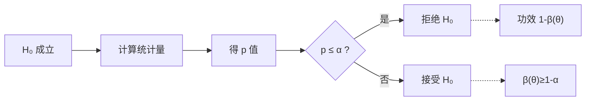

# p值检验法

## 什么是 p 值检验法

在假设检验中，我们通常先给定显著性水平 $\alpha$，再查表得到拒绝域。但如果统计量的观测值刚好落在拒绝域边缘，或者你想比较不同样本下拒绝 $H_0$ 的“证据强度”该怎么办？这时就需要 ==p 值==。

> [!IMPORTANT]
> p 值的本质定义
> p 值是在 $H_0$ 成立的前提下，出现当前样本观测结果或==更极端结果==的概率。它不是 $H_0$ 为真的概率！

p 值越小，说明在 $H_0$ 下观察到当前数据的可能性越低，拒绝 $H_0$ 的证据就越强。它将离散的“拒绝/接受”判断转化为连续的“证据度量”。

## p 值与 OC 函数的关系

课件中提到的施行特征函数（OC 函数）$\beta(\theta) = P_\theta(\text{接受 } H_0)$ 描述了检验法在不同参数真值下的表现。那么 p 值和它有什么联系？

当 $\theta \in H_0$ 时，p 值服从 $U(0,1)$ 分布，此时 $P(p \leq \alpha) = \alpha$，对应 OC 曲线上 $\beta(\theta) \geq 1-\alpha$ 的正确判断概率；当 $\theta \in H_1$ 时，p 值倾向于取小值，拒绝概率 $1-\beta(\theta)$ 即为==功效函数==的值。p 值实际上是连接固定水平检验与功效分析的桥梁。

## 如何正确计算 p 值

计算 p 值的关键在于明确“更极端”的方向，这完全取决于备择假设 $H_1$ 的形式：

| $H_1$ 形式 | 极端方向 | p 值计算公式 |
| :--- | :--- | :--- |
| $\theta > \theta_0$ | 右尾 | $P(T \geq t_{obs} \mid H_0)$ |
| $\theta < \theta_0$ | 左尾 | $P(T \leq t_{obs} \mid H_0)$ |
| $\theta \neq \theta_0$ | 双尾 | $2 \times \min\{P(T \geq t_{obs}), P(T \leq t_{obs})\}$ |

> [!WARNING]
> 双侧检验易错点
> 双侧 p 值==不是==简单地将单侧概率乘以 2，而是取观测值两侧尾部概率中较小者的 2 倍。若分布不对称（如 $\chi^2$、$F$），直接乘 2 会得到错误结果。

## 算对一个例子

设总体 $X \sim N(\mu, \sigma^2)$，$\sigma^2$ 已知，检验 $H_0: \mu = \mu_0$ vs $H_1: \mu > \mu_0$。样本均值 $\bar{x}$ 对应的检验统计量观测值为 $z_{obs} = 2.1$。

$$
p = P(Z \geq 2.1 \mid H_0) = 1 - \Phi(2.1) \approx 0.0179
$$

若 $\alpha = 0.05$，因 $0.0179 < 0.05$，拒绝 $H_0$。注意此处是==右侧检验==，只算右尾概率。若误用双侧公式 $2 \times 0.0179 = 0.0358$，虽本例仍拒绝，但在边界情形（如 $z_{obs}=1.8$）会导致截然不同的结论。

> [!TIP]
> 解题口诀
> “p 值看方向，极端由 $H_1$ 定；小则拒，大则留；双侧取小再翻倍。”

## 常见误区辨析

> [!CAUTION]
> 高危误解
> p 值 $\neq P(H_0 \text{为真} \mid \text{数据})$。p 值是频率学派概念，前提是 $H_0$ 已成立，不能反推 $H_0$ 的真假概率。将 p 值当作“原假设为真的可能性”是最常见的概念混淆。

此外，p 值大小不代表实际效应的大小。一个极小的 p 值可能仅源于超大样本量，而非参数偏离 $H_0$ 的程度显著。结合 OC 曲线理解：即使 p 值很小，若真实 $\theta^*$ 离 $\theta_0$ 很近，检验的功效 $1-\beta(\theta^*)$ 也可能不高，这意味着该“显著”结果在实际应用中未必有实质意义。
