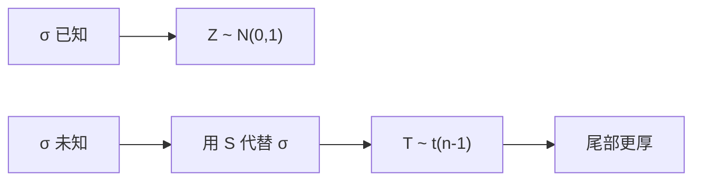

# t分布（定义、性质、上α分位点）

## t分布：小样本推断的基石

当总体方差 $\sigma^2$ 未知时，我们还能用标准正态分布 $Z$ 来推断均值吗？答案是否定的。此时若强行用样本方差 $S^2$ 替代 $\sigma^2$，统计量的波动会变大，必须引入一个“更胖”的分布来修正误差——这就是 **t分布（Student's t-distribution）**。

> [!IMPORTANT]
> ==t分布的核心定义==：设 $X \sim N(0,1)$，$Y \sim \chi^2(n)$，且 $X, Y$ 相互独立，则称随机变量
> $$ T = \frac{X}{\sqrt{Y/n}} \sim t(n) $$
> 服从自由度为 $n$ 的 t分布。注意分母是 $\sqrt{Y/n}$ 而非 $\sqrt{Y}$，这是构造时的关键归一化步骤。

### 为什么需要t分布

在正态总体均值检验或区间估计中，若 $\sigma$ 已知，统计量 $Z=\frac{\bar{X}-\mu}{\sigma/\sqrt{n}}$ 服从 $N(0,1)$；但当 $\sigma$ 未知需用 $S$ 估计时，统计量变为 $T=\frac{\bar{X}-\mu}{S/\sqrt{n}}$。由于 $S$ 本身是随机变量，引入了额外不确定性，导致 $T$ 的尾部比正态分布更厚。t分布正是为了==精确刻画这种小样本下的抽样波动==而存在。

### 三大核心性质

| 性质 | 内容 | 应用场景 |
| :--- | :--- | :--- |
| 渐近正态性 | $n \to \infty$ 时，$t(n) \to N(0,1)$ | 大样本可用Z近似 |
| 对称性 | $t_{1-\alpha}(n) = -t_{\alpha}(n)$ | 查表只需上侧分位点 |
| 矩特征 | $E(T)=0$；$D(T)=\frac{n}{n-2}\,(n>2)$ | 理解方差大于1的原因 |

> [!TIP]
> 实际应用中记住两条经验法则：当 $n > 45$ 时，$t_\alpha(n) \approx z_\alpha$；而 $T^2 \sim F(1,n)$，这在填空题中高频出现。

### 上α分位点与查表

定义满足 $P(T > t_\alpha(n)) = \alpha$ 的点为上 $\alpha$ 分位点。利用对称性，双侧置信区间中的临界值直接取 $t_{\alpha/2}(n)$。例如求 $\mu$ 的95%置信区间（$n=9$），需查 $t_{0.025}(8)=2.306$，而非正态的1.96。

> [!WARNING]
> ==自由度别搞错==：单样本均值推断中，$T=\frac{\bar{X}-\mu}{S/\sqrt{n}}$ 的自由度是 $n-1$（因为 $S^2$ 消耗了1个自由度），不是 $n$！这是考试最常见的扣分点。

### 算对一道典型题

以课件计算题为例：设 $X_1,\dots,X_5 \sim N(0,1)$，求常数 $d$ 使 $T=d\frac{X_1+X_2}{\sqrt{X_3^2+X_4^2+X_5^2}} \sim t(k)$。

**解题三步走：**
1.  **标准化分子**：$X_1+X_2 \sim N(0,2)$，故 $U=\frac{X_1+X_2}{\sqrt{2}} \sim N(0,1)$。
2.  **识别分母**：$V=X_3^2+X_4^2+X_5^2 \sim \chi^2(3)$，自由度 $k=3$。
3.  **凑定义形式**：按t分布定义应为 $\frac{U}{\sqrt{V/3}} = \frac{(X_1+X_2)/\sqrt{2}}{\sqrt{V/3}} = \sqrt{\frac{3}{2}}\cdot\frac{X_1+X_2}{\sqrt{V}}$。

对比原式得 $d=\sqrt{3/2}=\frac{\sqrt{6}}{2}$，自由度为3。此过程严格遵循“==分子标准正态、分母卡方除自由度再开方、两者独立=="的构造铁律。

> [!CAUTION]
> 切勿将t分布与F分布混淆！$T^2 \sim F(1,n)$ 成立的前提是同一个t变量平方；若分子分母来源不同或非标准形式，不能直接套用该结论。
