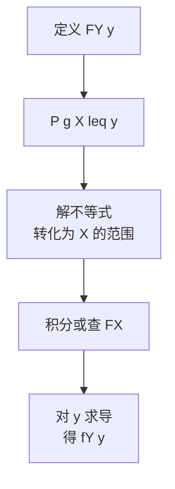

# 一维随机变量函数的分布（分布函数法、公式法）

## 一维随机变量函数的分布

已知随机变量 $X$ 的分布，如何求其函数 $Y=g(X)$ 的分布？这是从“原因”推导“结果”分布的核心技能。根据 $X$ 是离散型还是连续型，处理方法截然不同。

### 离散型：映射与合并

若 $X$ 为离散型，步骤非常直观：
1. **映射**：将 $X$ 的每个取值 $x_i$ 代入 $y_i = g(x_i)$。
2. **合并**：若不同的 $x_i$ 对应相同的 $y_k$，需将这些 $x_i$ 对应的概率**相加**。

> [!TIP]
> 核心原则：**值相同，概率加**。切勿直接罗列，必须合并同类项。

### 连续型：两大法宝

对于连续型 $X \sim f_X(x)$，求 $Y=g(X)$ 的密度 $f_Y(y)$，主要有两种方法。

#### 1. 分布函数法（通用万能法）
无论 $g(x)$ 是否单调，均可使用。逻辑链条如下：

*   **第一步**：写出定义 $F_Y(y) = P(Y \le y) = P(g(X) \le y)$。
*   **第二步**：解不等式 $g(X) \le y$，将其转化为 $X$ 落在某个区间 $(a, b)$ 的形式。
*   **第三步**：利用 $X$ 的分布计算概率，得到 $F_Y(y)$ 的表达式。
*   **第四步**：求导 $f_Y(y) = F'_Y(y)$。

> [!WARNING]
> 求导后务必检查定义域！$f_Y(y)$ 仅在 $Y$ 的有效取值范围内非零，其余地方为 0。

#### 2. 公式法（单调专用）
若 $y=g(x)$ 在 $X$ 的支持集上**严格单调**且可导，存在反函数 $x=h(y)$，则：
$$
f_Y(y) = \begin{cases} 
f_X[h(y)] \cdot |h'(y)| & y \in R_Y \\ 
0 & \text{其他} 
\end{cases}
$$
其中 $R_Y$ 是 $Y$ 的取值范围。

| 特性 | 分布函数法 | 公式法 |
| :--- | :--- | :--- |
| **适用性** | ==所有情况== | 仅严格单调 |
| **复杂度** | 逻辑清晰，计算稍繁 | 套公式快，但易忘绝对值 |
| **核心坑** | 不等式方向搞反 | 漏写 $|h'(y)|$ 或范围 |

### 典型例题解析

**题目**：设 $X \sim U(0, 2)$，求 $Y=X^2$ 的概率密度 $f_Y(y)$。

**解析**：
$X$ 的密度为 $f_X(x) = \begin{cases} 1/2 & 0<x<2 \\ 0 & \text{其他} \end{cases}$。
$Y=X^2$ 在 $(0,2)$ 上单调递增，可用公式法，也可用分布函数法。这里演示更稳妥的**分布函数法**：

1.  **确定范围**：$x \in (0,2) \Rightarrow y \in (0,4)$。
2.  **求分布函数**：
    *   当 $y \le 0$ 时，$F_Y(y)=0$；
    *   当 $y \ge 4$ 时，$F_Y(y)=1$；
    *   当 $0 < y < 4$ 时：
        $$
        F_Y(y) = P(X^2 \le y) = P(-\sqrt{y} \le X \le \sqrt{y})
        $$
        因 $X>0$，故等价于 $P(0 < X \le \sqrt{y}) = \int_0^{\sqrt{y}} \frac{1}{2} dx = \frac{\sqrt{y}}{2}$。
3.  **求导得密度**：
    $$
    f_Y(y) = F'_Y(y) = \left( \frac{\sqrt{y}}{2} \right)' = \frac{1}{4\sqrt{y}}, \quad 0 < y < 4
    $$

**最终答案**：
$$
f_Y(y) = \begin{cases} 
\frac{1}{4\sqrt{y}} & 0 < y < 4 \\ 
0 & \text{其他} 
\end{cases}
$$

> [!IMPORTANT]
> 常见错误是直接写 $\frac{1}{2\sqrt{y}}$ 而忘记乘以 $X$ 的原密度值 $1/2$，或者遗漏定义域 $0<y<4$。务必最后补全分段函数的“其他”情况。
