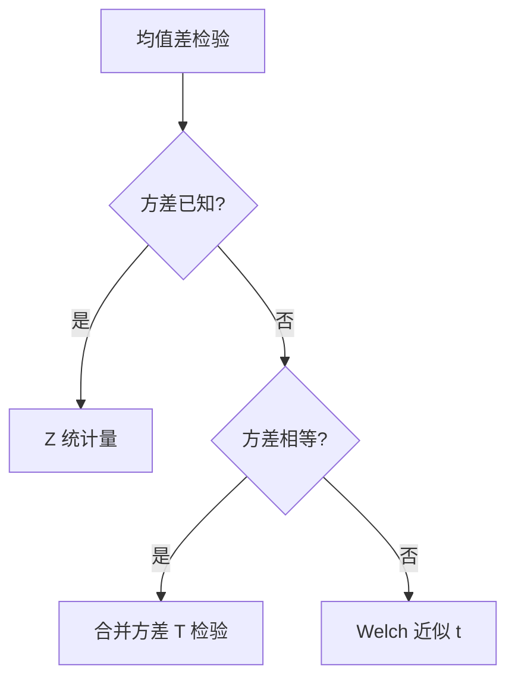

# 两个正态总体均值差与方差比的假设检验

## 为什么比较两个总体不能只看样本差值？

当我们拿到两组样本数据时，样本均值差 $\overline{x}-\overline{y}$ 或方差比 $s_1^2/s_2^2$ 几乎不可能恰好等于假设值。这种差异究竟是==抽样误差==造成的，还是反映了==总体本质区别==？这就需要通过构造特定的统计量，将样本信息标准化后进行检验。南邮考题中，这类问题严格分为“均值差检验”与“方差比检验”两条路径，选错统计量是失分主因。

## 均值差检验：方差是否相等是关键分水岭

检验 $H_0: \mu_1 - \mu_2 = \delta$ 时，首先要问自己：两总体方差 $\sigma_1^2, \sigma_2^2$ 是否已知或相等？

> [!IMPORTANT]
> ==方差未知但相等==时，必须使用合并方差 $S_\omega^2$ 构造 $T$ 统计量，自由度为 $n_1+n_2-2$。这是考试最高频考点。

$$S_\omega^2 = \frac{(n_1-1)S_1^2 + (n_2-1)S_2^2}{n_1+n_2-2}, \quad T=\frac{\overline{X}-\overline{Y}-\delta}{S_\omega\sqrt{\dfrac{1}{n_1}+\dfrac{1}{n_2}}}$$

若方差不等且未知，则需用 Welch 近似 $t$ 检验（自由度取整），但南邮基础考题较少涉及，通常默认方差相等或先做方差齐性检验。

## 方差比检验：F 统计量的方向性陷阱

检验 $H_0: \sigma_1^2 = \sigma_2^2$ 或 $\sigma_1^2 \leq \sigma_2^2$ 时，统计量为 $F = S_1^2 / S_2^2$。这里最容易出错的是==拒绝域的方向==。

> [!WARNING]
> $F$ 分布不对称！双侧检验需查 $F_{\alpha/2}$ 和 $F_{1-\alpha/2}$；单侧检验若 $H_1: \sigma_1^2 > \sigma_2^2$，拒绝域仅在右侧 $F \geq F_\alpha(n_1-1, n_2-1)$。**务必注意分子分母自由度顺序不可颠倒**。

| 检验类型 | 原假设 $H_0$ | 统计量 | 拒绝域 |
| :--- | :--- | :--- | :--- |
| 均值差(等方差) | $\mu_1-\mu_2=\delta$ | $T$ (合并方差) | $\|t\| \geq t_{\alpha/2}(n_1+n_2-2)$ |
| 方差比(双侧) | $\sigma_1^2=\sigma_2^2$ | $F=S_1^2/S_2^2$ | $F \geq F_{\alpha/2}$ 或 $F \leq F_{1-\alpha/2}$ |
| 方差比(单侧) | $\sigma_1^2 \leq \sigma_2^2$ | $F=S_1^2/S_2^2$ | $F \geq F_\alpha(n_1-1,n_2-1)$ |

## 实战避坑：以锌矿含锌量检验为例

回顾经典考题“检验3”：东支 $n_1=9, \overline{x}=0.230, s_1^2=0.1337$；西支 $n_2=8, \overline{y}=0.0269, s_2^2=0.1736$。题目明确“方差相等”，故选用合并方差 $T$ 检验。

计算 $S_\omega = \sqrt{\frac{8\times0.1337+7\times0.1736}{15}} \approx 0.390$，代入得：

$$|t|=\left|\frac{0.230-0.0269}{0.390\times\sqrt{\dfrac{1}{9}+\dfrac{1}{8}}}\right|=1.072$$

查表 $t_{0.025}(15)=2.1315$，因 $1.072 < 2.1315$，==接受原假设==。

> [!TIP]
> 解题三步走：①判类型（均值/方差）→②选公式（看方差条件）→③定拒绝域（查表注意自由度）。计算前务必确认 $S_\omega$ 是标准差而非方差，避免根号遗漏！
