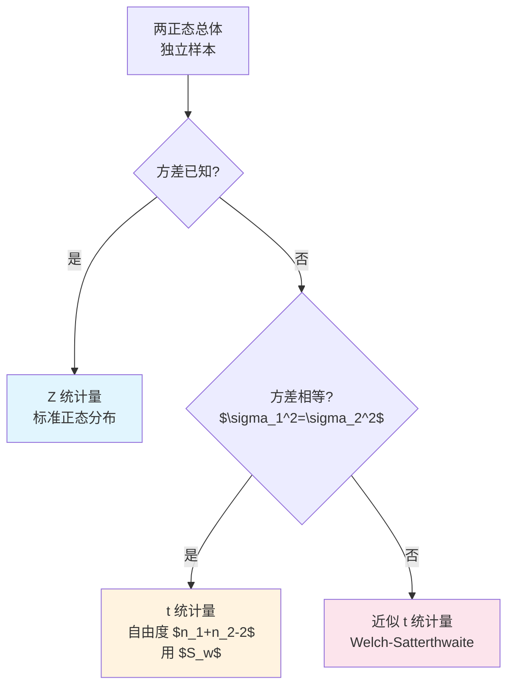

# 两个正态总体均值差与方差比的区间估计

# 两个正态总体均值差与方差比的区间估计

在处理两组独立数据（如两种火箭推进器、两位化验员）时，我们常需比较其总体均值 $\mu_1-\mu_2$ 或方差比 $\sigma_1^2/\sigma_2^2。核心在于根据**方差是否已知**及**是否相等**，选择正确的枢轴量。

## 均值差 $\mu_1-\mu_2$ 的估计

构造置信区间前，先判断方差情况：

1.  **方差已知**：使用 $Z$ 统计量。
    $$ (\overline{X}-\overline{Y}) \pm z_{\alpha/2}\sqrt{\frac{\sigma_1^2}{n_1}+\frac{\sigma_2^2}{n_2}} $$
2.  **方差未知但相等**（最常见考点）：使用合并样本方差 $S_w^2$。
    $$ S_w^2 = \frac{(n_1-1)S_1^2 + (n_2-1)S_2^2}{n_1+n_2-2} $$
    枢轴量为 $T = \frac{(\overline{X}-\overline{Y})-(\mu_1-\mu_2)}{S_w\sqrt{\frac{1}{n_1}+\frac{1}{n_2}}} \sim t(n_1+n_2-2)$。

> [!IMPORTANT]
> ==核心结论==：若题目未声明方差相等，通常默认需用 $t$ 分布且可能涉及 $S_w$。南邮考题中，若给出 $S_1^2, S_2^2$ 且未提不等，多考察等方差假设下的 $t$ 区间。

## 方差比 $\sigma_1^2/\sigma_2^2$ 的估计

利用 $F$ 分布性质。枢轴量为：
$$ F = \frac{S_1^2/\sigma_1^2}{S_2^2/\sigma_2^2} \sim F(n_1-1, n_2-1) $$

置信区间为：
$$ \left( \frac{S_1^2}{S_2^2} \cdot \frac{1}{F_{\alpha/2}(n_1-1, n_2-1)},\ \frac{S_1^2}{S_2^2} \cdot \frac{1}{F_{1-\alpha/2}(n_1-1, n_2-1)} \right) $$

> [!WARNING]
> **易错坑**：$F$ 分布分位点的倒数关系。
> $F_{1-\alpha/2}(n_1-1, n_2-1) = \frac{1}{F_{\alpha/2}(n_2-1, n_1-1)}$。
> 注意分子分母自由度的**交换**。查表时务必看清第一个参数是分子自由度。

## 典型例题解析

**题目**：两位化验员 A、B 各作 10 次测定，$s_A^2=0.5419$，$s_B^2=0.6065$。求方差比 $\sigma_A^2/\sigma_B^2$ 的 0.95 置信区间。

**解析**：
1.  **确定参数**：$n_1=n_2=10$，自由度均为 $9$。$\alpha=0.05$。
2.  **查表**：$F_{0.025}(9,9)=4.03$。由对称性，$F_{0.975}(9,9) = 1/4.03$。
3.  **计算**：
    *   下限：$\frac{0.5419}{0.6065} \times \frac{1}{4.03} \approx 0.222$
    *   上限：$\frac{0.5419}{0.6065} \times 4.03 \approx 3.601$
    *   区间：$(0.222, 3.601)$

> [!TIP]
> **解题技巧**：若区间包含 1，则认为两总体方差无显著差异；若不包含 1，则认为有显著差异。本题区间含 1，故可认为 $\sigma_A^2 = \sigma_B^2$。

## 常见误区对比

| 场景 | 枢轴量分布 | 关键统计量 | 自由度 |
| :--- | :---: | :---: | :---: |
| $\sigma^2$ 已知 | $N(0,1)$ | $\sigma_1, \sigma_2$ | - |
| $\sigma^2$ 未知但相等 | $t$ | $S_w$ (合并方差) | $n_1+n_2-2$ |
| 方差比估计 | $F$ | $S_1^2, S_2^2$ | $(n_1-1, n_2-1)$ |

> [!CAUTION]
> 计算单侧置信限时，$\alpha$ 不用除以 2。例如求单侧上限，查 $F_{1-\alpha}$ 或 $t_{\alpha}$ 即可，勿混淆双侧与单侧的分位点。
